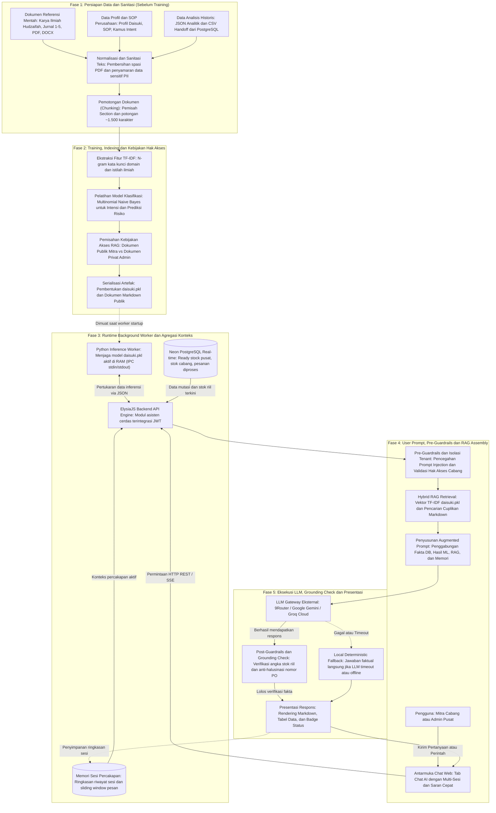

# Daisuki Inventory  B2B Inventory & Order Management

Platform manajemen inventaris dan pemesanan restock multi-tenant B2B antara **Admin Daisuki Pusat** dan **Mitra Cabang** (hotel, kafe, restoran, dan minimarket).

---

## Tech Stack

| Kategori | Teknologi & Framework | Keterangan |
|---|---|---|
| **Runtime & Monorepo** |   | Bun Monorepo workspace & runtime berkecepatan tinggi |
| **Frontend Web** |    | TanStack Start, Tailwind v4, TanStack Query |
| **Backend API** |   | Bun runtime, Jose JWT, End-to-end Type Safety (Eden Treaty) |
| **Database** |  | Serverless PostgreSQL via connection pooling |
| **Data Science & AI** |   | Multi-Factor Naive Bayes, Text Filtering, & Demand Forecasting |

---

## Arsitektur RAG & Alur Kerja LLM (Sebelum Training hingga User Prompt)

Sistem AI pada **Daisuki Inventory** menggabungkan **Retrieval-Augmented Generation (RAG)**, **klasifikasi Machine Learning lokal (`daisuki.pkl`)**, dan **data operasional real-time PostgreSQL** untuk menghasilkan asisten cerdas yang akurat dan bebas halusinasi.

Berikut adalah diagram alir (*flowchart*) menyeluruh dari persiapan data sebelum training hingga respons diterima pengguna:



### Tahapan Alur Kerja Sistem RAG Daisuki:

1. **Fase 1: Persiapan Data & Sanitasi (Sebelum Training)**
   - Dokumen sumber berupa naskah ilmiah (*Karya Ilmiah Hudzaifah Ar-Rantisi* dan jurnal referensi), profil perusahaan, SOP inventaris, kamus intensi pengguna, serta data historis PostgreSQL dibaca dan dinormalisasi.
   - Dilakukan sanitasi otomatis: teks PDF yang terpecah per kata disatukan kembali, watermark dibersihkan, dan informasi sensitif (PII seperti nomor kontak/email korespondensi) disamarkan.
   - Dokumen dipecah menjadi potongan (*chunks*) terstruktur per bagian (`\n---\n`) berukuran ~1.500 karakter dengan tetap mempertahankan tabel empiris dan terminologi domain.

2. **Fase 2: Training, Indexing & Kebijakan Hak Akses**
   - Skrip training mengekstraksi bobot kata menggunakan TF-IDF (unigram & bigram) untuk kata kunci operasional dan penelitian (`nlp`, `sgd`, `mbg`, `sentiment`, `logistic regression`, `rop`, `safety stock`).
   - Melatih model klasifikasi **Multinomial Naive Bayes** untuk membedakan intensi percakapan dan memprediksi risiko kehabisan stok cabang (*urgent_restock*, *regular_order*, *normal*).
   - Menerapkan kebijakan batas akses (*RAG policy*): dokumen yang disetujui publik diekspor ke `.public.md` untuk Mitra Toko, sedangkan naskah privat dan data internal diindeks khusus untuk Admin Pusat.
   - Seluruh bobot, kamus, dan classifier diserialisasi ke dalam satu artefak model biner `daisuki.pkl`.

3. **Fase 3: Runtime Background Worker & Agregasi Konteks**
   - Backend ElysiaJS menjalankan proses latar belakang Python (`inference_worker.py`) menggunakan `Bun.spawn` yang menjaga model `daisuki.pkl` tetap aktif di RAM agar inferensi berjalan instan (< 50ms) tanpa overhead pembacaan berkas berulang.
   - API secara langsung melakukan agregasi data terkini dari Neon PostgreSQL: stok ready gudang pusat, kuantitas riil cabang, status buffer dinamis, pesanan yang sedang menunggu persetujuan, dan pengiriman aktif.
   - Memori percakapan memuat riwayat 4–6 pesan terakhir ditambah ringkasan padat sesi terdahulu dari PostgreSQL.

4. **Fase 4: User Prompt, Pre-Guardrails & RAG Assembly**
   - Ketika pengguna (Mitra atau Admin) mengirimkan pesan melalui UI chat:
     - **Pre-Guardrails** memvalidasi token JWT pengguna, menegakkan isolasi tenant (Mitra hanya dapat melihat data cabangnya sendiri, Admin memiliki akses jaringan penuh), dan menyaring upaya *prompt injection* atau pertanyaan di luar lingkup.
     - **Hybrid Retrieval** mencocokkan intensi pengguna via `daisuki.pkl`, mengambil skor prediksi risiko, dan mengambil hingga 4 cuplikan dokumen Markdown yang paling relevan.
     - **Penyusunan Prompt Terpadu (*Augmented Prompt*)**: Menggabungkan fakta operasional JSON database, hasil prediksi model Naive Bayes, cuplikan naskah RAG, dan ringkasan riwayat ke dalam format prompt terstruktur.

5. **Fase 5: Eksekusi LLM, Grounding Check & Presentasi**
   - Prompt dikirimkan ke LLM (9Router, Gemini, atau Groq) dengan streaming SSE untuk respon yang interaktif.
   - **Post-Guardrails & Grounding Verification**: Memastikan jawaban LLM tidak mengarang angka kuantitas stok atau nomor pesanan yang tidak ada di fakta database.
   - **Fallback Deterministik**: Jika layanan LLM eksternal mengalami gangguan atau melampaui batas waktu (*timeout*), mesin fallback lokal secara otomatis menyusun jawaban faktual langsung dari database dan dokumen RAG tanpa membiarkan pengguna menunggu pesan error kosong.
   - Respons akhir dirender secara kaya di frontend React dengan format Markdown, tabel data HTML responsif, dan chip saran pertanyaan berikutnya.

---

## Panduan Setup Cepat (Mulai dari Nol)

Pastikan sudah menginstal **[Git](https://git-scm.com/)** dan **[Bun](https://bun.sh/)** di komputer Anda.  
*(Wajib menggunakan runtime **Bun**. Jangan gunakan npm, yarn, atau pnpm).*

### 1. Clone Repository & Masuk ke Folder
```bash
git clone https://github.com/HudzaifahArrantisi/Dicoding-Project.git daisuki-inventory
cd daisuki-inventory
```

### 2. Install Dependensi
Jalankan perintah ini di root folder untuk menginstal seluruh dependensi workspace:
```bash
bun install
```

### 3. Konfigurasi File Environment (.env)

Salin template file `.env.example` ke `.env`:

**Windows (PowerShell):**
```powershell
Copy-Item apps/api/.env.example apps/api/.env
Copy-Item apps/web/.env.example apps/web/.env
```

**Linux / macOS / Git Bash:**
```bash
cp apps/api/.env.example apps/api/.env
cp apps/web/.env.example apps/web/.env
```

Buka dan sesuaikan file berikut:
- **`apps/api/.env`**:
  ```env
  PORT=3001
  DATABASE_URL=postgresql://<user>:<password>@<host-neon>/neondb?sslmode=require
  WEB_ORIGIN=http://localhost:3000
  JWT_SECRET=daisuki-super-secret-key-min-32-characters-change-in-production
  ```
  *(Ambil connection string `DATABASE_URL` dari dashboard [Neon DB](https://neon.tech) pada menu **Connect**).*

- **`apps/web/.env`**:
  ```env
  VITE_API_URL=http://localhost:3001
  ```

---

### 4. Setup Database & Data Demo

1. **Setup Skema Database & Data Demo**:  
   Buka menu **SQL Editor** di console database Anda ([Neon DB](https://neon.tech)), lalu salin dan jalankan seluruh isi file skema database terpadu:  
    **`neon/init.sql`**  
   *(File tunggal ini sudah mencakup seluruh ekstensi, enum, tabel, kolom wilayah, optimasi index, hak akses RLS, dan seed data awal).*

   Pilihan provinsi, kabupaten/kota, kecamatan, dan kelurahan/desa diambil melalui API backend dari [Wilayah.id](https://wilayah.id/). Server API memerlukan akses HTTPS ke layanan tersebut saat daftar wilayah belum tersedia di cache.

2. **Isi Data Awal (Seeding)**:  
   Setelah tabel berhasil dibuat, isi data awal demo (cabang, 4 produk resmi, dan akun demo) dengan perintah:
   ```bash
   bun --cwd apps/api run seed
   ```

---

### 5. Jalankan Aplikasi

Jalankan frontend web dan backend API sekaligus:
```bash
bun run dev
```

Aplikasi siap diakses di browser:
- **Web Frontend**: `http://localhost:3000`
- **Backend API**: `http://localhost:3001`
- **Cek Koneksi Database**: `http://localhost:3001/health/db`

---

---

##  Perintah Pengembangan Harian

| Perintah | Keterangan |
|---|---|
| `bun run dev` | Menjalankan Web (port 3000) & API (port 3001) secara bersamaan |
| `bun run dev:web` | Menjalankan hanya Frontend web |
| `bun run dev:api` | Menjalankan hanya Backend API |
| `bun run typecheck` | Pemeriksaan tipe TypeScript di seluruh workspace |
| `bun --cwd apps/web run lint` | Menjalankan ESLint pada frontend |
| `bun --cwd apps/web run build` | Build production frontend |
| `bun --cwd apps/api run seed` | Menjalankan ulang pengisian data demo database |
| `bun run qa:api` | Memeriksa route API lokal dan menampilkan hasil QA per fitur dalam tabel terminal |

---

## QA API saat Development

Jalankan backend API lokal, lalu buka terminal kedua untuk pemeriksaan QA:

```powershell
bun --cwd=apps/api run dev
# Di terminal lain:
bun run qa:api --json qa-reports/api-latest.json
```

Perintah `qa:api` membaca route Elysia langsung dari kode. Output terminal berupa tabel ringkasan dan tabel detail yang dikelompokkan menurut fitur: **Login & Sesi**, **Admin**, **Mitra**, **Pesanan**, **Stok & Produk**, **Wilayah**, serta **Sistem & Berkas**. Kolom `Route` menghitung endpoint unik; kolom `Lulus`, `Gagal`, dan `Skip` menghitung pemeriksaan, sehingga jumlahnya dapat lebih besar dari jumlah route.

Contoh ringkasan terminal:

```text
+---------------------------------+-------+-------+-------+-------+
| Fitur                           | Route | Lulus | Gagal | Skip  |
+---------------------------------+-------+-------+-------+-------+
| Login & Sesi                    | 4     | 4     | 0     | 2     |
| Admin · Dashboard & AI          | 5     | 8     | 0     | 1     |
| Pesanan · Admin & Mitra         | 10    | 4     | 0     | 8     |
+---------------------------------+-------+-------+-------+-------+
```

Untuk menguji GET sebagai pengguna yang sudah login, isi akun **development** melalui environment variable PowerShell sebelum menjalankan `qa:api`:

```powershell
$env:QA_ADMIN_EMAIL = 'email-admin-development'
$env:QA_ADMIN_PASSWORD = 'kata-sandi-admin'
$env:QA_MITRA_EMAIL = 'email-mitra-development'
$env:QA_MITRA_PASSWORD = 'kata-sandi-mitra'
bun run qa:api --json qa-reports/api-latest.json
```

`PASS` berarti status sesuai harapan: HTTP 401 untuk endpoint privat tanpa login, atau HTTP 2xx setelah login. `FAIL` menunjukkan status tidak sesuai, timeout, atau server tidak terjangkau; perintah keluar dengan kode `1`. `SKIP` berarti pemeriksaan belum dijalankan. Mutasi stok dan pesanan sengaja tidak dikirim agar data development tidak berubah. Laporan JSON tersimpan di `qa-reports/api-latest.json` dan memuat kategori setiap pemeriksaan. Petunjuk fixture untuk route dinamis dan opsi lain tersedia di [panduan QA API](docs/API_QA.md).

---

##  Setup Modul Python (Data Science & AI) — *Opsional*

Khusus anggota tim yang mengerjakan modul analisis atau model cerdas di `data-science/` atau `ai/`:

```bash
cd data-science   # atau: cd ai
python -m venv .venv

# Aktivasi virtual environment:
# Windows (PowerShell):
.venv\Scripts\Activate.ps1
# Linux / macOS:
source .venv/bin/activate

pip install -r requirements.txt
```
