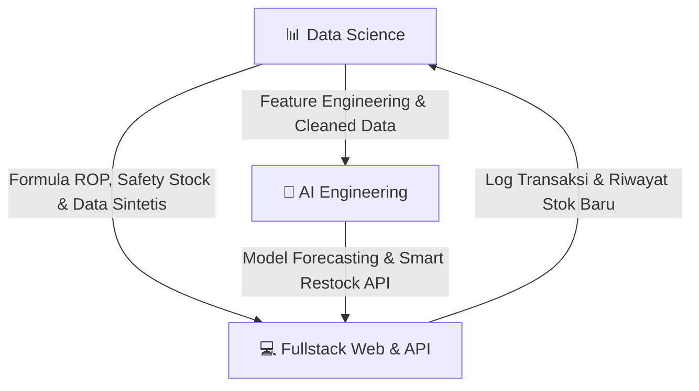

# 🍱 Daisuki B2B Inventory & Order Management System

Sistem manajemen inventaris dan pemesanan B2B multi-cabang (Mitra & Admin Daisuki) berbasis monorepo modern menggunakan **TanStack Start**, **ElysiaJS**, dan **Supabase**.

---

## 📌 Daftar Isi

1. [Arsitektur & Tech Stack](#-arsitektur--tech-stack)
2. [Struktur Direktori](#-struktur-direktori)
3. [Prasyarat Sistem (Prerequisites)](#-prasyarat-sistem-prerequisites)
4. [Panduan Setup Langkah Demi Langkah](#-panduan-setup-langkah-demi-langkah)
   - [Langkah 1: Clone Repository](#1-clone-repository)
   - [Langkah 2: Install Dependensi Monorepo](#2-install-dependensi-monorepo)
   - [Langkah 3: Konfigurasi Environment Variables](#3-konfigurasi-environment-variables)
   - [Langkah 4: Setup Database Supabase](#4-setup-database-supabase)
   - [Langkah 5: Jalankan Server Development](#5-jalankan-server-development)
5. [Daftar Perintah (NPM/Bun Scripts)](#-daftar-perintah-scripts)
6. [Pembagian Peran & Tanggung Jawab Tim (Roles & Tasks)](#-pembagian-peran--tanggung-jawab-tim)
7. [Alur & Aturan Kolaborasi Tim](#-alur--aturan-kolaborasi-tim)
8. [Troubleshooting & FAQ](#-troubleshooting--faq)
9. [Dokumentasi Lanjutan](#-dokumentasi-lanjutan)

---

## 🏗 Arsitektur & Tech Stack

Proyek ini dibangun menggunakan arsitektur **Monorepo (Bun Workspaces)** dengan pembagian tanggung jawab sebagai berikut:

| Lapisan | Teknologi | Port | Deskripsi |
|---|---|---|---|
| **Web (Frontend)** | [TanStack Start](https://tanstack.com/start), React 19, Tailwind CSS v4, TanStack Query/Form/Table | `3000` | UI Dashboard Admin & Portal Mitra |
| **API (Backend)** | [ElysiaJS](https://elysiajs.com/), Bun, Drizzle ORM, Jose (JWT) | `3001` | Business logic, auth guard, validasi transaksi, cron reminder |
| **Database & Auth** | [Supabase](https://supabase.com/) (PostgreSQL, Auth, Realtime) | Cloud | Penyimpanan data, RLS (Row Level Security), JWT auth provider |
| **Shared Package** | TypeScript Workspace Package (`@daisuki/shared`) | - | Definisi tipe enum status stok, order, dan utilitas bersama |

> **Prinsip Arsitektur:**  
> Frontend **tidak melakukan penulisan langsung** ke tabel database Supabase. Semua mutasi (stok, pesanan, approval) wajib melalui **API Elysia** agar aturan validasi bisnis terpusat. Frontend membaca event realtime secara aman melalui Supabase Realtime dengan proteksi RLS.

---

## 📁 Struktur Direktori

```text
daisuki-inventory/
├── apps/
│   ├── web/                    # Frontend TanStack Start (Port 3000)
│   │   ├── .env.example
│   │   ├── src/
│   │   └── package.json
│   └── api/                    # Backend API ElysiaJS (Port 3001)
│       ├── .env.example
│       ├── src/
│       └── package.json
├── packages/
│   └── shared/                 # Kode/tipe yang dipakai bersama web & api
│       ├── src/index.ts
│       └── package.json
├── data-science/               # Workspace tim Data Science (Python)
│   ├── notebooks/              # Eksperimen EDA & prototyping model
│   ├── src/                    # Modul reusable
│   ├── data/                   # Data mentah/olahan (git-ignored)
│   ├── models/                 # File model tersimpan (git-ignored)
│   ├── reports/                # Laporan metodologi & hasil evaluasi
│   ├── requirements.txt
│   ├── .env.example
│   └── README.md
├── ai/                         # Workspace tim AI Engineer (Python)
│   ├── jobs/                   # Background job harian restock
│   ├── assistant/              # Asisten LLM admin
│   ├── bot/                    # Prototipe bot input stok via chat
│   ├── evals/                  # Pengujian akurasi & evaluasi asisten
│   ├── requirements.txt
│   ├── .env.example
│   └── README.md
├── supabase/
│   ├── migrations/             # Skrip SQL skema tabel, fungsi, RLS
│   │   ├── 0001_init.sql
│   │   ├── 0002_restock_recommendations.sql
│   │   └── 0003_ds_ai_roles.sql
│   └── seed.sql                # Data awal untuk testing/development
├── docs/                       # Dokumen spesifikasi teknis proyek
│   ├── alursistem.md           # Flow bisnis, state machine stok & order
│   └── design_system.md        # Aturan warna, tipografi, & komponen UI
├── SETUP.md                    # Catatan teknis setup awal
├── package.json                # Root package.json (Bun workspaces)
└── README.md                   # Panduan kolaborator (file ini)
```

### Struktur Monorepo

| Folder | Pemilik | Isi |
|---|---|---|
| `apps/` | Fullstack | Aplikasi web (TanStack Start) dan API backend (ElysiaJS) |
| `packages/` | Fullstack | Paket pustaka bersama (`shared`) untuk web dan API |
| `supabase/` | Fullstack | Migrasi skema database PostgreSQL, RLS, dan seeder SQL |
| `data-science/` | Data Science | Eksplorasi data, eksperimen, dan model prediksi inventaris |
| `ai/` | AI Engineer | Job harian restock otomatis, asisten admin, dan bot input chat |
| `docs/` | Bersama | Spesifikasi alur sistem bisnis dan panduan sistem desain UI |

Folder `data-science/` dan `ai/` berbasis Python dan tidak termasuk Bun workspace.

---

## 💻 Prasyarat Sistem (Prerequisites)

Sebelum memulai, pastikan perangkat Anda telah terpasang:

1. **[Bun](https://bun.sh/)** (v1.1 atau terbaru)  
   > ⚠️ **PENTING:** Proyek ini menggunakan **Bun** sebagai runtime dan package manager. **DILARANG** menggunakan `npm`, `yarn`, atau `pnpm` karena dapat merusak file `bun.lock` dan resolusi workspace symlink.
   - Cek instalasi: `bun --version`
2. **[Git](https://git-scm.com/)**
3. **Akun & Project Supabase**:
   - Buat project baru di [supabase.com](https://supabase.com).
   - Siapkan kredensial project (Database Connection String, URL, Anon Key, Service Role Key, JWT Secret).

---

## 🚀 Panduan Setup Langkah Demi Langkah

### 1. Clone Repository

Buka terminal (PowerShell / Command Prompt / Terminal) dan clone repositori ini:

```bash
git clone https://github.com/HudzaifahArrantisi/Dicoding-Project.git daisuki-inventory
cd daisuki-inventory
```

---

### 2. Install Dependensi Monorepo

Jalankan perintah instalasi dari **root direktori**:

```bash
bun install
```

Perintah ini akan secara otomatis menginstall seluruh dependensi untuk `apps/web`, `apps/api`, dan menghubungkan `packages/shared`.

---

### 3. Konfigurasi Environment Variables

Terdapat dua file `.env` yang wajib disiapkan: satu untuk Backend (`apps/api`) dan satu untuk Frontend (`apps/web`).

#### A. Backend API (`apps/api/.env`)
Salin file template `.env.example` ke `.env`:

```bash
# Windows PowerShell
copy apps/api/.env.example apps/api/.env

# Linux / macOS / Git Bash
cp apps/api/.env.example apps/api/.env
```

Buka `apps/api/.env` dan sesuaikan dengan data Supabase Anda:

```env
PORT=3001
# Ambil dari Supabase Dashboard -> Project Settings -> Database -> Connection string (URI mode Transaction / Session pooler port 6543)
DATABASE_URL=postgresql://postgres.<project-ref>:<db-password>@aws-0-<region>.pooler.supabase.com:6543/postgres

# Ambil dari Project Settings -> API
SUPABASE_URL=https://<project-ref>.supabase.co
SUPABASE_SERVICE_ROLE_KEY=eyJh... (Service Role Key / Secret)
SUPABASE_JWT_SECRET=your-jwt-secret (Project Settings -> API -> JWT Secret)

# Origin frontend yang diizinkan untuk CORS
WEB_ORIGIN=http://localhost:3000

# Opsional: Jika ingin menguji fitur kirim email alert
RESEND_API_KEY=
```

#### B. Frontend Web (`apps/web/.env`)
Salin file template `.env.example` ke `.env`:

```bash
# Windows PowerShell
copy apps/web/.env.example apps/web/.env

# Linux / macOS / Git Bash
cp apps/web/.env.example apps/web/.env
```

Buka `apps/web/.env` dan lengkapi:

```env
# Ambil dari Supabase Dashboard -> Project Settings -> API
VITE_SUPABASE_URL=https://<project-ref>.supabase.co
VITE_SUPABASE_ANON_KEY=eyJh... (Anon / Public Key)

# URL API lokal
VITE_API_URL=http://localhost:3001
```

---

### 4. Setup Database Supabase

1. Masuk ke dashboard project Anda di [supabase.com](https://supabase.com).
2. Buka menu **SQL Editor**.
3. Jalankan migrasi skema tabel:
   - Buka file [`supabase/migrations/0001_init.sql`](./supabase/migrations/0001_init.sql).
   - Salin seluruh isinya dan jalankan (Run) di SQL Editor.
4. (Opsional tapi disarankan) Jalankan data awal / dummy seeder:
   - Buka file [`supabase/seed.sql`](./supabase/seed.sql).
   - Salin isinya dan jalankan di SQL Editor untuk mengisi produk awal dan role pengguna.
5. Konfigurasi **Supabase Auth**:
   - Di menu **Authentication** -> **URL Configuration**, pastikan **Site URL** diset ke `http://localhost:3000`.

---

### 5. Jalankan Server Development

Cukup jalankan satu perintah dari **root direktori**:

```bash
bun run dev
```

> Skrip ini menggunakan `concurrently` untuk menyalakan frontend dan backend sekaligus:
> - 🌐 **Web App:** [http://localhost:3000](http://localhost:3000)
> - ⚙️ **API Server:** [http://localhost:3001](http://localhost:3001) (Cek health endpoint di `http://localhost:3001/health`)

Jika Anda ingin menjalankan layanan secara terpisah:
- Hanya Web: `bun run dev:web`
- Hanya API: `bun run dev:api`

---

## 📜 Daftar Perintah (Scripts)

| Perintah | Lokasi | Keterangan |
|---|---|---|
| `bun install` | Root | Menginstall semua dependensi workspace |
| `bun run dev` | Root | Menjalankan Frontend (:3000) dan API (:3001) secara bersamaan |
| `bun run dev:web` | Root | Menjalankan server frontend saja |
| `bun run dev:api` | Root | Menjalankan server backend API saja |
| `bun run typecheck` | Root | Memeriksa validasi tipe TypeScript di seluruh proyek |
| `bun run lint` | `apps/web` | Menjalankan ESLint pada frontend |
| `bun run build` | `apps/web` | Membangun bundle produksi frontend |

---

## 👥 Pembagian Peran & Tanggung Jawab Tim (Roles & Tasks)

Proyek ini dirancang untuk dikerjakan secara kolaboratif oleh tim yang beranggotakan **6 orang** (2 Fullstack Developer, 2 Data Scientist, dan 2 AI Engineer). Setiap peran memiliki tanggung jawab nyata yang saling melengkapi dalam menyelesaikan masalah bisnis **Daisuki B2B Inventory**:



---

### 1. 💻 Fullstack Developers (2 Orang)
> **Misi Utama:** Membangun arsitektur aplikasi end-to-end (Frontend & Backend), mengamankan data dan transaksi bisnis, serta mengintegrasikan output analitik Data Science & model AI ke antarmuka pengguna.

- **Developer 1 (Frontend & UI/UX Specialist):**
  - **Portal Mitra:** Membangun antarmuka entri stok fisik harian yang cepat, form pengajuan restock barang, konfirmasi penerimaan order, dan riwayat mutasi stok.
  - **Dashboard Admin:** Membangun dashboard monitoring live status stok cabang (aman/kritis), filter cabang, kartu alert notifikasi, dan antarmuka persetujuan order restock.
  - **Realtime UI:** Mengintegrasikan **Supabase Realtime WebSocket** agar dashboard admin langsung beranimasi/update saat ada perubahan stok cabang tanpa perlu reload halaman.
  - **AI & Analytics Visualization:** Menampilkan grafik tren stok, visualisasi metrik inventaris dari tim Data Science, dan kartu rekomendasi order otomatis dari model AI.
- **Developer 2 (Backend, Database & Core Services Specialist):**
  - **ElysiaJS REST API:** Membangun endpoint transaksi (`/stocks`, `/orders`, `/admin`, `/notifications`) dengan performa tinggi di atas runtime Bun.
  - **Keamanan & Otorisasi Bertingkat:** Mengimplementasikan auth guard JWT, pengecekan role (Admin vs Mitra), dan konfigurasi Row Level Security (RLS) di Supabase agar data antar mitra terisolasi aman.
  - **Database Integrity & State Machine:** Menjamin keabsahan transaksi stok menggunakan Drizzle ORM (penerapan row-level lock `FOR UPDATE` untuk mencegah *race condition*) dan state machine status pesanan (`diproses` → `disetujui` → `dikirim` → `selesai`).
  - **Automated Cron Jobs:** Membangun scheduler background (deteksi stok cabang yang tidak di-update > 24 jam dan trigger reminder otomatis via email/notifikasi).
  - **Model Integration Gateway:** Menyediakan endpoint/adapter untuk menghubungkan microservice model AI ke alur kerja aplikasi utama.

---

### 2. 📊 Data Scientists (2 Orang)
> **Misi Utama:** Menganalisis pola pergerakan inventaris cabang, memodelkan formula stok probabilistik (Lead Time & Safety Stock), serta merancang metrik analitik bisnis yang dapat ditindaklanjuti.

- **Data Scientist 1 (Inventory Optimization & Mathematical Modeling):**
  - **Dynamic Reorder Point (ROP) & Safety Stock:**
    - Merancang formula titik pemesanan ulang dinamis per cabang:
      $$\text{ROP} = (\text{Rata-rata Konsumsi Harian} \times \text{Lead Time Pabrik}) + \text{Safety Stock}$$
    - Memperhitungkan *lead time* produksi pabrik (5–7 hari per 1.000 pcs) dan fluktuasi permintaan agar mitra tidak mengalami kehabisan stok (*stockout*).
  - **Estimasi Hari Tersisa (Days of Inventory / Run-out Date):**
    - Menghitung sisa hari sebelum stok habis per produk berdasarkan *burn rate* historis dari tabel `stock_logs`.
  - **Klasifikasi Produk (ABC/XYZ Analysis):**
    - Mengelompokkan SKU produk berdasarkan nilai transaksi (ABC) dan volatilitas permintaan (XYZ) agar admin dapat memprioritaskan stok bernilai tinggi dan meminimalkan risiko barang rusak/kadaluarsa.
- **Data Scientist 2 (Data Pipeline, EDA & Business Intelligence):**
  - **Synthetic Data Generation & Seeding:**
    - Merancang skrip generator data historis sintetis yang realistis (pola konsumsi harian, lonjakan akhir pekan, efek promo) untuk memperkaya `supabase/seed.sql` sebagai data latih model AI dan pengujian performa aplikasi.
  - **Exploratory Data Analysis (EDA) & Mitra Behavior:**
    - Menganalisis kedisiplinan mitra dalam melakukan update stok harian serta mendeteksi pola anomali keterlambatan laporan.
    - Mengidentifikasi tren musiman konsumsi produk per regional atau kategori cabang.
  - **Perancangan KPI Dashboard Bisnis:**
    - Merumuskan formula metrik inventaris untuk admin: *Stockout Risk Index*, *Order Fulfillment Rate*, *Inventory Turnover*, dan rasio akurasi stok fisik vs sistem.

---

### 3. 🤖 AI Engineers (2 Orang)
> **Misi Utama:** Membangun model machine learning prediktif (Time-Series Demand Forecasting), mesin rekomendasi order cerdas, dan fitur asisten pintar (GenAI/LLM).

- **AI Engineer 1 (Time-Series Demand Forecasting & Reorder Engine):**
  - **Demand Forecasting Model (Prediksi Kebutuhan 7–30 Hari):**
    - Melatih model deret waktu (misal: Prophet, ARIMA/SARIMAX, LightGBM, atau LSTM) untuk memprediksi volume kebutuhan produk per cabang untuk minggu berikutnya.
    - Membantu pabrik pusat Daisuki merencanakan jadwal batch produksi (1.000 pcs butuh 5–7 hari) secara proaktif sebelum stok mitra benar-benar habis.
  - **Smart Restock Recommendation Engine:**
    - Membuat sistem cerdas yang secara otomatis mengisi rekomendasi kuantitas restock (`recommended_qty`) saat mitra membuka formulir pesanan baru berdasarkan tren konsumsi cabang tersebut.
    - **Order Anomaly Detection:** Memberikan peringatan (*warning flag*) jika jumlah pesanan mitra tidak wajar (terlalu sedikit sehingga cepat habis lagi, atau terlalu banyak sehingga berisiko basi).
- **AI Engineer 2 (GenAI Conversational Assistant & Model Serving):**
  - **AI Inventory Assistant (LLM / Natural Language Query):**
    - Membangun asisten AI berbasis LLM (menggunakan Gemini API / OpenAI / Claude) untuk:
      - **Admin:** Tanya jawab berbasis bahasa alami, misalnya: *"Cabang mana yang paling berisiko kehabisan saus keju sebelum akhir pekan?"* atau *"Berapa estimasi kebutuhan bahan baku untuk 2 minggu ke depan?"*.
      - **Mitra:** Asisten interaktif untuk cek status order atau panduan cepat penanganan stok.
  - **Model Serving & API Deployment:**
    - Membungkus model ML/AI ke dalam REST microservice (FastAPI atau Python/Bun API) dengan endpoint terstandar (`POST /predict/demand`, `POST /recommend/restock`).
    - Mengoptimalkan latency inferensi model (< 200ms) agar respons di aplikasi web tetap cepat dan lancar.

---

### 🔄 Matriks Sinergi & Alur Kerja Antar Peran (Cross-Functional Workflow)

```text
1. DATA SCIENCE        ──> Menganalisis data historis, merumuskan formula ROP,
                           dan menyiapkan dataset sintetis berkualitas di Supabase.
                               │
                               ▼
2. AI ENGINEERING      ──> Melatih model Demand Forecasting & Asisten LLM,
                           lalu mendeploy API microservice inferensi cerdas.
                               │
                               ▼
3. FULLSTACK DEV       ──> Mengintegrasikan API inferensi ke backend Elysia,
                           menampilkan kartu rekomendasi dan grafik prediktif di frontend TanStack,
                           serta mengalirkan data transaksi baru kembali ke database.
```

---

## 🤝 Alur & Aturan Kolaborasi Tim

Demi menjaga kualitas kode dan kerapian repositori bersama, seluruh kolaborator diharapkan mengikuti ketentuan berikut:

### 1. Manajemen Branch
- Jangan push langsung ke branch `main`.
- Buat branch baru dari `main` dengan format penamaan:
  - `feat/nama-fitur` (contoh: `feat/partner-stock-input`)
  - `fix/nama-bug` (contoh: `fix/order-status-update`)
  - `chore/nama-tugas` (contoh: `chore/update-dependencies`)

### 2. Standar Commit Message
Gunakan konvensi [Conventional Commits](https://www.conventionalcommits.org/):
- `feat: tambah halaman input stok mitra`
- `fix: perbaiki validasi token jwt pada middleware`
- `style: perbarui styling kartu statistik dashboard`
- `docs: update panduan setup readme`

### 3. Validasi Sebelum Push / Buat Pull Request
Sebelum melakukan commit dan membuka Pull Request, jalankan perintah ini di root:

```bash
bun run typecheck
```

Pastikan tidak ada error TypeScript. Jika mengerjakan frontend, pastikan juga linting lulus:

```bash
bun --cwd apps/web run lint
```

### 4. Code Review & Merge
- Buka Pull Request (PR) ke branch `main`.
- Jelaskan perubahan yang dilakukan dan sertakan screenshot jika terdapat perubahan UI.
- Minta review dari rekan tim sebelum branch di-merge.

---

## ❓ Troubleshooting & FAQ

#### Q: Mengapa muncul error `Cannot find module '@daisuki/shared'`?
**A:** Pastikan Anda menjalankan `bun install` dari **root folder**, bukan di dalam `apps/web` atau `apps/api`. Bun Workspaces membutuhkan instalasi root untuk melakukan symlink antar paket.

#### Q: API tidak bisa terkoneksi ke Supabase Database (`connection timeout` / `ECONNREFUSED`)?
**A:** Jika menggunakan koneksi pooler Supabase (AWS / IPv4), pastikan menggunakan port `6543` pada connection string `DATABASE_URL` (bukan port default `5432` jika network lokal Anda belum mendukung IPv6 langsung).

#### Q: Muncul peringatan PostCSS `@import`?
**A:** Aturan CSS Tailwind v4 mengharuskan `@import` internal dan stylesheet lokal dikelompokkan sebelum aturan style lainnya. Font Google eksternal dikonfigurasi melalui tag `<link>` pada [`apps/web/src/routes/__root.tsx`](./apps/web/src/routes/__root.tsx).

---

## 📚 Dokumentasi Lanjutan

Untuk memahami logika bisnis dan desain antarmuka secara mendalam, silakan baca dokumentasi di folder `docs/`:

- 📖 [**Alur Sistem & Aturan Bisnis**](./docs/alursistem.md): Berisi diagram state order, status stok aman/kritis, jadwal cron reminder, dan hak akses user.
- 🎨 [**Desain Sistem UI**](./docs/design_system.md): Panduan warna token Tailwind, hierarki font, dan panduan komponen UI.

---

Selamat berkolaborasi! Jika mengalami kendala saat setup, diskusikan melalui GitHub Issues atau grup komunikasi tim. 🚀
