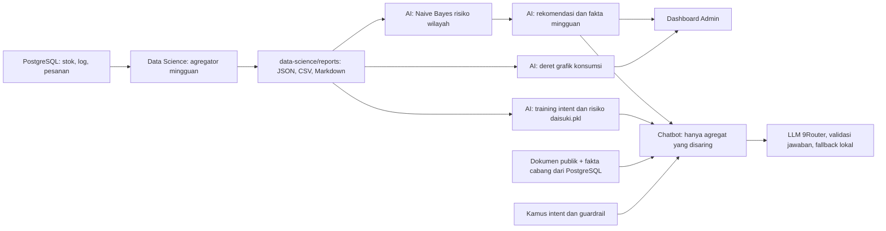

# AI Engineering — Daisuki Inventory

## 1. Tujuan
Menjalankan hasil model Data Science secara otomatis dan menyediakan fitur berbasis AI:
- Job harian rekomendasi restock otomatis.
- Asisten admin berbasis LLM (*tool calling*).
- Input stok cabang via chat.
- Ringkasan laporan mingguan (*weekly summary*).

## 2. Pemilik
Tim AI Engineer.

## 3. Struktur Folder

| Folder | Keterangan |
|---|---|
| `jobs/` | Skrip background job harian yang menghitung dan menulis ke tabel `restock_recommendations` |
| `assistant/` | Modul asisten admin LLM yang terintegrasi dengan *tool calling* API |
| `bot/` | Layanan input stok via antarmuka chat (prototipe Telegram) |
| `evals/` | Skrip pengujian akurasi parsing input chat dan performa respon asisten AI |
| `data/raw_references/` | PDF, DOCX, dan CSV sumber untuk ekstraksi pengetahuan |
| `data/mega_data_word/` | Frasa training, intent, alias produk, dan filter guardrail |
| `data/mainbrain/corporate_knowledge/` | Profil perusahaan, aturan bisnis, dan kebijakan sumber RAG |
| `data/mainbrain/context_embeddings/` | Dokumen publik RAG dan snapshot analitik; retrieval saat ini memakai indeks kata, bukan embedding vektor |
| `data/mainbrain/models/` | Model lokal `daisuki.pkl` hasil training |
| `requirements.txt` | Satu daftar dependensi Python untuk seluruh workspace AI |

## 4. Dependensi & Library Python (`requirements.txt`)

Berikut adalah daftar pustaka (*libraries*) yang wajib diinstal beserta fungsi dan perannya dalam arsitektur AI Daisuki:

| Library | Versi Minimal | Fungsi Utama di Proyek Daisuki |
|---|---|---|
| `scikit-learn` | `>=1.3.0` | Melatih dan mengeksekusi pipeline machine learning Multinomial Naive Bayes (`daisuki.pkl`) untuk klasifikasi intent pesan mitra dan estimasi risiko stok toko. |
| `numpy` | `>=1.24.0` | Operasi vektor, manipulasi matriks fitur pada classifier, dan kalkulasi numerik inferensi. |
| `pandas` | `>=2.0.0` | Agregasi data konsumsi mingguan, pemrosesan log inventaris, dan konversi dataset tabel CSV/JSON. |
| `matplotlib` | `>=3.7.0` | Membuat grafik dari snapshot analitik pada skrip `colab/`. |
| `psycopg[binary]` | `>=3.1.0` | Driver PostgreSQL resmi (Neon DB) untuk menarik data riil (`stock_logs`, `partner_stocks`, `orders`) langsung dari server database. |
| `python-dotenv` | `>=1.0.0` | Memuat variabel konfigurasi dan kredensial sensitif (`DATABASE_URL`, `LLM_API_KEY`) dari berkas `.env` lokal secara aman. |
| `pypdf` | `>=3.17.0` | Universal Document Ingestion — mengekstrak teks dokumen PDF (seperti `CV-Hudzaifah_Ar-Rantisi.pdf`, laporan, dsb.) secara otomatis menjadi berkas Markdown di `ai/data/mainbrain/context_embeddings/`. |
| `python-docx` | `>=1.0.0` | Universal Document Ingestion — membaca dan mengonversi berkas dokumen Microsoft Word (`.docx`) menjadi Markdown terstruktur untuk otak RAG. |
| `httpx` | `>=0.25.0` | Klien HTTP asinkron/sinkron berkecepatan tinggi untuk komunikasi dengan LLM lokal via 9Router (`localhost:20128`) dan webhook eksternal. |
| `python-telegram-bot` | `>=20.0` | Integrasi bot percakapan Telegram sebagai saluran alternatif pelaporan sisa stok cabang secara mobile. |

---

## 5. Setup Lingkungan & Instalasi

### A. Melalui PowerShell (Windows)

```powershell
# 1. Pindah ke direktori workspace ai
cd ai

# 2. Buat virtual environment (.venv)
python -m venv .venv

# 3. Aktifkan virtual environment
.venv\Scripts\Activate.ps1

# 4. Perbarui pip dan pasang seluruh dependensi
python -m pip install --upgrade pip
python -m pip install -r requirements.txt

# 5. Buat konfigurasi lokal hanya jika belum ada, lalu isi DATABASE_URL
if (-not (Test-Path .env)) { Copy-Item .env.example .env }
```

### B. Melalui Command Prompt (CMD)

```cmd
cd ai
python -m venv .venv
.venv\Scripts\activate.bat
python -m pip install -r requirements.txt
```

### C. Melalui Git Bash / Linux Shell

```bash
cd ai
python -m venv .venv
source .venv/Scripts/activate   # atau source .venv/bin/activate di Linux
python -m pip install -r requirements.txt
```

---

## 6. Perintah Operasional Utama

Jalankan perintah berikut dari folder `ai/` setelah dependensi terpasang. Perintah JavaScript/TypeScript proyek tetap memakai Bun dari root repository.

1. **Menjalankan Training Model & Ingestion Dokumen Mainbrain:**
   ```bash
   python retraining/train.py
   ```
   *Fungsi*: Memindai dokumen di `ai/data/raw_references/`, membaca `data-science/reports/cleaned_inventory_summary.csv`, dan menghasilkan `ai/data/mainbrain/models/daisuki.pkl`.

2. **Menjalankan Pengujian AI Guardrails:**
   ```bash
   python -m unittest guardrails.test_guardrails
   ```
   *Fungsi*: Menguji filter pre-guardrail (Prompt Injection, Jailbreak, Cross-Tenant Isolation) dan post-guardrail context grounding angka.

3. **Menjalankan Worker Inferensi Lokal:**
   ```bash
   python retraining/inference_worker.py
   ```
   *Fungsi*: Worker latar belakang berbasis stdio IPC yang digunakan oleh backend ElysiaJS API untuk prediksi instan (<5ms).

4. **Memperbarui classifier intent tanpa koneksi database:**
   ```bash
   python retraining/refresh_identity.py
   ```
   Tambahkan frasa di `data/mega_data_word/intent/training/` sebelum menjalankan perintah ini. Model risiko stok lama tetap dipertahankan. Restart API agar kamus JSON dan dokumen publik yang dicache dimuat ulang.

### Handoff laporan Data Science

1. Data Science menjalankan `python data-science/src/weekly_analytics_aggregator.py` dari root, menghasilkan JSON, CSV, dan Markdown di `data-science/reports/`.
2. AI menjalankan `python ai/jobs/regional_stockout_naive_bayes.py`, `python ai/jobs/smart_allocation.py`, `python ai/jobs/weekly_facts_aggregator.py`, lalu `python ai/retraining/train.py` dari root. Tombol **Perbarui analisis & model** menjalankan urutan ini otomatis dan menyiapkan grafik setelah training.
3. Model risiko memakai CSV laporan yang berumur paling lama tujuh hari. Jika CSV tidak ada, lama, atau tidak valid, training gagal dan model lama dipertahankan. Ringkasan agregat privat tetap disimpan di `ai/data/raw_references/csv/ai_analysis_summary.csv`.

Model `.pkl` menyimpan classifier intent dan risiko; dokumen RAG perusahaan tetap dibaca terpisah. Dokumen privat hasil CSV tidak otomatis tersedia untuk chatbot mitra. Jika ada pengetahuan agregat yang layak dibagikan, buat versi `*.public.md` yang sudah diperiksa dan daftarkan di `data/mainbrain/corporate_knowledge/rag_policy.json`, lalu restart API.

---

## 7. Akses dan Keamanan
- `DATABASE_URL` menggunakan role PostgreSQL `ai_job` (memiliki hak baca tabel inti dan hak tulis hanya ke tabel `restock_recommendations`).
- Asisten admin hanya boleh memanggil endpoint API berstatus *read-only* melalui `API_BASE_URL` dan **dilarang keras** mengeksekusi perintah SQL mentah secara bebas.
- Mitra tidak boleh memiliki akses atau melihat data mitra lain melalui respon AI (wajib mematuhi batasan *tenant isolation*).
- Semua API key (LLM, Telegram token, database) hanya disimpan dalam file `.env`.

## 8. Output yang Diharapkan
- Job harian yang mengeksekusi inferensi model dan menyimpan rekomendasi ke database.
- Asisten cerdas untuk dashboard admin dengan kemampuan *function/tool calling*.
- Prototipe bot input stok chat yang menyertakan tahap konfirmasi data sebelum menyimpan transaksi.
- Modul pembuatan ringkasan performa dan kebutuhan inventaris mingguan.
- Dokumentasi hasil pengujian dan akurasi di folder `evals/`.

## 9. Pipeline Rekomendasi Stok

Setelah Data Science membuat laporan di `data-science/reports/`, jalankan dari root repo:

```powershell
python ai/jobs/regional_stockout_naive_bayes.py
python ai/jobs/smart_allocation.py
python ai/jobs/weekly_facts_aggregator.py
python ai/retraining/train.py
```

Job pertama menulis ringkasan zona wilayah ke `ai/data/mainbrain/context_embeddings/regional_stockout_insights.json` dan skor lengkap per mitra-produk ke `regional_item_risks.json` yang diabaikan Git. Job kedua menggunakan koneksi database hanya untuk mengecek stok pusat terkini dan menyimpan rekomendasi/alert. Fakta mingguan untuk dashboard dan RAG ditulis oleh job ketiga; API chatbot hanya menerima agregat katalog yang aman, bukan daftar mitra lain.

## 10. Aturan Kerja AI Workspace
- Jangan pernah meng-commit file `.env`, API key, atau token ke repositori git.
- Semua aset AI, termasuk model lokal, referensi mentah, dan snapshot analitik, berada di `ai/data/`. Model `.pkl` dan snapshot privat diabaikan oleh Git; jangan memuat model biner dari sumber yang tidak tepercaya.

## 11. Alur Mingguan Data Science ke AI dan Chatbot



**Pembagian kerja tiap minggu:**

1. **Data Science** menjalankan [agregator mingguan](../data-science/README.md#10-serah-terima-mingguan-ke-ai-engineer), memeriksa periode serta empat produk resmi, lalu menyerahkan tiga artefak di `data-science/reports/`. Ketiganya berasal dari satu eksekusi; jangan mencampur JSON dan CSV dari minggu berbeda.
2. **AI Engineer** menjalankan job berurutan dari root repositori:

   ```powershell
   python ai/jobs/regional_stockout_naive_bayes.py
   python ai/jobs/smart_allocation.py
   python ai/jobs/weekly_facts_aggregator.py
   python ai/retraining/train.py
   python ai/retraining/chart_data.py
   ```

   Job pertama membaca `risk_records` dari JSON dan menghitung probabilitas Gaussian/Categorical Naive Bayes serta zona `ZONA_HIJAU`, `ZONA_KUNING`, dan `ZONA_MERAH`. Job alokasi mengurutkan saran menurut skor itu, mengecek stok pusat terkini, lalu menulis `restock_recommendations`. Job fakta menggabungkan laporan dan skor ke `ai/data/mainbrain/context_embeddings/weekly_operational_facts.json`. Training membaca CSV yang berumur paling lama tujuh hari dan memperbarui `ai/data/mainbrain/models/daisuki.pkl`. Grafik mengambil deret konsumsi dari JSON laporan dan jumlah kelas risiko dari model.
3. **Admin** membaca empat kartu AI Insights dan modal rincian dari fakta mingguan yang selaras dengan laporan. Grafik 14 hari tersedia pada status pipeline di tab Log & Data. Fakta operasional cabang untuk chatbot tetap diambil menurut mitra yang sedang login.

**Pemakaian untuk chatbot:** `daisuki.pkl` berisi classifier intent dan risiko berbasis Multinomial Naive Bayes; model ini tidak menyimpan seluruh profil perusahaan sebagai pengetahuan percakapan. Profil dan SOP berasal dari `ai/data/mainbrain/corporate_knowledge/` serta cuplikan `*.public.md` yang terdaftar dalam `rag_policy.json`. Pengambilan cuplikan saat ini memakai indeks kata, belum embedding vektor. `ai/data/mega_data_word/` menyediakan frasa, alias, dan pola regex untuk normalisasi, intent, serta guardrail; memperbarui kamus bukan proses training risiko. Saat chat berlangsung, API menggabungkan sumber RAG yang disetujui dengan fakta PostgreSQL milik mitra yang login, lalu memeriksa permintaan dan jawaban LLM. Jika 9Router tidak tersedia, jawaban memakai fallback lokal.

**Status tombol saat ini:** tombol **Perbarui saran** di AI Insights dan tombol analisis Python di Log & Data sama-sama memanggil `POST /admin/ai-insights/run`. Server menjalankan keenam langkah di atas mulai dari agregator Data Science dengan periode bawaan tujuh hari terakhir. Belum ada tombol tersendiri untuk role Data Science, persetujuan serah terima antar-role, atau jadwal otomatis setiap minggu. Untuk memproses periode khusus, jalankan CLI Data Science lalu lima job AI secara manual; menekan tombol Admin sesudahnya akan membuat ulang laporan untuk periode bawaan.

File laporan per mitra dan `regional_item_risks.json` bersifat privat dan diabaikan Git. RAG mitra hanya memakai dokumen publik yang disetujui, agregat katalog yang telah disaring, dan fakta cabangnya sendiri; daftar serta angka cabang lain tidak masuk ke konteks chat.
