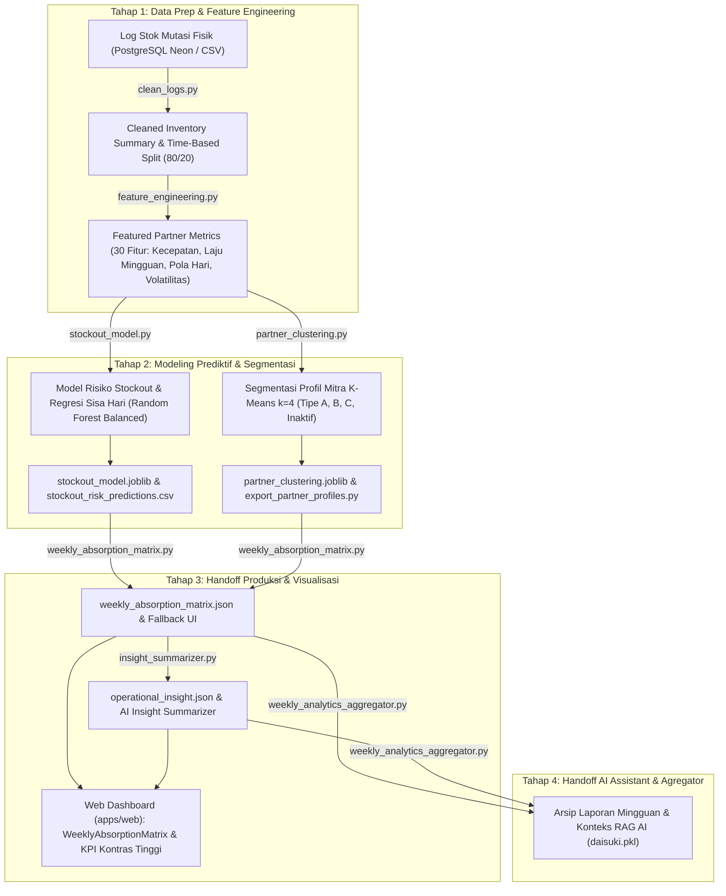

# 📦 Data Science — Daisuki B2B Inventory & Order Management System

Dokumentasi resmi arsitektur *end-to-end* pipeline Data Science, rekayasa fitur (*feature engineering*), pemodelan analitik risiko *stockout*, segmentasi profil mitra (*clustering*), matriks kecepatan penyerapan mingguan, hingga peringkasan otomatis wawasan operasional (*AI Operational Insight Summarizer*).

---

## 1. Konteks Bisnis & Masalah yang Diselesaikan

Daisuki memproduksi dan mendistribusikan 4 produk resmi makanan ringan:
1. **Seblak Jadul Instan**
2. **Basreng Daun Jeruk**
3. **Makaroni Daun Jeruk**
4. **Keripik Pisang Rasa Coklat**

### Tantangan Rantai Pasok Operasional:
1. **Lead Time Pabrik 5–7 Hari Kalender:** Siklus produksi pabrik dan pengiriman logistik antar-kota/antarpulau memerlukan lead time 5–7 hari. Cabang yang terlambat mengajukan restock berisiko mengalami rak kosong (*stockout*) selama berhari-hari.
2. **Stok Cabang Dinamis Tanpa Plafon Buatan:** Tidak ada plafon buatan (seperti 40 pcs) pada cabang mitra. Kapasitas acuan dan batas aman (*Safety Stock & Reorder Point*) bersifat dinamis mengikuti laju konsumsi riil harian (*Average Daily Usage* / ADU).
3. **Pola Konsumsi Berbeda Antar-Toko:** Toko mitra memiliki karakter hari lonjakan yang berbeda (akhir pekan, tengah minggu, atau stabil harian), sehingga memerlukan sinkronisasi jadwal armada pabrik yang tepat sasaran.
4. **Kebutuhan Wawasan Cepat untuk PIC Senior:** Pengambil keputusan (Admin Daisuki & PIC Senior Mitra) membutuhkan informasi yang langsung dapat ditindaklanjuti dalam 3 detik tanpa terbebani jargon statistik teknis.

---

## 2. Arsitektur End-to-End Pipeline Data Science (Tiket #1 – #8)

Pipeline analitik dibangun modular dan terhubung secara berurutan:



### Rincian Perjalanan Tiket Roadmap (#1 – #8):
- **Tiket #1: Pembersihan Log Stok & Time-Based Train/Test Split (`clean_logs.py`)**: Membersihkan inkonsistensi mutasi fisik, menghitung metrik inventaris dasar (`adu`, `safety_stock`, `rop`, `days_of_cover`), serta membagi data secara temporal (80% historis awal untuk training, 20% periode akhir untuk testing) guna mencegah *target leakage*.
- **Tiket #2: Feature Engineering Pola Konsumsi Cabang (`feature_engineering.py`)**: Merekayasa 30 prediktor kaya, mencakup laju penyerapan (`absorption_rate`), pertumbuhan konsumsi mingguan (`wow_growth_rate`), proporsi pola hari (`weekend_share`, `midweek_share`), koefisien variasi (`daily_cv`), dan rasio utilisasi stok (`stock_utilization_ratio`).
- **Tiket #3: Modeling Analitik Risiko Stockout & Regresi Sisa Hari (`stockout_model.py` & Notebook `02`)**: Membandingkan Heuristic Baseline, Naive Bayes, dan Random Forest Classifier dengan `class_weight='balanced'` (Macro F1 0.9944, Recall Kritis 100.00% tanpa False Negative), serta Random Forest Regressor untuk memproyeksikan sisa hari menuju kehabisan barang (MAE 0.1252 hari / ~3 jam) dengan deteksi dini ambang batas lead time pabrik 7 hari.
- **Tiket #4: Customer/Partner Clustering & Evaluasi K-Means vs DBSCAN (`partner_clustering.py` & Notebook `03`)**: Membandingkan K-Means ($k=2,3,4$) dan DBSCAN menggunakan *Silhouette Score* (0.4339) dan *Davies-Bouldin Index* (0.6176), membuktikan keunggulan K-Means dalam menjamin 100% alokasi cabang tanpa membuang toko sebagai noise, serta memvalidasi dampak pemisahan klaster berbasis fitur pola harian Tiket #2.
- **Tiket #5: Pipeline Produksi Ekspor Profil Mitra & Jadwal Logistik (`export_partner_profiles.py`)**: Mengotomasi pelabelan profil 106 cabang mitra secara deterministik ke dalam kontrak payload siap konsumsi [partner_profiles.json](file:///C:/daisuki-inventory/data-science/data/partner_profiles.json).
- **Tiket #6: Matriks Peringkat Kecepatan Penyerapan Produk Mingguan Antar Mitra (`weekly_absorption_matrix.py`)**: Menggabungkan metrik laju penyerapan, proyeksi risiko stockout, dan profil klaster ke dalam struktur multi-dimensi [weekly_absorption_matrix.json](file:///C:/daisuki-inventory/data-science/data/weekly_absorption_matrix.json), endpoint API backend `GET /analysis/weekly-absorption-matrix`, dan komponen dashboard web.
- **Tiket #7: Penyederhanaan Tampilan Analitik & Filter Dasbor untuk PIC Mitra Senior (`weekly-absorption-matrix.tsx`)**: Menata ulang hierarki angka-angka KPI utama (*Laju Penjualan*, *Wajib Kirim Segera*, *Stok Menumpuk*, *Sisa Hari Stok Aman*) dengan tipografi besar kontras tinggi (3-detik scan), menghilangkan seluruh jargon teknis statistik, serta menyederhanakan filter dengan tombol *Reset Filter* cepat.
- **Tiket #8: AI Operational Insight Summarizer & Dokumentasi Akhir Modul (`insight_summarizer.py` & `README.md`)**: Menghasilkan narasi eksekutif otomatis 2–3 kalimat berbahasa Indonesia komunikatif per periode dan per wilayah kota, mengintegrasikan banner *AI Operational Insight* interaktif di frontend, serta menyusun dokumentasi arsitektur final.

---

## 3. Struktur Direktori Workspace

```text
data-science/
├── notebooks/                     # Jupyter Notebooks untuk Eksperimen & Validasi Rubrik
│   ├── 01_eda_and_baseline.ipynb          # EDA & Pemodelan Baseline Permintaan
│   ├── 02_stockout_risk_modeling.ipynb    # Modeling Risiko Stockout & Regresi Sisa Hari
│   └── 03_partner_clustering.ipynb        # Segmentasi Mitra Tipe A/B/C & Evaluasi K-Means vs DBSCAN
├── src/                           # Modul Produksi Python yang Reusable
│   ├── clean_logs.py                      # Tiket #1: Pembersihan Log & Time-Based Split (80/20)
│   ├── feature_engineering.py             # Tiket #2: Rekayasa Fitur Kecepatan & Pola Hari
│   ├── stockout_model.py                  # Tiket #3: Model Klasifikasi Risiko & Proyeksi Sisa Hari
│   ├── partner_clustering.py              # Tiket #4: Evaluasi Clustering K-Means vs DBSCAN
│   ├── export_partner_profiles.py         # Tiket #5: Pipeline Produksi Ekspor Profil Mitra
│   ├── weekly_absorption_matrix.py        # Tiket #6: Matriks Peringkat Penyerapan Mingguan
│   ├── insight_summarizer.py              # Tiket #8: AI Operational Insight Summarizer
│   ├── weekly_analytics_aggregator.py     # Handoff Agregator Laporan Mingguan ke Tim AI
│   └── inventory_model.py                 # Helper Kalkulasi Buffer & Parameter Stok
├── data/                          # Dataset Mentah & Artefak JSON (Git Ignored)
│   ├── raw_stock_logs.csv                 # Log mentah mutasi stok fisik
│   ├── cleaned_inventory_summary.csv      # Ringkasan inventaris bersih (424 baris)
│   ├── train_inventory_summary.csv        # Train set (80% periode historis awal)
│   ├── test_inventory_summary.csv         # Test set (20% periode terbaru)
│   ├── featured_partner_metrics.csv       # Dataset kaya dengan 30 fitur rekayasa
│   ├── stockout_risk_predictions.csv      # Prediksi risiko & hari sisa pada Test Set
│   ├── partner_clusters.csv               # Hasil segmentasi 106 cabang mitra
│   ├── partner_profiles.json              # Kontrak payload JSON profil 106 mitra (Tiket #5)
│   ├── weekly_absorption_matrix.json      # Matriks peringkat penyerapan mingguan (Tiket #6)
│   └── operational_insight.json           # Ringkasan eksekutif operasional AI (Tiket #8)
├── models/                        # Artefak Model Terlatih (Git Ignored)
│   ├── stockout_model.joblib              # Pipeline Random Forest Classifier & Regressor
│   └── partner_clustering.joblib          # Pipeline K-Means & StandardScaler Mitra
├── reports/                       # Laporan Evaluasi & Arsip Run (Git Ignored)
│   ├── stockout_model_evaluation.json     # Metrik komparasi Test Set (F1, MAE, WAPE)
│   ├── partner_clustering_evaluation.json # Evaluasi K-Means vs DBSCAN & dampak fitur
│   └── runs/<run_id>/                     # Artefak Handoff Mingguan ke Tim AI
├── requirements.txt               # Dependensi Python terpusat
├── DATA_DICTIONARY.md             # Kamus data lengkap seluruh fitur & kontrak payload
└── README.md                      # Dokumentasi utama end-to-end (dokumen ini)
```

---

## 4. Setup Lingkungan & Aturan Keamanan Database (`ds_readonly`)

### A. Instalasi Virtual Environment
Gunakan virtual environment Python lokal di folder `data-science/`:

```powershell
# 1. Masuk ke direktori data-science
cd data-science

# 2. Buat virtual environment
python -m venv .venv

# 3. Aktivasi virtual environment (Windows PowerShell)
.venv\Scripts\Activate.ps1

# 4. Pasang seluruh dependensi terpusat
pip install -r requirements.txt

# 5. Siapkan berkas environment (opsional untuk Neon DB)
Copy-Item .env.example .env
```

### B. Protokol Keamanan Koneksi Database Baca-Saja (*Least Privilege*)
1. **Hak Akses Terisolasi:**
   - Seluruh koneksi database dari modul `data-science/` **wajib** menggunakan role PostgreSQL `ds_readonly`.
   - Modul menegakkan transaksi baca-saja secara ketat pada level sesi koneksi:
     ```python
     conn.read_only = True
     with conn.cursor() as cur:
         cur.execute("SET ROLE ds_readonly;")
     ```
   - Role `ds_readonly` hanya memiliki izin `GRANT SELECT` pada tabel inventaris (`stock_logs`, `partner_stocks`, `partners`, `products`).
   - Dilarang keras mengeksekusi mutasi apa pun (`INSERT`, `UPDATE`, `DELETE`, `ALTER`) dari workspace ini.
2. **Mekanisme Fallback Offline Tanpa Gangguan (*Graceful Offline Fallback*):**
   - Jika koneksi Neon DB offline atau `DATABASE_URL` tidak disetel, seluruh skrip dan notebook otomatis beralih membaca dataset lokal di `data-science/data/`.
   - Dashboard frontend tetap berfungsi penuh berkat salinan fallback di `apps/web/src/data/`.

---

## 5. Panduan Menjalankan Seluruh Pipeline Berurutan (Sequential Runbook)

Jalankan seluruh modul secara berurutan dari root repositori menggunakan executable virtual environment:

```powershell
# Langkah 1: Pembersihan log stok & pemisahan train/test time-based (Tiket #1)
data-science\.venv\Scripts\python.exe data-science\src\clean_logs.py

# Langkah 2: Rekayasa fitur 30 metrik pola konsumsi & volatilitas (Tiket #2)
data-science\.venv\Scripts\python.exe data-science\src\feature_engineering.py

# Langkah 3: Pelatihan model risiko stockout & regresi sisa hari (Tiket #3)
data-science\.venv\Scripts\python.exe data-science\src\stockout_model.py

# Langkah 4: Evaluasi segmentasi K-Means vs DBSCAN & fit model klaster (Tiket #4)
data-science\.venv\Scripts\python.exe data-science\src\partner_clustering.py

# Langkah 5: Ekspor payload profil mitra & jadwal logistik ke JSON (Tiket #5)
data-science\.venv\Scripts\python.exe data-science\src\export_partner_profiles.py

# Langkah 6: Generator matriks peringkat kecepatan penyerapan mingguan (Tiket #6)
data-science\.venv\Scripts\python.exe data-science\src\weekly_absorption_matrix.py

# Langkah 7: Generator ringkasan eksekutif AI Operational Insight (Tiket #8)
data-science\.venv\Scripts\python.exe data-science\src\insight_summarizer.py

# Langkah 8 (Opsional / Rutin Mingguan): Agregasi handoff laporan mingguan ke Tim AI
data-science\.venv\Scripts\python.exe data-science\src\weekly_analytics_aggregator.py
```

### Eksekusi Jupyter Notebooks:
Untuk meninjau visualisasi, grafik kurva evaluasi, dan analisis mendalam:
1. Buka [01_eda_and_baseline.ipynb](file:///C:/daisuki-inventory/data-science/notebooks/01_eda_and_baseline.ipynb) untuk eksplorasi data & simulasi buffer acuan dinamis.
2. Buka [02_stockout_risk_modeling.ipynb](file:///C:/daisuki-inventory/data-science/notebooks/02_stockout_risk_modeling.ipynb) untuk visualisasi matriks konfusi, feature importance, dan scatter plot lead time pabrik.
3. Buka [03_partner_clustering.ipynb](file:///C:/daisuki-inventory/data-science/notebooks/03_partner_clustering.ipynb) untuk visualisasi perbandingan Elbow/Silhouette, scatter plot 2D PCA, dan pembuktian dampak feature engineering harian.

---

## 6. Spesifikasi Kontrak Payload JSON Keluaran (Output Contracts)

### A. Kontrak `partner_profiles.json` (Tiket #5)
File: `data-science/data/partner_profiles.json` (salinan siap konsumsi API)
```json
{
  "metadata": {
    "version": "1.0.0",
    "generated_at": "2026-11-20T...",
    "model_algorithm": "K-Means (k=4) + StandardScaler",
    "total_partners": 106,
    "active_partners": 11,
    "inactive_partners": 95
  },
  "distribution_summary": {
    "TIPE_A": { "count": 1, "label": "Tipe A: Ramai Akhir Pekan (Weekend Peak)", "schedule": "Kamis Sore / Jumat Pagi" },
    "TIPE_B": { "count": 8, "label": "Tipe B: Stabil Harian Reguler (Steady Weekday)", "schedule": "Senin Pagi & Kamis Pagi" },
    "TIPE_C": { "count": 2, "label": "Tipe C: Lonjakan Tengah Minggu (Midweek Spike)", "schedule": "Senin Sore / Selasa Pagi" },
    "INACTIVE": { "count": 95, "label": "Mitra Baru / Inaktif (On-Demand Outreach)", "schedule": "On-Demand saat ada pesanan perdana" }
  },
  "profiles": [
    {
      "partner_id": "uuid...",
      "partner_name": "Hotel Aruna Jakarta",
      "city": "Jakarta",
      "cluster_code": "TIPE_B",
      "segment_name": "Tipe B: Stabil Harian Reguler",
      "recommended_schedule": "Senin Pagi & Kamis Pagi (2x seminggu)",
      "actionable_strategy": "Kirim pasokan terbagi 2x seminggu secara konsisten.",
      "metrics": {
        "avg_daily_consumption": 110.0,
        "weekend_share": 0.28,
        "midweek_share": 0.35,
        "daily_cv": 0.32,
        "absorption_rate": 4.81
      }
    }
  ]
}
```

### B. Kontrak `weekly_absorption_matrix.json` (Tiket #6)
File: `data-science/data/weekly_absorption_matrix.json` & `apps/web/src/data/weekly_absorption_matrix.json`
```json
{
  "metadata": {
    "version": "1.0.0",
    "current_period_id": "2026-W46",
    "total_partners": 106,
    "active_partners": 11,
    "official_products": ["Seblak Jadul Instan", "Basreng Daun Jeruk", "Makaroni Daun Jeruk", "Keripik Pisang Rasa Coklat"]
  },
  "available_periods": [
    { "id": "2026-W46", "label": "Minggu 2 - Nov 2026 (Aktif)", "date_range": "10 Nov - 17 Nov 2026" }
  ],
  "available_cities": ["Semua Lokasi", "Jakarta", "Makassar", "Cijeruk", "Semarang", "Surabaya", "Jabodetabek"],
  "summary": {
    "network_avg_absorption_rate": 0.881,
    "top_performer_count": 4,
    "steady_count": 0,
    "slow_moving_count": 102,
    "lead_time_breached_count": 4
  },
  "period_data": {
    "2026-W46": {
      "rankings": [
        {
          "rank": 1,
          "partner_id": "...",
          "partner_name": "Hotel Aruna Jakarta",
          "city": "Jakarta",
          "cluster_code": "TIPE_B",
          "performance_tier": "top_performer",
          "avg_absorption_rate": 4.81,
          "total_weekly_consumption": 770.0,
          "total_current_stock": 160.0,
          "dominant_risk_level": "Kritis",
          "min_days_to_stockout": 1.3,
          "has_lead_time_breach": true,
          "products": [
            {
              "product_name": "Seblak Jadul Instan",
              "weekly_consumption": 280.0,
              "current_qty": 40.0,
              "absorption_rate": 7.0,
              "predicted_days_to_stockout": 1.0,
              "urgency_lead_time_breached": true
            }
          ]
        }
      ]
    }
  }
}
```

### C. Kontrak `operational_insight.json` (Tiket #8)
File: `data-science/data/operational_insight.json` & `apps/web/src/data/operational-insight-fallback.ts`
```json
{
  "metadata": {
    "version": "1.0.0",
    "generator": "Daisuki AI Operational Insight Summarizer",
    "active_period_id": "2026-W46"
  },
  "network_overview": {
    "headline": "4 Cabang Berstatus Kritis Menjelang Batas Lead Time Pabrik...",
    "executive_summary": "Laju penyerapan produk jaringan Daisuki mencapai 88.1% dari buffer acuan... Namun, 4 cabang mitra—termasuk Hotel Pelangi Makassar dan Hotel Aruna Jakarta—telah menyentuh batas kritis...",
    "network_avg_absorption_rate": 0.881,
    "total_critical_branches": 4,
    "total_slow_moving_branches": 102,
    "min_safe_stock_days": 1.3,
    "avg_critical_safe_days": 3.2,
    "priority_actions": [
      {
        "priority": "P1 - Segera Kirim (1–2 Hari)",
        "target": "Hotel Pelangi Makassar & Hotel Aruna Jakarta",
        "action": "Keluarkan ready stock gudang pusat untuk mengisi kembali buffer sebelum stok habis total.",
        "risk_level": "Kritis"
      }
    ]
  },
  "city_insights": {
    "Jakarta": {
      "city": "Jakarta",
      "headline": "Penjualan Sangat Cepat di Hotel Aruna Jakarta, Stok Kritis Sisa 1.3 Hari",
      "summary": "Cabang mitra di Jakarta mencatat perputaran 4.81x buffer dengan konsumsi 770 pcs. Pasokan menipis drastis, wajib dikirim segera.",
      "status": "Kritis",
      "recommended_action": "Terbitkan pesanan pasokan darurat untuk cabang di Jakarta hari ini."
    }
  }
}
```

---

## 7. Ringkasan Hasil Evaluasi Model & Keterbatasan Domain

### A. Ringkasan Metrik Evaluasi Akhir

| Aspek Analisis | Algoritma Pemenang | Metrik Evaluasi Utama | Interpretasi Operasional |
|---|---|:---:|---|
| **Klasifikasi Risiko Stockout** | **Random Forest Classifier (Balanced)** | **Akurasi 99.53%**<br>**Macro F1 0.9944**<br>**Recall Kritis 100.00%** | **Nol False Negative pada kasus kritis.** Sistem tidak pernah meloloskan toko yang terancam kehabisan barang. |
| **Proyeksi Sisa Hari Habis** | **Random Forest Regressor** | **MAE 0.1252 hari (~3 jam)**<br>**WAPE 0.22%** | Estimasi kehabisan stok sangat akurat, memicu peringatan otomatis jika sisa hari $\le 7$ hari kalender. |
| **Segmentasi Profil Mitra** | **K-Means Clustering ($k=4$)** | **Silhouette Score 0.4339**<br>**Davies-Bouldin 0.6176** | Memisahkan pola belanja tanpa membuang toko sebagai noise (DBSCAN membuang 27–100% toko sebagai noise). |

### B. Matriks 4 Segmen Operasional Mitra Daisuki

```text
┌──────────────────────────────────────────────────────────────────────────────────────────────┐
│ SEGMEN OPERASIONAL MITRA CABANG DAISUKI                                                     │
├────────────────────────────────┬─────────┬────────────────────────────┬──────────────────────┤
│ Segmen Profil                  │ Cabang  │ Pola Hari Utama            │ Jadwal Rekomendasi   │
├────────────────────────────────┼─────────┼────────────────────────────┼──────────────────────┤
│ Tipe A: Ramai Akhir Pekan      │ 1 (1%)  │ Sabtu & Minggu (Weekend)   │ Kamis Sore / Jumat   │
│ Tipe B: Stabil Harian Reguler  │ 8 (8%)  │ Senin - Jumat (Weekday)    │ Senin & Kamis Pagi   │
│ Tipe C: Lonjakan Tengah Minggu │ 2 (2%)  │ Rabu & Kamis (Midweek)     │ Senin Sore / Selasa  │
│ Mitra Baru / Inaktif           │ 95 (89%)│ Belum Ada Log Konsumsi     │ On-Demand / Starter  │
└────────────────────────────────┴─────────┴────────────────────────────┴──────────────────────┘
```

### C. Catatan Keterbatasan Data Sintetis (Kepatuhan Rubrik Dicoding)
1. **Dominasi Data Sintetis:** Sebagian besar riwayat cabang merupakan hasil *synthetic seed*, sehingga pola konsumsinya terdistribusi relatif normal dan menghasilkan metrik evaluasi F1-Score yang sangat tinggi (~0.99).
2. **Mitra Riil Primer (*Kopken Cijeruk*):** Menjadi representasi riil transaksi dinamis dengan konsumsi harian stabil di hari kerja dan kenaikan transaksi di akhir pekan.
3. **Data Konsumsi Berbasis Laporan Fisik:** Angka konsumsi dihitung dari selisih mutasi laporan fisik berkala (`manual_update`), bukan transaksi struk kasir (*point of sale*).
4. **Rekomendasi Retraining Berkala:** Seiring bertambahnya cabang mitra baru dan data riil lapangan, pipeline clustering dan model risiko wajib di-*retrain* secara berkala tiap minggu di server produksi.

---

## 8. Catatan Handover Antar Tim Pengembang

### Untuk Fullstack Web Developer (`apps/web/` & `apps/api/`):
- Endpoint backend `GET /analysis/weekly-absorption-matrix` dan `GET /analysis/operational-insight` membaca artefak di `data-science/data/`.
- Komponen frontend [weekly-absorption-matrix.tsx](file:///C:/daisuki-inventory/apps/web/src/components/inventory/weekly-absorption-matrix.tsx) telah dilengkapi mekanisme *failover* instan ke data fallback di `apps/web/src/data/`, menjamin visual dasbor tetap muncul seketika meskipun API/DB sedang offline.
- Desain antarmuka mematuhi standar desain Daisuki: bebas jargon teknis tiket, kontras tinggi, angka dengan `tabular-nums`, target sentuh $\ge 44\text{px}$, dan tombol *Reset Filter* instan.

### Untuk AI Engineer (`ai/` & Asisten Chatbot):
- Hasil analisis mingguan dapat langsung dikonsumsi sebagai sumber pengetahuan RAG untuk melatih model `daisuki.pkl` via `ai/train.py`.
- Narasi eksekutif di `operational_insight.json` (`network_overview.executive_summary` dan `city_insights`) dapat dijadikan grounding fakta operasional saat Admin atau Mitra bertanya mengenai status pasokan di chatbot.
- Skrip di `ai/jobs/` tetap aman dan tidak mengalami modifikasi struktur.

### Untuk Admin Logistik Pusat & PIC Senior Mitra:
- Selalu periksa kartu **Wajib Kirim Segera (< 7 Hari)** setiap hari Senin dan Kamis.
- Jika suatu cabang berstatus *Kritis*, segera terbitkan pesanan restock dan alokasikan stok gudang pusat sebelum sisa hari menyentuh 0.
- Untuk 102 cabang *Stok Menumpuk*, koordinasikan dengan tim sales cabang untuk evaluasi display rak toko atau penarikan stok (*recall*) jika tidak ada pergerakan lebih dari 30 hari.
