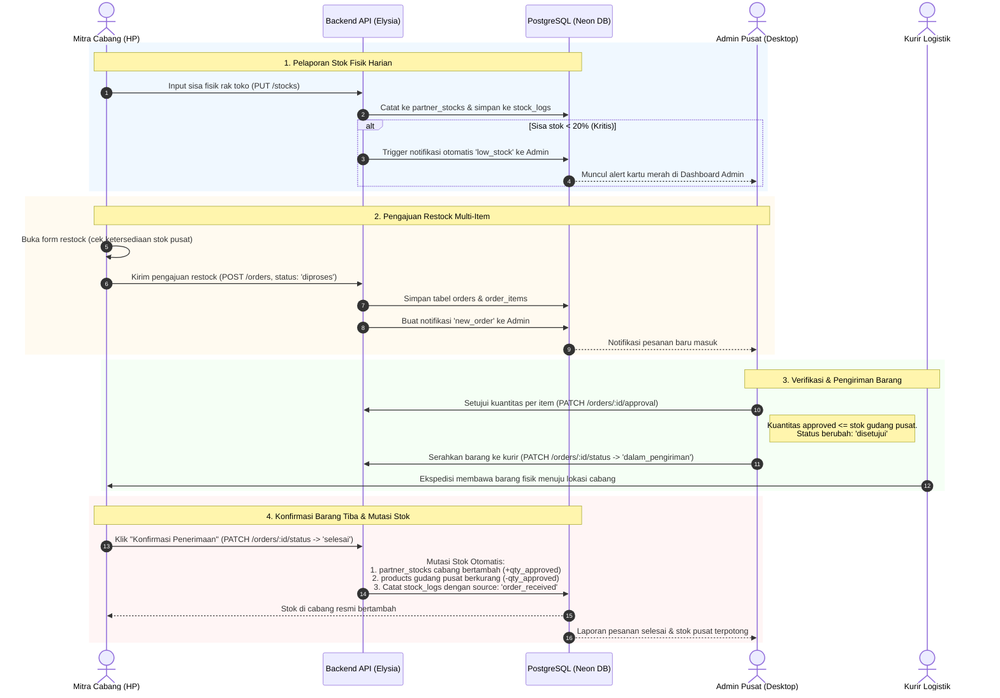

# Daisuki B2B Inventory & Order Management System
## Dokumentasi Resmi: Alur Kerja Sistem & Pembagian Peran (Roles)

---

## 1. Tentang Proyek & Masalah yang Diselesaikan

**Daisuki Inventory** adalah platform manajemen inventaris dan pemesanan barang B2B (*Business-to-Business*) multi-tenant yang menghubungkan **Admin Daisuki Pusat** dengan **Mitra Cabang** (hotel, kafe, restoran, dan minimarket).

### Masalah Utama yang Diselesaikan:
1. **Blind Stock & Catatan Manual**: Stok di cabang mitra sering habis mendadak karena pencatatan manual via chat WhatsApp/spreadsheet yang tidak sinkron secara realtime.
2. **Koordinasi Lead Time Produksi Pabrik**: Produksi dan pengiriman dari pabrik Daisuki membutuhkan waktu (lead time 5–7 hari). Sistem ini memastikan cabang melakukan restock sebelum menyentuh batas kritis (*Safety Stock & Reorder Point*).
3. **Visibilitas Stok Gudang Pusat**: Mitra dapat memantau ketersediaan stok ready di gudang pusat secara transparan saat mengajukan restock.
4. **Approval Restock Parsial & Transparan**: Admin pusat dapat menyetujui kuantitas per item sesuai alokasi gudang pusat serta memberikan catatan penjelasan tertulis jika kuantitas disesuaikan.

### 4 Produk Resmi Daisuki:
1. **Seblak Jadul Instan** (`DSK-SB-001`) — Rp12.000 / pcs
2. **Basreng Daun Jeruk** (`DSK-BR-002`) — Rp10.000 / pcs
3. **Makaroni Daun Jeruk** (`DSK-MK-003`) — Rp8.500 / pcs
4. **Keripik Pisang Rasa Coklat** (`DSK-KP-004`) — Rp15.000 / pcs

---

## 2. Peran Pengguna Sistem (User Roles)

Sistem membedakan hak akses dan antarmuka pengguna berdasarkan peran akun (`users.role`):

```text
┌────────────────────────────────────────────────────────────────────────┐
│                        PENGGUNA SISTEM DAISUKI                         │
├──────────────────────────────────┬─────────────────────────────────────┤
│   A. ADMIN DAISUKI PUSAT         │   B. MITRA CABANG                   │
│   (role: "admin")                │   (role: "mitra")                   │
│   Akses: Dashboard Desktop       │   Akses: Portal Mobile / HP         │
└──────────────────────────────────┴─────────────────────────────────────┘
```

### A. Admin Daisuki Pusat (`role: "admin"`)
- **Monitoring Kesehatan Stok Seluruh Cabang**:
  - Memantau kondisi stok seluruh cabang mitra secara realtime dalam 1 kartu per cabang dengan accordion detail produk dan indikator kapasitas rak (`RakBar`).
  - Indikator status stok otomatis: **Aman** (> 50%), **Waspada** (20% – 50%), **Kritis** (< 20%), dan **Belum Update** (> 24 jam).
- **Monitoring Stok Gudang Pusat**:
  - Memantau ketersediaan ready stock 4 produk di gudang pusat (kapasitas default 1.000 pcs per produk).
- **Manajemen & Approval Pesanan Restock B2B**:
  - **Tab Menunggu Persetujuan**: Menyetujui kuantitas restock per produk (bisa disetujui penuh, disetujui parsial `qty_approved <= central_stock`, atau ditolak).
  - **Catatan Admin**: Wajib/dapat menyertakan catatan tertulis jika kuantitas disetujui sebagian.
  - **Tab Selesai / Disetujui**: Mengubah status menjadi `dalam_pengiriman` saat paket barang diserahkan ke ekspedisi/kurir logistik.
  - **Tab Ditolak**: Menolak pesanan dengan alasan penolakan yang jelas.
- **Pusat Notifikasi & Alert Cerdas**:
  - Menerima alert instan saat ada cabang yang stoknya kritis (< 20%) atau saat ada permohonan restock baru masuk.
- **Data Science & AI Tab**:
  - Melihat ringkasan keaktifan mitra mingguan dan melakukan export data log mentah (`raw_stock_logs.csv`) untuk diolah oleh tim data.

### B. Mitra Cabang (`role: "mitra"`)
- **Laporan Stok Fisik Harian (Mobile Friendly & Touch-Friendly)**:
  - Menginput sisa stok fisik di rak toko dengan cepat melalui perangkat mobile menggunakan tombol plus/minus atau ketik langsung (target sentuh minimal 44px).
- **Monitoring Stok Gudang Pusat**:
  - Melihat sisa ready stock gudang pusat Daisuki secara langsung sebelum memesan.
- **Pengajuan Restock Multi-Item**:
  - Mengajukan restock untuk beberapa atau ke-4 produk sekaligus dalam 1 nomor pesanan (`PO-yymmdd-xxxxxxxx`).
  - Peringatan instan jika kuantitas yang diminta melebihi stok gudang pusat, lengkap dengan tombol cepat **[Sesuaikan]** untuk menyamakan dengan stok ready pusat.
- **Konfirmasi Penerimaan Barang**:
  - Mengonfirmasi penerimaan saat kurir logistik tiba di toko cabang (`dalam_pengiriman` ➔ `selesai`).
  - Begitu dikonfirmasi, stok fisik cabang bertambah sebesar jumlah yang disetujui (`qty_approved`) dan stok gudang pusat otomatis berkurang.
- **Riwayat Log & Kalender Perubahan Stok**:
  - Melihat riwayat pergerakan stok toko per tanggal dan per jam sesi pelaporan.

---

## 3. Pembagian Peran Tim Pengembang (Development Team Roles)

Proyek ini dibangun secara kolaboratif oleh 3 divisi pengembang:

| Peran Tim | Fokus & Tanggung Jawab | Modul Kode Utama |
|---|---|---|
| **Fullstack Developer** | Arsitektur web monorepo, REST API, skema database, autentikasi JWT, state management, dan antarmuka UI/UX (Admin & Mitra) | `apps/web/`, `apps/api/`, `packages/shared/` |
| **Data Science** | Pembersihan data mentah transaksi cabang (`raw_stock_logs.csv`), pemodelan konsumsi, perhitungan batas aman stok (*Safety Stock* & *Reorder Point / ROP*), serta klasifikasi produk *Fast-Moving* vs *Slow-Moving* | `data-science/` (Python, Pandas, Jupyter) |
| **AI Engineer** | Otomasi alert stok kritis (< 20%), scheduler reminder 24 jam bagi mitra yang lupa lapor stok, pembuatan rekomendasi kuantitas restock cerdas (`restock_recommendations`), dan asisten inventaris | `ai/` (Python scripts, cron jobs, ML pipeline) |

---

## 4. Alur Kerja Sistem (End-to-End System Workflow)



---

## 5. Alur Estafet Data: Data Science & AI Engine

Selain alur operasional harian, data riwayat log diolah untuk mengoptimasi rantai pasok:

```text
┌────────────────────────────────────────────────────────────────────────┐
│ 1. MITRA CABANG MELAPOR STOK SECARA RUTIN                              │
│    Setiap perubahan fisik tercatat di tabel `stock_logs`              │
└───────────────────────────────────┬────────────────────────────────────┘
                                    │
                                    ▼ (Export dari Dashboard Admin)
┌────────────────────────────────────────────────────────────────────────┐
│ 2. EXPORT RAW CSV (Dashboard Admin -> Tab Data Science)               │
│    Admin mengunduh file `raw_stock_logs.csv`                           │
└───────────────────────────────────┬────────────────────────────────────┘
                                    │
                                    ▼ (Diolah Tim Data Science)
┌────────────────────────────────────────────────────────────────────────┐
│ 3. PEMBERSIHAN & PEMODELAN DATA SCIENCE (data-science/)                │
│    - Menghapus input ganda & menangani tanggal kosong                  │
│    - Menghitung Average Daily Usage (ADU) konsumsi per cabang          │
│    - Menentukan Safety Stock & Reorder Point (ROP) dengan lead time 7h │
│    - Menghasilkan file bersih: `cleaned_inventory_summary.csv`         │
└───────────────────────────────────┬────────────────────────────────────┘
                                    │
                                    ▼ (Diteruskan ke AI Engineer)
┌────────────────────────────────────────────────────────────────────────┐
│ 4. PREDIKSI & OTOMASI AI (ai/)                                         │
│    - Memprediksi cabang yang berisiko mengalami stockout (habis stok) │
│    - Menghitung rekomendasi kuantitas restock optimal                 │
│    - Menyimpan rekomendasi ke tabel `restock_recommendations`          │
│    - Menjalankan cron job reminder 24 jam untuk cabang yang lupa update│
└───────────────────────────────────┬────────────────────────────────────┘
                                    │
                                    ▼ (Tampil Kembali di Web)
┌────────────────────────────────────────────────────────────────────────┐
│ 5. REKOMENDASI MUNCUL OTOMATIS DI FORMULIR PEMESANAN MITRA             │
│    Mitra mendapatkan saran jumlah restock yang akurat & rasional       │
└────────────────────────────────────────────────────────────────────────┘
```

---

## 6. Aturan Bisnis & Batasan Arsitektur (Business Rules)

### 1. Perhitungan Status Kesehatan Stok Cabang:
- **Aman (`aman`)**: Sisa stok > 50% dari kapasitas rak (`par_level`).
- **Waspada (`waspada`)**: Sisa stok antara 20% s.d. 50%.
- **Kritis (`kritis`)**: Sisa stok < 20% (atau sisa stok ≤ 10 pcs).
- **Belum Lapor (`is_stale`)**: Cabang belum memperbarui laporan stok fisik dalam waktu > 24 jam terakhir.

### 2. Siklus Status Pesanan Restock (*State Machine*):
```text
diproses ➔ disetujui (atau ditolak / dibatalkan) ➔ dalam_pengiriman ➔ selesai
```
- **Strict Boundary Mutasi Stok**:
  - Stok cabang **hanya boleh bertambah** saat pesanan berpindah dari `dalam_pengiriman` ke `selesai` melalui konfirmasi fisik oleh Mitra.
  - Jumlah penambahan stok cabang menggunakan nilai **`qty_approved`** (hasil persetujuan admin), bukan `qty_requested`.
  - Pada saat yang sama, stok gudang pusat (**`central_stock`**) otomatis dikurangi sebesar `qty_approved`.

### 3. Batasan Keamanan API (*Strict Mutation Boundary*):
- Frontend **tidak diizinkan** melakukan query/mutasi langsung ke database.
- Seluruh mutasi stok dan perubahan status pesanan **wajib** melalui endpoint Elysia API di `apps/api/`.
- Identitas `partner_id` dan `user_id` **selalu ditentukan di sisi server** dari payload JWT pengguna terotentikasi, tidak boleh dipercaya dari body request client.

---

## 7. Desain Sistem & Standar Antarmuka

- **Tipografi**:
  - Judul & angka numerik besar: `Bricolage Grotesque` (`--font-display`).
  - Teks isi & formulir: `Figtree` (`--font-sans`).
  - Seluruh angka stok, harga, dan persentase wajib memakai format `tabular-nums` (`.num`) agar angka sejajar secara vertikal.
- **Warna Semantik**:
  - 🟢 **Aman**: `--color-ok` (`#1E8E4E`)
  - 🟡 **Waspada**: `--color-warn` (`#F5B700`)
  - 🔴 **Kritis**: `--color-crit` (`#C62828`)
  - ⚪ **Belum Update**: `--color-stale` (`#8A91A3`)
  - Aksen Brand Daisuki: **Ume** (`#B83A6A`)
- **Komponen Khas**:
  - `RakBar`: Indikator visual stok berbentuk petak rak yang terisi proporsional sesuai persentase stok cabang.
