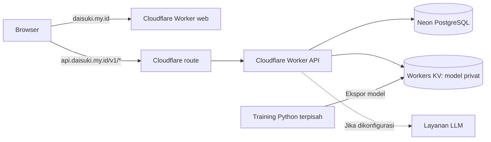

# Produksi Daisuki tanpa laptop menyala



Rute `api.daisuki.my.id/*` mengeksekusi Worker API sebelum origin DNS. CNAME Tunnel lama boleh tetap ada selama transisi; permintaan pada rute ini tidak membutuhkan PC atau `bun run dev`. Web memanggil `https://api.daisuki.my.id/v1/{path}`. Model terlatih diekspor sebagai JSON dan dibaca dari KV saat inferensi. PostgreSQL menyimpan akun, sesi, stok, pesanan, artefak model cadangan, dan berkas unggahan.

## Yang berjalan di Worker

- Login akun database melalui hash bcrypt; akun demo lama dimigrasikan tanpa mengganti kata sandi.
- Operasi API Elysia, Neon, dan pembacaan gambar unggahan.
- Klasifikasi intent, prediksi risiko stok, dan pencarian dokumen dari model JSON privat di KV. Versi aktif saat ini memuat indeks dokumen publik.
- Job terjadwal melalui cron Worker, dengan batas CPU paket gratis yang perlu dipantau.

## Yang masih memerlukan proses terpisah

- Training dan pembaruan model Python. Jalankan pipeline pada mesin komputasi yang tersedia, ekspor JSON dengan `ai/retraining/export_worker_classifier.py`, lalu publikasikan ke KV. API tetap memakai versi terakhir saat laptop mati.
- Endpoint analisis yang menjalankan Python lokal, pemrosesan PDF, dan retraining penuh belum dipindahkan ke Worker. Uji tiap endpoint sebelum menganggapnya siap produksi tanpa laptop.
- Jawaban generatif memerlukan `LLM_BASE_URL` menuju layanan daring. Klasifikasi dan retrieval KV tetap tersedia tanpa itu.

## Deploy API

Jalankan dari `apps/api`:

```powershell
bun run typecheck
bunx wrangler deploy --config wrangler.jsonc
```

Konfigurasi tersebut memasang route `api.daisuki.my.id/*`. Uji `/v1/health`, login, dan dashboard setelah deploy. Web punya deploy Git tersendiri. Perubahan kode API perlu diterbitkan melalui Wrangler, kecuali pipeline deploy API otomatis sudah disiapkan.

Paket Workers Free memiliki batas CPU dan permintaan harian. Neon, KV, dan penyedia LLM memiliki kuota tersendiri. Training Python tidak berjalan di Cloudflare Workers.
