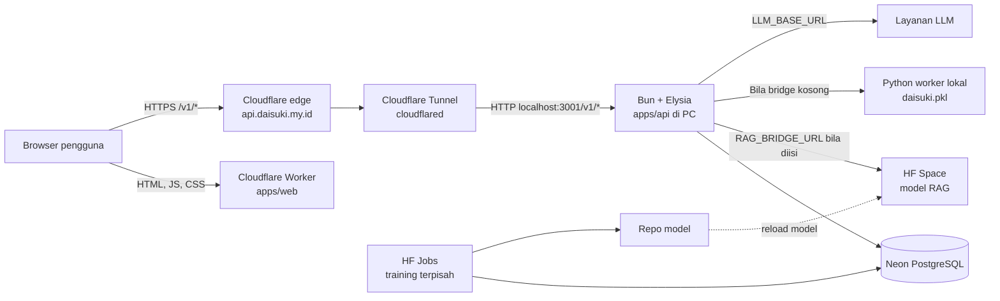

# Deploy Daisuki: Cloudflare Workers + Hugging Face

> Panduan ini menggambarkan rancangan lama yang memakai Cloudflare Tunnel dan Bun di PC. Untuk jalur produksi API Worker tanpa laptop, lihat [DEPLOY_CF_FREE.md](DEPLOY_CF_FREE.md). Rute domain produksi baru aktif setelah konfigurasi Worker diterbitkan.

Panduan ini memisahkan web, API, database, dan layanan model.



**Mengapa dipisah:** Cloudflare Workers adalah runtime V8 tanpa Python, tanpa
filesystem, dan tanpa proses panjang. Model `daisuki.pkl` memerlukan
scikit-learn, dan pipeline training memerlukan filesystem. Keduanya tidak dapat
berjalan di Workers.

Browser memanggil API langsung pada `https://api.daisuki.my.id/v1/<path>`.
Tunnel meneruskan path lengkap ke Bun; ia tidak menghapus `/v1`. API menerima
rute `/v1` dan rute lama selama transisi. Saat ini `RAG_BRIDGE_URL` belum
diisi, sehingga permintaan asisten memakai Python lokal, bukan HF Space.
HF Jobs adalah pekerjaan training terpisah, bukan bagian dari setiap request.

### Jika dashboard production terasa lambat

Pada pemeriksaan 2026-11-21, satu permintaan publik `GET /admin/shipment-logs`
memakan sekitar 6 detik dan `GET /orders` sekitar 2 detik. Angka ini hanya
sampel, sehingga perlu dibandingkan dengan waktu query database dan waktu
respons API lokal sebelum menetapkan penyebab. Di tab Network, matikan
**Preserve log**, muat ulang halaman sekali, lalu urutkan menurut **Duration**.

1. Bandingkan `http://localhost:3001/v1/health` dengan
   `https://api.daisuki.my.id/v1/health`. Selisih yang besar menunjukkan bagian
   jaringan, tunnel, atau koneksi PC yang perlu diperiksa.
2. Untuk endpoint yang lambat, catat waktu tiap query SQL dan jalankan
   `EXPLAIN (ANALYZE, BUFFERS)` pada query tersebut. Periksa lokasi region Neon
   terhadap PC yang menjalankan Bun serta waktu sambungan setelah idle.
3. Pada halaman Log pengiriman, query total dan halaman berjalan bersamaan.
   Langkah berikutnya adalah meninjau indeks `orders.shipped_at` berdasarkan
   hasil `EXPLAIN` dan memuat foto bukti hanya saat pengguna membuka detail.
4. Query utama per tab sudah memakai syarat `enabled`. Periksa request global
   dan invalidasi cache pada event `/events`; ukur apakah perubahan stok
   memuat ulang endpoint yang tidak sedang terlihat. Sesuaikan masa segar
   cache berdasarkan data yang memang perlu langsung diperbarui.
5. Bila kelak model memakai HF Space, ukur waktu respons `/understand` dan
   `/predict` secara terpisah dari dashboard biasa. Space gratis dapat tidur
   ketika tidak dipakai, sehingga permintaan pertama bisa lebih lambat.

---

## Isi berkas dalam folder `deploy/`

| Berkas | Untuk |
|---|---|
| `deploy/hf-space/app.py` | Bridge HTTP (FastAPI) untuk Space |
| `deploy/hf-space/Dockerfile` | Image Space |
| `deploy/hf-space/requirements.txt` | Dependensi Space, sklearn di-pin |
| `deploy/hf-space/README.md` | Frontmatter Space |
| `deploy/hf-train/Dockerfile` | Image HF Jobs |
| `deploy/hf-train/requirements.txt` | Dependensi Jobs |
| `deploy/hf-train/run-pipeline.sh` | Tujuh langkah pipeline + unggah model |
| `deploy/prepare.mjs` | Menyalin berkas dari `ai/` ke folder staging |

`ai/` tetap menjadi satu-satunya sumber kebenaran. `prepare.mjs` menyalin,
tidak pernah menggandakan secara manual.

### Mengapa `daisuki.pkl` tidak ada di folder `deploy/`

Model berukuran sekitar 11 MB dan diabaikan Git, jadi menyalinnya ke folder
`deploy/` akan menghasilkan dua salinan yang bisa menyimpang. `prepare.mjs`
menyalinnya saat dijalankan:

```
deploy/.staging/space/
├── app.py  Dockerfile  requirements.txt  README.md
├── retraining/                          ← 6 modul Python dari ai/retraining
└── data/mainbrain/models/daisuki.pkl    ← model, disalin saat build
```

Urutan pemilihan model di `prepare.mjs` **sama persis** dengan
`activeArtifact("model")` di `apps/api/src/lib/analysis-artifacts.ts`:

1. `DAISUKI_MODEL_PATH` dari environment atau `apps/api/.env`
2. `ai/data/private/runs/<run_id>/daisuki.pkl` bila `active_run.json` ada
3. `ai/data/mainbrain/models/daisuki.pkl` sebagai fallback

Bila urutannya berbeda, Space dapat melayani model yang lebih tua daripada
kontainer API. Skrip mencetak sumber model yang dipilih — periksa keluarannya
agar yakin model yang terunggah memang yang aktif.


---

## FASE 0 — Beresi sebelum deploy

```bash
git add AGENTS.md CLAUDE.md
git commit -m "merge: gabungkan changelog tim dan perubahan asisten"
git push origin main

bun --cwd apps/api run typecheck
bun --cwd apps/web run typecheck
```

Jangan deploy dari working tree yang masih berkonflik.

---

## FASE 1 — HF Space (model hidup)

### 1.1 Pasang CLI dan login

```bash
curl -LsSf https://hf.co/cli/install.sh | bash -s
hf auth login          # token dari huggingface.co/settings/tokens, scope write
hf auth whoami
```

### 1.2 Rakit berkas staging

```bash
bun deploy/prepare.mjs space
```

Skrip mencetak jumlah modul tersalin dan ukuran model. Periksa bahwa tidak ada
modul yang hilang.

### 1.3 Buat Space private

```bash
hf repos create <username>/daisuki-rag \
  --type space --space-sdk docker --private
```

### 1.4 Unggah

```bash
hf upload <username>/daisuki-rag ./deploy/.staging/space . --type space \
  --commit-message "Bridge RAG Daisuki"
```

### 1.5 Buat repo model private

```bash
hf repos create <username>/daisuki-model --type model --private
```

### 1.6 Tambah secret

```bash
# WAJIB. Space menolak start bila kosong atau kurang dari 16 karakter.
hf spaces secrets add <username>/daisuki-rag \
  --secrets BRIDGE_TOKEN=<string-acak>

# Repo model + token agar /reload bisa unduh model terbaru
hf spaces secrets add <username>/daisuki-rag \
  --secrets HF_MODEL_REPO=<username>/daisuki-model
hf spaces secrets add <username>/daisuki-rag \
  --secrets HF_TOKEN=hf_xxxxxxxxxxxx
```

### Peringatan data privat

`daisuki.pkl` memuat dua indeks yang tidak boleh keluar dari Space private:

| Indeks | Perkiraan isi | Sifat |
|---|---|---|
| `retrieval` | ~72 cuplikan dokumen publik | Aman untuk Mitra |
| `analysis_retrieval` | ~644 baris analisis per cabang | **Privat** |
| `raw_pdf_retrieval` | ~387 cuplikan CV, karya ilmiah, jurnal | **Privat** |

`analysis_retrieval` memuat konsumsi, log, kejadian kritis, dan status
pelaporan per cabang mitra. `prepare.mjs` mencetak jumlah dokumen tiap indeks
setiap kali dijalankan — periksa keluarannya dan pastikan Space serta repo
model selalu private.

### 1.7 Tunggu build dan uji

```bash
hf spaces logs <username>/daisuki-rag --build

curl https://<username>-daisuki-rag.hf.space/health \
  -H "Authorization: Bearer <BRIDGE_TOKEN>"
```

Harus mengembalikan `"available": true` dan `"retrieval_ready": true`.
Bila `retrieval_ready` bernilai `false`, model yang diunggah belum memuat
indeks retrieval.

---

## FASE 2 — Kontainer API

`Dockerfile.api` sudah ada di root proyek.

### 2.1 Volume persisten wajib

API menyimpan unggahan resi dan foto profil ke `apps/api/uploads/`
(`apps/api/src/lib/storage.ts`). Tanpa volume persisten, berkas hilang setiap
container restart. Pasang volume pada path `/app/apps/api/uploads`.

### 2.2 Environment

| Variabel | Nilai |
|---|---|
| `DATABASE_URL` | Connection string Neon |
| `WEB_ORIGIN` | Domain web, misal `https://daisuki.pages.dev` |
| `RAG_BRIDGE_URL` | `https://<username>-daisuki-rag.hf.space` |
| `RAG_BRIDGE_TOKEN` | Sama dengan `BRIDGE_TOKEN` Space |
| `LLM_ENABLED` | `true` |
| `LLM_BASE_URL` | Endpoint LLM |
| `LLM_API_KEY` | Kunci LLM |
| `LLM_MODEL` | Nama model |

### 2.3 Jalankan migrasi

Terapkan migrasi di `neon/migrations/` yang belum berjalan, terutama
`20261119_analysis_storage.sql` dan `20261119_stock_recalls.sql`. Siapkan
snapshot database sebelum menjalankan.

### 2.4 Verifikasi

Bila `RAG_BRIDGE_URL` terisi, log API akan menampilkan:

```
[ASSISTANT MODEL] Mode Hugging Face: https://...
[ASSISTANT MODEL] Siap: intent aktif, retrieval biner aktif
```

Tidak boleh ada proses Python yang berjalan di dalam kontainer.

---

## FASE 3 — Web ke Cloudflare Workers

### 3.1 Nama Worker

`apps/web/wrangler.jsonc` memakai nama `daisuki-inventory`. Nama Worker di
dashboard Cloudflare harus sama.

### 3.2 Set `VITE_API_URL` di dashboard Cloudflare

Ini **build-time**, bukan runtime. Nilainya adalah origin API tanpa `/api` di
akhir. API Elysia menyediakan `/auth/login` dan endpoint lain langsung pada
root origin serta `/v1/auth/login` dan endpoint lain pada prefix `/v1`.
Frontend menambahkan `/v1` untuk API publik. Bila nilainya localhost, frontend
memakai proxy Vite lokal `/api`.

```
VITE_API_URL=https://api.daisuki.my.id
```

### 3.3 Build dan deploy

Untuk Cloudflare Workers Builds yang tersambung ke root monorepo, kosongkan
Build command dan isi Deploy command dengan:

```bash
cd apps/web && bun run deploy
```

Perintah ini membangun web dan langsung menjalankan Wrangler dari direktori
yang memuat `wrangler.jsonc`. Jangan gunakan `bun --cwd apps/web run deploy` pada
Workers Builds; pada lingkungan build tersebut perintah itu hanya mencetak
bantuan Bun tanpa menjalankan script.

API tetap harus berjalan terpisah pada host yang mendukung Bun dan volume
persisten untuk unggahan. `apps/api/src/modules/auth/index.ts` memakai
`Bun.password.verify`, sehingga Worker V8 biasa belum dapat melayani login.
Pasang `WEB_ORIGIN=https://daisuki.my.id` pada host API dan uji
`https://api.daisuki.my.id/health` sebelum membangun ulang web.

---

## FASE 4 — Verifikasi end-to-end

Akun demo dari `neon/init.sql` dapat digunakan untuk uji login jika database
khusus demo dipakai. Kredensial demo tersedia di halaman login; jangan arahkan
API publik yang mengaktifkannya ke database berisi data nyata.

| Uji | Harapan |
|---|---|
| Buka web | Halaman login tampil |
| Login sebagai admin | Berhasil, data stok termuat |
| Buka tab Chat AI | Jawaban muncul dengan banner sumber |
| Buka Log & Data | Ringkasan termuat |
| Klik Perbarui analisis Data Science | Draft dibuat, muncul di AI Insights |

Bila data tidak termuat, periksa `VITE_API_URL` dan `WEB_ORIGIN`.

---

## FASE 5 — Training ke HF Jobs (setelah Fase 1-4 stabil)

### 5.1 Rakit dan unggah image

```bash
bun deploy/prepare.mjs train
```

Periksa jumlah PDF. **Tanpa delapan PDF di `ai/data/raw_references/pdf/`,
`build_raw_pdf_index()` gagal dan seluruh training ikut gagal.**

Unggah folder `deploy/.staging/train/` menjadi repo Docker pribadi, atau
bangun image lalu dorong ke registry.

### 5.2 Jalankan job

```bash
hf jobs run <image> \
  --env DAISUKI_ANALYSIS_RUN_ID=<uuid-run> \
  --env DATABASE_URL=<kredensial-ai_job> \
  --env HF_MODEL_REPO=<username>/daisuki-model \
  --env HF_TOKEN=<token-tulis>
```

Gunakan role database `ai_job`, bukan `neondb_owner`. Role owner dapat
menghapus seluruh database.

### 5.3 Muat ulang model

Setelah job selesai dan model terunggah, panggil:

```bash
curl -X POST https://<username>-daisuki-rag.hf.space/reload \
  -H "Authorization: Bearer <BRIDGE_TOKEN>"
```

Space mengunduh `daisuki.pkl` terbaru dari repo model lalu memuatnya ulang.

---

## Batasan yang perlu diketahui

**Space gratis tidur setelah 48 jam tanpa trafik.** Panggilan pertama setelah
tidur memerlukan 30-60 detik. Backend memakai batas 20 detik untuk `/health`
saat warmup dan 8 detik untuk permintaan biasa, sehingga permintaan pertama
setelah tidur akan jatuh ke fallback lokal. Tambahkan ping berkala bila tidak
diinginkan.

**Penyimpanan Space bersifat sementara.** Model hasil training harus diunggah
ke repo model. Karena itu `run-pipeline.sh` memperingatkan bila `HF_MODEL_REPO`
kosong.

**Endpoint proses analisis belum dapat berjalan di Workers.** Pipeline Python
masih memakai `Bun.spawn` dan filesystem sementara di
`apps/api/src/lib/analysis-runs.ts`. Selama Fase 5 belum selesai, jalur ini
memerlukan kontainer.

**Berkas di bawah `ai/data/` yang dibaca TypeScript** — `guardrails/`,
`mega_data_word/`, `corporate_knowledge/`, dan `*.public.md` — masih dibaca
dengan `readFileSync` dan `readdirSync`. Bila API nanti dipindahkan ke Workers,
berkas-berkas tersebut harus dibundel sebagai aset, bukan dibaca dari disk.
