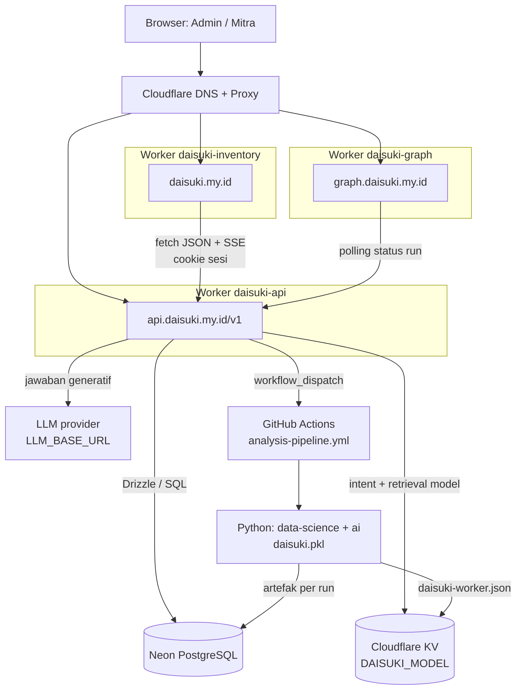
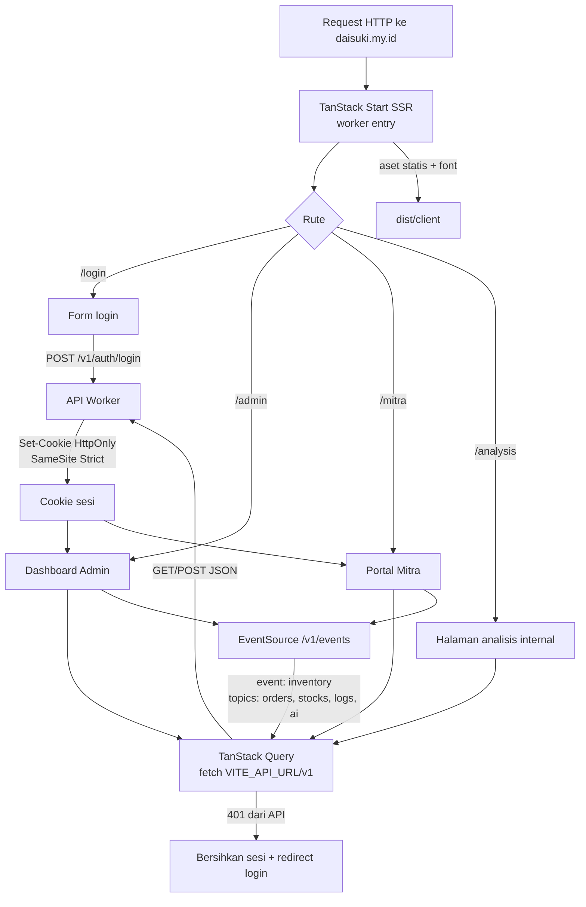
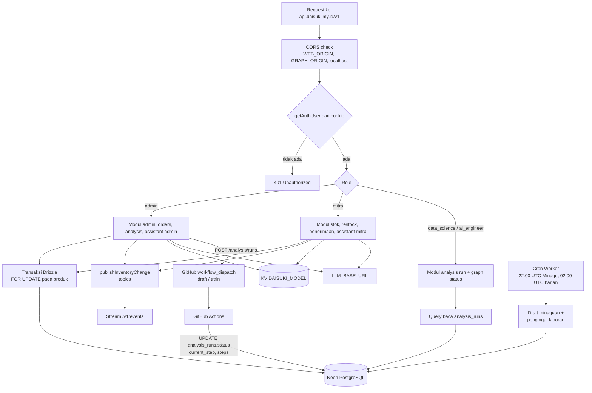
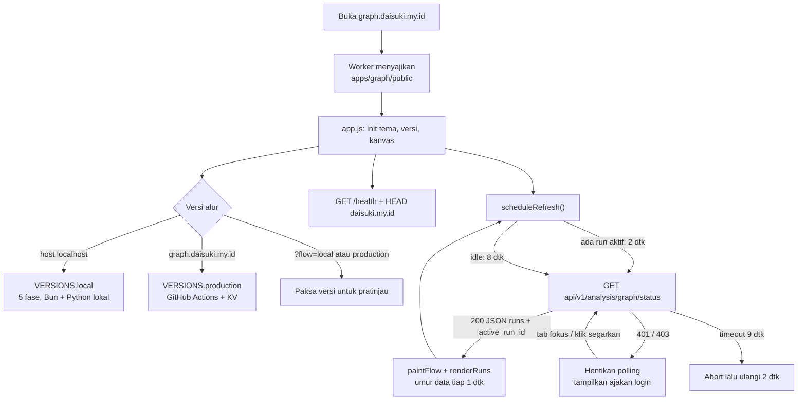
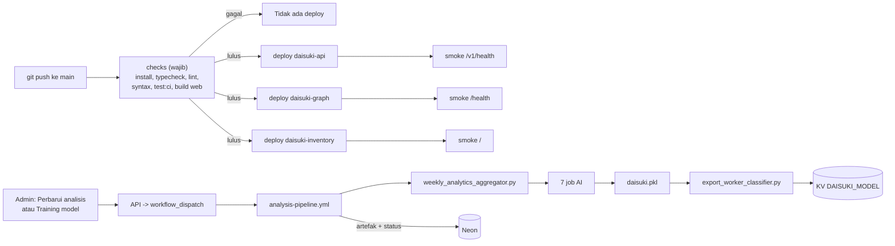

# Flow Sistem per Worker

Dokumen ini memuat diagram Mermaid untuk tiga Worker yang berjalan di Cloudflare:
`daisuki-inventory` (web), `daisuki-api` (backend), dan `daisuki-graph` (monitor).
Semua label memakai istilah yang sama dengan kode di repo.

## 1. Gambaran menyeluruh

## 2. Worker `daisuki-inventory` (web)

Catatan: web tidak pernah menyentuh database. Semua mutasi lewat API (`apps/api`).

## 3. Worker `daisuki-api`

Endpoint yang dipanggil Worker lain: `GET /v1/health`, `GET /v1/analysis/graph/status`,
dan `POST /v1/analysis/runs` (memicu tahap draft).

## 4. Worker `daisuki-graph`

## 5. Pipeline CI/CD dan analisis

## 6. Tabel ringkas per Worker

| Worker | Domain | Tanggung jawab | Sumber data | Dipanggil oleh |
|---|---|---|---|---|
| `daisuki-inventory` | `daisuki.my.id` | SSR TanStack Start, UI Admin dan Mitra, tidak pernah akses DB langsung | API `/v1`, SSE `/v1/events` | Browser |
| `daisuki-api` | `api.daisuki.my.id` | Auth, aturan bisnis, mutasi stok dan pesanan, analysis run, assistant, cron, SSE | Neon, KV `DAISUKI_MODEL`, LLM | Web, Graph, Browser (langsung untuk Graph) |
| `daisuki-graph` | `graph.daisuki.my.id` | Dashboard pipeline: aset statis, `/health`, polling status run | API `/v1/analysis/graph/status` | Browser |
