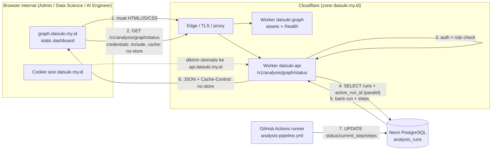
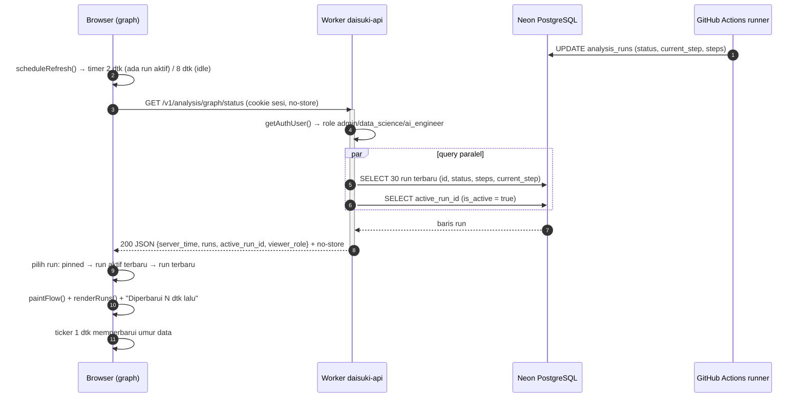
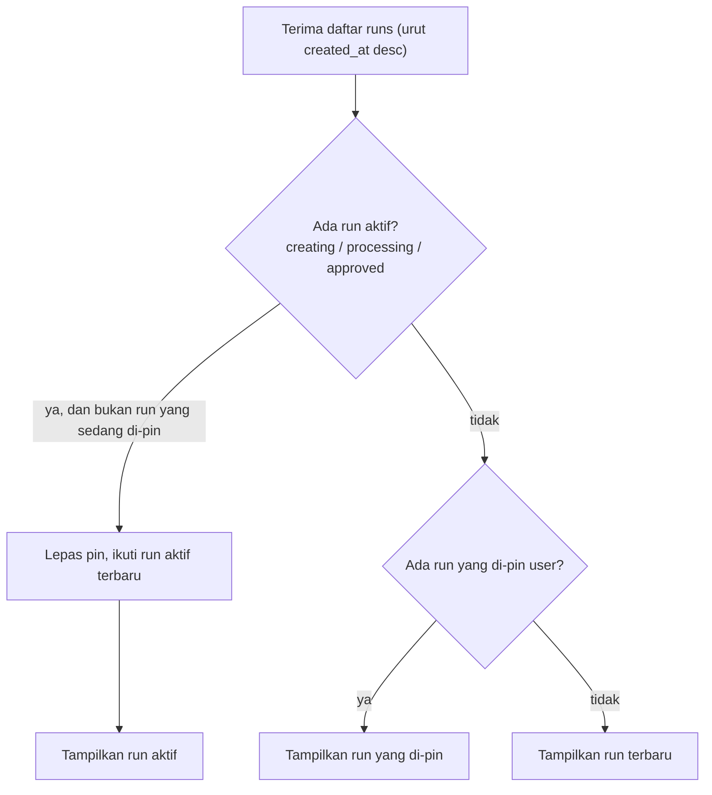
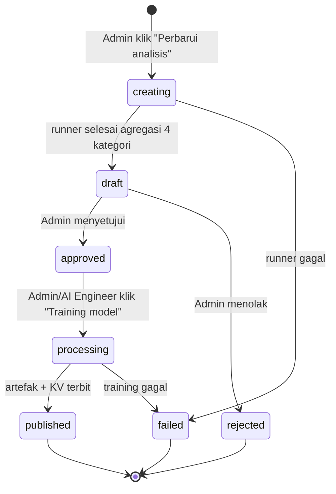
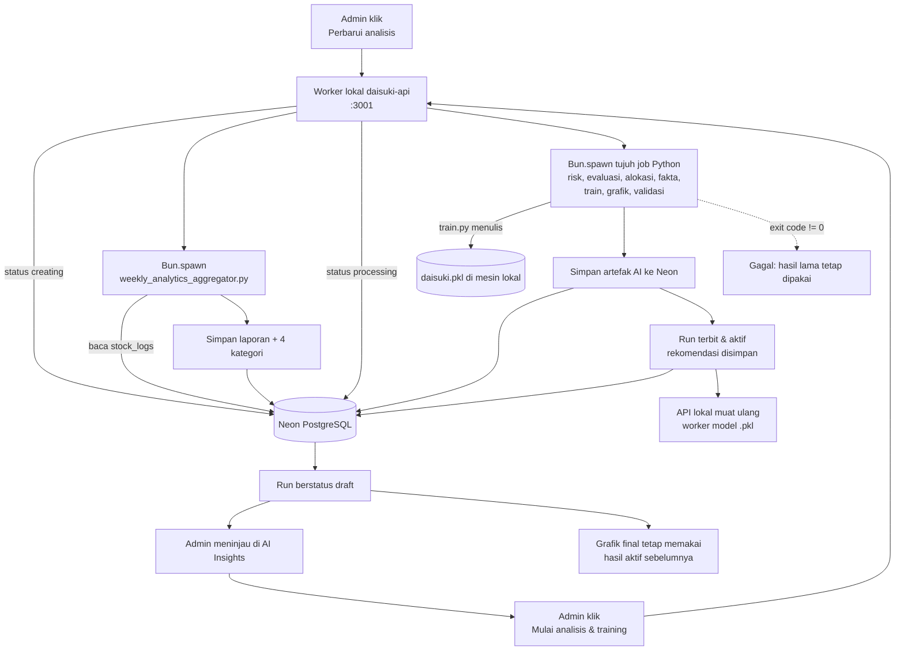
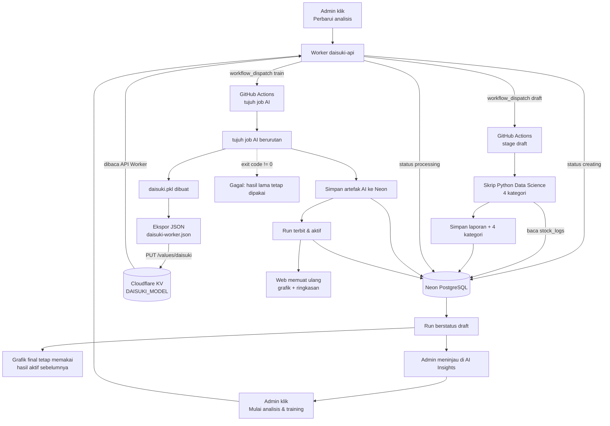

# Alur Realtime Status Analisis (Graph → API)

Dokumen ini menjelaskan bagaimana `graph.daisuki.my.id` mengambil status run analisis
secara realtime dari `api.daisuki.my.id`, termasuk penyebab status terlihat "telat",
dan apa yang diubah agar tidak ada jeda yang terasa.

## 1. Arsitektur permintaan

Catatan: Worker `daisuki-graph` **tidak** mem-proxy API. Halaman statis memanggil
`https://api.daisuki.my.id/v1` langsung (dev: `http://localhost:3001/v1`), sehingga
yang menentukan kesegaran data hanya polling browser → API → Neon.

## 2. Urutan permintaan realtime

## 3. Aturan pemilihan run di dashboard

Pin dilepas otomatis hanya bila muncul run aktif yang **lebih baru**, supaya saat
Admin menekan *Perbarui analisis* dashboard langsung pindah ke run baru tanpa klik,
tetapi inspeksi run lama yang sudah selesai tetap bisa dilakukan.

## 4. Siklus status run yang ditampilkan

## 5. Parameter waktu

| Parameter | Nilai | Arti |
|---|---|---|
| `REFRESH_ACTIVE_MS` | 2000 ms | Polling saat ada run `creating`/`processing`/`approved` |
| `REFRESH_IDLE_MS` | 8000 ms | Polling saat semua run sudah selesai |
| `REFRESH_TIMEOUT_MS` | 9000 ms | Batas satu permintaan; lewat dari ini di-abort lalu diulang |
| Ticker umur data | 1000 ms | Memperbarui teks "Diperbarui N dtk lalu" tanpa request baru |
| `checkServices()` | 30000 ms | Cek `/health` API dan reachability web |
| Tab tersembunyi | — | Polling dihentikan; langsung `refresh()` saat tab kembali terlihat |

Loop memakai `setTimeout` berantai, bukan `setInterval`, sehingga satu permintaan
lambat **tidak** menahan antrean berikutnya (penyebab tampilan "beku lalu melompat").
Tombol segarkan membatalkan permintaan yang sedang berjalan sebelum memulai yang baru.

## 6. Kenapa dulu terasa delay

1. **Interval tetap 5 dtk + guard `refreshInFlight`.** Permintaan yang lambat (cold start
   Worker, latensi Neon) membuat tick berikutnya dilewati, jadi UI diam lalu melompat.
2. **Dua query berurutan** pada endpoint status (`SELECT runs` lalu `active_run_id`)
   menambah satu round trip setiap polling.
3. **Tidak ada batas waktu request**, jadi kegagalan jaringan bisa menggantung lama.
4. **Urutan tahap hanya di-update runner** di batas tahap (GitHub Actions queue bisa
   10–60 dtk sebelum job mulai). Selama masa itu `status` masih `creating`; ini delay
   nyata dari pipeline, bukan dari dashboard.

Perbaikan: polling adaptif 2 dtk/8 dtk, query paralel, `AbortController` 9 dtk,
`Cache-Control: no-store` pada `/graph/status`, umur data berjalan tiap detik, dan
auto-follow run aktif terbaru.

## 7. Referensi kode

- `apps/graph/public/app.js` — `VERSIONS`, `refresh()`, `scheduleRefresh()`, `formatRelative()`, `REFRESH_*`.
- `apps/api/src/modules/analysis/index.ts` — handler `GET /analysis/graph/status`.
- `apps/api/src/realtime.ts` — SSE `/events` (topik inventori, bukan untuk pipeline).
- `apps/graph/src/index.ts` — Worker aset statis + `/health` + CSP dev.

## 8. Dua versi alur di kanvas

Kanvas punya sakelar **Lokal / Produksi**. Keduanya membaca `analysis_runs` yang sama;
perbedaannya hanya siapa yang menjalankan Python dan bagaimana model didistribusikan.

### 8.1 Alur lokal (`bun run dev`)

Tidak ada GitHub Actions, tidak ada ekspor JSON, dan tidak ada Cloudflare KV: API lokal
membaca `daisuki.pkl` langsung dari folder artefak run lalu memuat ulang worker model.

### 8.2 Alur produksi (`api.daisuki.my.id`)

Di produksi, API Worker tidak menjalankan Python; ia hanya mengirim `workflow_dispatch`
ke GitHub Actions dan membaca model hasil publikasi KV.
