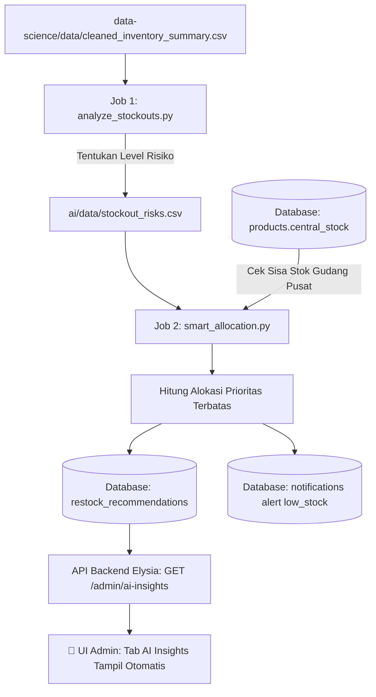

# 🤖 Panduan Alur & Cara Kerja: Role AI Engineer
## Fokus: Tab **AI Insights** (`admin` dashboard) & Alokasi Stok Cerdas

> **Tujuan Dokumen:**  
> Panduan ini menjelaskan secara terstruktur dan mudah dimengerti alur kerja peran **AI Engineer** dalam ekosistem Daisuki Inventory: bagaimana data hasil olahan Data Science diubah menjadi prioritas risiko darurat, rekomendasi kuantitas restock pintar dengan kendala stok gudang pusat, serta tampilannya pada Tab **AI Insights** di Dashboard Admin.

---

## 1. Peran AI Engineer dalam Sekilas

| Pertanyaan Kunci | *"Cabang mitra mana yang paling darurat kehabisan stok, dan berapa jumlah barang yang disarankan untuk dikirim dari gudang pusat?"* |
|---|---|
| **Lokasi Kerja di UI** | Dashboard Admin ➔ Tab **AI Insights** (ikon chip / sirkuit otak) |
| **Lokasi Kode di Repo** | Folder `ai/` (`jobs/smart_allocation.py`, `jobs/analyze_stockouts.py`, `assistant/`, `bot/`) |
| **Input Utama** | `data-science/data/cleaned_inventory_summary.csv` & Ready Stock Gudang Pusat di Database |
| **Output Utama** | Tabel Database `restock_recommendations`, tabel `notifications`, dan ringkasan risiko di UI |

### 💡 Analogi Sederhana:
> Jika Data Science adalah **"Petugas Medis yang membaca hasil tes darah & detak jantung"** (menghitung angka konsumsi),  
> maka AI Engineer adalah **"Dokter IGD (Instalasi Gawat Darurat)"**:  
> * Memutuskan siapa pasien yang **paling gawat dan harus ditolong duluan** (Triage Klasifikasi Risiko).  
> * Mengatur **jatah obat/oksigen yang terbatas di rumah sakit** agar dibagi secara adil dan tepat sasaran ke pasien yang paling membutuhkan (Smart Allocation).

---

## 2. Mengenal Tab "AI Insights" di Tampilan Admin

Ketika Admin Daisuki Pusat membuka tab **AI Insights**, layar menyajikan 2 tabel kecerdasan analitik:

```
┌─────────────────────────────────────────────────────────────────────────────────────┐
│  Perencanaan stok                                                                   │
│  AI Insights                                       [ ⏱ Diperbarui otomatis · 15d ]  │
│  Cabang berisiko dan alokasi yang disarankan                                        │
├─────────────────────────────────────────────────────────────────────────────────────┤
│ 🚨 TABEL 1: MITRA SERING KEHABISAN BARANG (FREQUENT STOCKOUTS)                      │
│ Menampilkan cabang yang stoknya < 20% par atau pernah kritis dalam 30 hari.        │
│ ┌───────────────┬──────────────────────┬────────────┬─────────────┬───────────────┐ │
│ │ Cabang        │ Produk               │ Stok / Par │ Log Kritis  │ Kondisi       │ │
│ ├───────────────┼──────────────────────┼────────────┼─────────────┼───────────────┤ │
│ │ Kopken Duta   │ Seblak Jadul Instan  │ 8 / 100    │ 14 kali     │ [🔴 Kritis]   │ │
│ │ Kafe Senja    │ Basreng Daun Jeruk   │ 11 / 80    │ 9 kali      │ [🔴 Kritis]   │ │
│ └───────────────┴──────────────────────┴────────────┴─────────────┴───────────────┘ │
├─────────────────────────────────────────────────────────────────────────────────────┤
│ 📦 TABEL 2: REKOMENDASI ALOKASI PENGIRIMAN (SMART ALLOCATION)                       │
│ Saran jumlah unit yang harus dikirim dengan mempertimbangkan ready stock pusat.     │
│ ┌───────────────┬──────────────────────┬────────────┬───────────┬─────────────────┐ │
│ │ Cabang        │ Produk               │ Disarankan │ Cakupan   │ Prioritas       │ │
│ ├───────────────┼──────────────────────┼────────────┼───────────┼─────────────────┤ │
│ │ Kopken Duta   │ Seblak Jadul Instan  │ 80 pcs     │ 1.2 hari  │ [🔴 Darurat]    │ │
│ │ Minimarket A  │ Keripik Pisang Coklat│ 45 pcs     │ 3.5 hari  │ [🟡 Terjadwal]  │ │
│ └───────────────┴──────────────────────┴────────────┴───────────┴─────────────────┘ │
└─────────────────────────────────────────────────────────────────────────────────────┘
```

---

## 3. Alur Kerja Lengkap AI Engineer (Step-by-Step)



---

## 4. Dua Logika Inti di Balik AI Insights

### Logika 1: Klasifikasi Tingkat Risiko (`analyze_stockouts.py`)
Skrip membaca sisa hari aman (`days_of_cover`) dan rasio sisa stok terhadap kapasitas rak (`par_level`):

```python
def classify(row):
    cover = float(row["days_of_cover"])
    qty = int(row["current_qty"])
    par = int(row["par_level"])

    # 1. RISIKO TINGGI (DARURAT): Stok bertahan < 2 hari ATAU fisik < 20% par level
    if cover < 2 or (par > 0 and qty < par * 0.2):
        return "HIGH_STOCKOUT_RISK"

    # 2. RISIKO SEDANG (TERJADWAL): Stok bertahan antara 2 hingga 4 hari
    if cover <= 4:
        return "MODERATE_RISK"

    # 3. AMAN: Stok masih cukup untuk > 4 hari ke depan
    return "SAFE"
```

---

### Logika 2: Alokasi Stok Cerdas & Realistis (`smart_allocation.py`)
Masalah klasik di lapangan adalah: **Cabang mitra ingin restock banyak, tetapi stok di gudang pusat Daisuki terbatas!**

AI Engineer memecahkan masalah ini dengan algoritma alokasi prioritas:

1. **Urutkan Cabang Berdasarkan Kegawatan (*Triage Ranking*)**:
   Cabang dengan label `HIGH_STOCKOUT_RISK` dan `days_of_cover` terkecil diproses paling pertama.
2. **Hitung Kebutuhan Ideal Cabang (*Demand*)**:
   $$\text{Demand} = \max(0, \text{Par Level} - \text{Stok Fisik Saat Ini} + \text{Safety Stock})$$
3. **Cek Ketersediaan Gudang Pusat (*Fair Constraint Allocation*)**:
   Saran pengiriman tidak boleh melebihi ready stock gudang pusat (`central_stock`):
   $$\text{Suggested Qty} = \min(\text{Demand}, \text{Central Stock Tersisa})$$
4. **Kurangi Stok Simulasi Pusat**:
   Setelah cabang darurat dialokasikan, sisa stok pusat dikurangi sebelum menghitung alokasi untuk cabang berikutnya yang prioritasnya lebih rendah.
5. **Simpan ke Database & Notifikasi**:
   * Data disimpan ke tabel `restock_recommendations`.
   * Jika ada cabang `HIGH_STOCKOUT_RISK` dengan saran pengiriman > 0, sistem otomatis membuatkan notifikasi `low_stock` ke Admin Daisuki.

---

## 5. Fitur Tambahan AI Engineer di Repository

Selain job rekomendasi restock di atas, tim AI Engineer juga mengembangkan modul pelengkap:

1. **Pengingat Cabang Pasif (`ai/jobs/stale_stock_reminder.py`)**:
   Mendeteksi cabang yang belum memperbarui stok fisik rak dalam > 24 jam dan membuatkan reminder otomatis.
2. **Alert Restock Darurat (`ai/jobs/emergency_restock_alert.py`)**:
   Peringatan cepat untuk stok cabang yang menyentuh angka kritis ≤ 10 pcs.
3. **Asisten Cerdas Admin (`ai/assistant/`)**:
   Integrasi LLM berbasis *Function / Tool Calling* yang dapat menjawab pertanyaan Admin seputar kondisi stok cabang tanpa query SQL manual.
4. **Prototipe Chatbot Telegram (`ai/bot/`)**:
   Eksperimen agar mitra dapat melapor sisa stok hanya dengan mengetik pesan di aplikasi chat.

---

## 6. Cara Menjalankan Pipeline AI Engineer (Panduan Praktis)

Jalankan perintah ini di terminal PowerShell:

```powershell
# 1. Masuk ke direktori ai
cd ai

# 2. Aktifkan Virtual Environment Python
.venv\Scripts\Activate.ps1

# 3. Pastikan dependensi terpasang
pip install -r requirements.txt

# 4. Pastikan file ai/.env sudah terisi DATABASE_URL (role ai_job atau admin)

# 5. Jalankan analisis risiko kehabisan barang
python jobs/analyze_stockouts.py

# 6. Jalankan kalkulasi rekomendasi alokasi ke database
python jobs/smart_allocation.py
```

Setelah script selesai:
```text
Analisis risiko: 48 baris; {'HIGH_STOCKOUT_RISK': 12, 'MODERATE_RISK': 18, 'SAFE': 18}
Rekomendasi upsert: 48; versi model: v1.0-ai-allocation
```
Buka browser Anda di `http://localhost:3000/admin`, klik tab **AI Insights**, maka seluruh tabel rekomendasi dan cabang kritis akan langsung terisi secara realtime!
