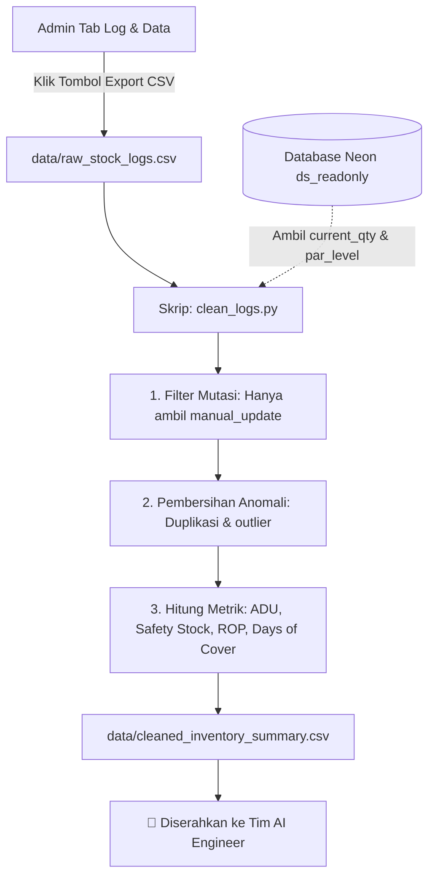

# 📊 Panduan Alur & Cara Kerja: Role Data Science
## Fokus: Tab **Log & Data** (`admin` dashboard) & Pemodelan Inventaris

> **Tujuan Dokumen:**  
> Panduan ini dibuat agar seluruh anggota tim dapat memahami secara mudah dan jelas peran **Data Science** dalam sistem inventaris Daisuki: mulai dari data apa yang dilihat di Dashboard Admin, bagaimana data tersebut diolah, rumus matematika yang dipakai, hingga output apa yang diserahkan ke tim AI Engineer.

---

## 1. Peran Data Science dalam Sekilas

| Pertanyaan Kunci | *"Seberapa cepat produk habis di masing-masing cabang, dan kapan cabang harus memesan lagi?"* |
|---|---|
| **Lokasi Kerja di UI** | Dashboard Admin ➔ Tab **Log & Data** (ikon database) |
| **Lokasi Kode di Repo** | Folder `data-science/` (`notebooks/`, `src/clean_logs.py`, `data/`) |
| **Input Utama** | `raw_stock_logs.csv` (hasil ekspor dari Tab Log & Data) atau koneksi Neon DB `ds_readonly` |
| **Output Utama** | `cleaned_inventory_summary.csv` (data ringkas siap latih & siap pakai untuk AI) |

### 💡 Analogi Sederhana:
> Bayangkan cabang mitra seperti mobil yang sedang berjalan.  
> * **Stok fisik** = sisa bensin di tangki.  
> * **Tugas Data Science** = menghitung *kecepatan konsumsi bensin per kilometer* (ADU), memperkirakan *kapan tangki akan habis* (Days of Cover), dan menentukan *kapan indikator bensin harus berkedip agar tidak mogok di tengah jalan* (Reorder Point & Safety Stock).

---

## 2. Mengenal Tab "Log & Data" di Tampilan Admin

Ketika membuka tab **Log & Data** di web portal Admin Daisuki, Anda akan melihat antarmuka yang dirancang khusus untuk memantau perilaku pencatatan stok cabang:

```
┌────────────────────────────────────────────────────────────────────────┐
│  Analisis stok                                                         │
│  Log & Data                                       [ 📥 Export CSV ]    │
│  Perkembangan laporan dan konsumsi stok · 7 hari terakhir              │
├────────────────────┬──────────────────────┬────────────────────────────┤
│ Total Log Minggu Ini│ Mitra Aktif Melapor  │ Rata-rata Konsumsi Harian  │
│      142 log       │      12 / 12         │         38.4 pcs           │
├────────────────────┴──────────────────────┴────────────────────────────┤
│ 📅 Laporan Harian (Grafik Keaktifan Laporan Mitra per Hari)            │
│ 📋 Riwayat Log Perubahan Stok per Cabang (Bisa difilter per mitra)     │
└────────────────────────────────────────────────────────────────────────┘
```

### Apa Fungsi Fitur di Tab Ini?
1. **Kartu Metrik Utama**:
   * **Total Log Minggu Ini**: Jumlah pembaruan stok fisik yang berhasil masuk ke sistem dari seluruh cabang mitra.
   * **Mitra Aktif Melapor**: Berapa cabang yang tertib mengirimkan laporan stok dalam 7 hari terakhir.
   * **Rata-rata Konsumsi Harian**: Estimasi total produk yang terjual/berkurang di seluruh jaringan per hari.
2. **Tombol "Export CSV"**:
   * Tombol ini mengunduh seluruh transaksi riwayat mutasi stok menjadi file mentah bernama `raw_stock_logs.csv`. File inilah yang menjadi **bahan bakar utama pekerjaan tim Data Science**.

---

## 3. Alur Kerja Lengkap Data Science (Step-by-Step)



---

## 4. Rumus dan Metrik yang Dihitung Data Science

Dalam file `data-science/src/clean_logs.py`, Data Science menghitung 4 metrik penting untuk setiap kombinasi **Cabang + Produk**:

### 1. Membedakan Jenis Mutasi Log Stok
Tidak semua mutasi stok berarti barang terjual:
* `manual_update`: Mitra menghitung fisik rak toko (misal: dari 100 pcs sisa 92 pcs = **8 pcs terjual / konsumsi**). Ini yang dihitung sebagai pemakaian.
* `order_received`: Barang kiriman dari pabrik Daisuki tiba (misal: stok bertambah +50 pcs). Ini **bukan konsumsi**, melainkan pasokan masuk (*restock*).

### 2. Average Daily Usage (ADU) — Laju Konsumsi Harian
Berapa rata-rata bungkus makanan yang terjual dalam satu hari di cabang tersebut:
$$\text{ADU} = \frac{\text{Total Unit Terkonsumsi}}{\text{Rentang Hari Observasi}}$$
*Contoh:* Dalam 7 hari, Seblak terjual 35 pcs di Cabang Kafe Senja. Maka $\text{ADU} = \frac{35}{7} = 5\text{ pcs/hari}$.

### 3. Days of Cover (DoC) — Berapa Hari Stok Bertahan
Estimasi waktu sebelum stok di rak cabang benar-benar habis jika tidak ada pengiriman baru:
$$\text{Days of Cover} = \frac{\text{Stok Fisik Saat Ini (Current Qty)}}{\text{ADU}}$$
*Contoh:* Sisa Seblak di rak adalah 15 pcs, sedangkan ADU = 5 pcs/hari. Maka $\text{DoC} = \frac{15}{5} = 3\text{ hari}$.

### 4. Safety Stock (SS) — Stok Pengaman
Penyangga untuk mengantisipasi lonjakan pembeli mendadak atau keterlambatan pengiriman pabrik (Daisuki mengasumsikan *Lead Time* pengiriman pabrik adalah **6 hari**):
$$\text{Safety Stock} = Z \times \sqrt{\text{Lead Time}} \times \sigma_{\text{demand}}$$
*Secara sederhana pada baseline:* Menjamin stok cukup untuk menahan fluktuasi selama 5–7 hari lead time.

### 5. Reorder Point (ROP) — Batas Pemesanan Ulang
Titik kritis di mana cabang **wajib memesan restock** ke pabrik sebelum stok menyentuh nol:
$$\text{ROP} = (\text{ADU} \times \text{Lead Time}) + \text{Safety Stock}$$
Jika stok fisik menyentuh ROP, cabang harus segera restock!

---

## 5. Struktur Data Output (`cleaned_inventory_summary.csv`)

File output yang dihasilkan oleh script `clean_logs.py` memiliki kolom standar:

| Nama Kolom | Contoh Nilai | Keterangan |
|---|---|---|
| `partner_id` | `uuid-mitra-01` | ID unik cabang mitra |
| `partner_name` | `Kopken Duta` | Nama cabang mitra |
| `product_id` | `uuid-seblak` | ID produk resmi Daisuki |
| `product_name` | `Seblak Jadul Instan` | Nama produk Daisuki |
| `current_qty` | `18` | Sisa fisik di rak saat ini (pcs) |
| `par_level` | `100` | Kapasitas maksimal rak cabang (pcs) |
| `adu` | `4.2` | Konsumsi rata-rata per hari (pcs/hari) |
| `safety_stock` | `12` | Jumlah stok pengaman minimum (pcs) |
| `rop` | `37` | Batas stok untuk pesan ulang (pcs) |
| `days_of_cover` | `4.3` | Stok cukup untuk berapa hari ke depan |

---

## 6. Cara Menjalankan Pipeline Data Science (Panduan Praktis)

Buka terminal PowerShell di folder proyek Daisuki:

```powershell
# 1. Masuk ke direktori data-science
cd data-science

# 2. Aktifkan Virtual Environment Python
.venv\Scripts\Activate.ps1

# 3. Pastikan dependensi terpasang
pip install -r requirements.txt

# 4. Siapkan file data mentah
# Opsi A: Unduh dari Tab "Log & Data" di Web, simpan sebagai data/raw_stock_logs.csv
# Opsi B: Isi DATABASE_URL di data-science/.env (role ds_readonly)

# 5. Jalankan skrip pembersihan & kalkulasi
python src/clean_logs.py
```

Setelah berhasil dijalankan, terminal akan mencetak konfirmasi:
```text
Ringkasan inventaris bersih ditulis ke data-science/data/cleaned_inventory_summary.csv
```
File ini sekarang **siap diolah oleh tim AI Engineer**.
