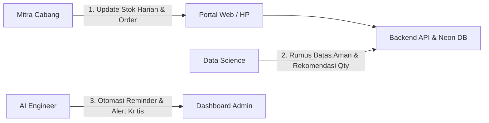

# Pembagian Tugas Tim — Daisuki Inventory (Versi Praktis & Terarah)

## 1. Ringkasan Proyek

Daisuki Inventory adalah sistem inventaris dan pemesanan barang B2B yang praktis antara **Admin Daisuki Pusat** dan **Mitra Cabang** (hotel, kafe, resto, minimarket).

**Masalah utama yang diselesaikan:**
- Stok di cabang sering habis mendadak karena pencatatan manual via WhatsApp/Excel.
- Admin kesulitan memantau cabang mana yang stoknya sudah menipis (kritis).
- Mitra sering telat lapor stok harian atau telat pesan barang restock.

---

## 2. Anggota & Peran

| Peran | Anggota | Fokus Utama |
|---|---|---|
| **Fullstack Developer** | Frisca Nabilla, Hudzaifah Ar-Rantisi | Membangun aplikasi web, API backend, database, dan antarmuka pengguna |
| **Data Science** | Adelia Juliani, Keyla Farrelia | Analisis data stok/penjualan mitra, hitung batas aman stok, dan buat data dummy |
| **AI Engineer** | Annura Rizkya Chantika, Reyhan Fawwaz Habibi | Otomasi alert/reminder stok, serta asisten/bot praktis untuk admin & mitra |

---

## 3. Alur Kerja Sederhana

---

## 4. Pembagian Tugas Praktis per Peran

### 1. Fullstack Developer (Inti Sistem & Aplikasi)
> **Tujuan:** Membuat web yang gampang dipakai mitra di HP dan dashboard admin di desktop.

- **Frontend (Web):**
  - **Portal Mitra (Mobile Friendly):**
    - Halaman input stok fisik harian (cepat & mudah via HP).
    - Halaman pengajuan order restock barang baru.
    - Tombol konfirmasi "Barang Diterima" saat restock tiba (stok otomatis bertambah).
  - **Dashboard Admin (Desktop):**
    - Tabel monitoring stok cabang realtime dengan indikator warna:
      - 🟢 **Aman** (Stok > 50%)
      - 🟡 **Waspada** (Stok 20% - 50%)
      - 🔴 **Kritis** (Stok < 20%)
      - ⚪ **Belum Update** (> 24 jam belum lapor)
    - Halaman approval order mitra (Setujui / Tolak / Kirim).
- **Backend & Database:**
  - REST API (ElysiaJS + Neon DB) untuk mencatat:
    - Input & output stok (`stock_logs`).
    - Alur status order: `diproses` ➔ `disetujui` ➔ `dalam_pengiriman` ➔ `selesai`.
  - Autentikasi login aman (Admin vs Mitra).

---

### 2. Data Science (Analisis Data & Batas Stok)
> **Tujuan:** Membantu admin menentukan angka batas aman stok dan menganalisis produk yang paling laku.

- **Data Dummy / Sintetis:**
  - Membuat data simulasi transaksi dan pergerakan stok 5 produk Daisuki untuk bahan pengujian sistem.
- **Analisis Pola Konsumsi Cabang:**
  - Menghitung rata-rata penjualan per produk per cabang (misal: Kafe A rata-rata habis 5 pcs keripik/hari).
- **Penentuan Batas Stok (Par Level & Safety Stock):**
  - Merumuskan batas minimal stok per cabang dengan memperhitungkan waktu produksi pabrik (lead time 5–7 hari), agar mitra tidak kehabisan barang sebelum restock tiba.
- **Laporan Ringkas:**
  - Menyediakan insight produk *Fast-Moving* (cepat habis) vs *Slow-Moving* (jarang laku).

---

### 3. AI Engineer (Otomasi, Alert & Asisten)
> **Tujuan:** Membuat sistem bekerja otomatis tanpa admin harus mengecek layar terus-menerus.

- **Sistem Alert Otomatis (Notifikasi):**
  - Trigger alert instan ke admin saat ada cabang yang stoknya menyentuh status **Kritis (< 20%)**.
  - Notifikasi saat ada order baru yang masuk dari mitra.
- **Scheduler Reminder Stok:**
  - Script otomatis untuk mendeteksi cabang yang belum lapor stok lebih dari 24 jam dan membuat reminder otomatis.
- **Rekomendasi Jumlah Restock (Smart Restock):**
  - Mengisi rekomendasi jumlah restock otomatis saat mitra membuka formulir order (berdasarkan rata-rata konsumsi dari tim Data Science).
- **Asisten AI Admin (Opsional / Nilai Tambah):**
  - Chat asisten sederhana di dashboard (misal: *"Cabang mana yang stoknya kritis hari ini?"* atau *"Berapa keripik yang terjual minggu ini?"*).

---

## 5. Ringkasan Fitur Utama (Fokus Selesai)

1. **Update Stok Fisik:** Mitra lapor stok harian dengan cepat dari HP.
2. **Monitoring Stok:** Admin melihat status stok semua cabang dalam satu tabel warna.
3. **Alert Kritis:** Notifikasi langsung berbunyi/muncul saat stok cabang hampir habis.
4. **Order Restock Sederhana:** Mitra minta barang ➔ Admin setujui & kirim ➔ Mitra konfirmasi terima (stok otomatis nambah).
5. **Reminder 24 Jam:** Peringatan otomatis bagi mitra yang lupa update stok.
