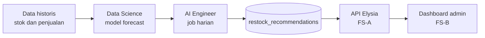

# Pembagian Tugas Tim — Daisuki Inventory

## 1. Ringkasan

Proyek capstone ini membangun sistem inventaris B2B terintegrasi untuk Daisuki Snack & Food (PT Yan Group Gfs). Masalah klien: stok di tempat mitra tidak terlihat realtime (cek manual lewat WhatsApp dan Excel), restock sering terlambat atau salah jumlah (stok habis Rabu atau Kamis padahal restock hari Minggu), dan pabrik tidak pasti (1000 pcs bisa selesai 5 sampai 7 hari).

Tim **Fullstack** membangun inti sistem (inventory dan order). Tim **Data Science** dan **AI Engineer** membangun lapisan kecerdasan di atasnya: prediksi dan rekomendasi restock, asisten, dan otomasi.

Dokumen acuan: `docs/alursistem.md`, `docs/design_system.md`, dan `SETUP.md`.

## 2. Anggota dan role

| Role | Nama | Pembagian A/B |
|---|---|---|
| Fullstack developer | Frisca Nabilla, Hudzaifah Ar-Rantisi | (isi: siapa FS-A backend, siapa FS-B frontend) |
| Data science | Adelia Juliani, Keyla Farrelia | (isi: DS-A, DS-B) |
| AI engineer | Annura Rizkya Chantika, Reyhan Fawwaz Habibi | (isi: AI-A, AI-B) |

> Catatan: pembagian role per nama disimpulkan dari kode ID di notulensi (FS/DS/AE). **Cek ulang kebenaran role per nama.**

## 3. Alur kerja antar-role



## 4. Tugas per role

### Fullstack

**FS-A (backend dan data)**
- [ ] Skema database, RLS, dan seed data di Supabase
- [ ] API Elysia: auth guard, update stok, order dan approval, alert kritis, cron reminder stok basi
- [ ] Tabel `restock_recommendations` dan endpoint `GET /admin/reports/forecast`
- [ ] Keamanan: CORS, env, isolasi data per mitra
- [ ] Deploy API

**FS-B (frontend dan UX)**
- [ ] Portal Mitra: update stok, ajukan restock, riwayat
- [ ] Dashboard Admin: ringkasan realtime, panel alert, approval order, laporan
- [ ] Design system, komponen Rak Bar, Supabase Realtime
- [ ] Menampilkan rekomendasi restock dari DS di dashboard admin

**Bersama**
- [ ] Integrasi, testing, deploy web

### Data Science
- [ ] Minta dan audit data riwayat stok dan penjualan dari klien, bersihkan, lalu EDA (pola mingguan, produk fast dan slow moving, perbedaan antar mitra)
- [ ] Buat dataset sintetis sebagai cadangan jika data asli sedikit
- [ ] Forecast permintaan per mitra per produk: mulai dari baseline (moving average, seasonal naive), model lanjutan hanya jika data cukup; ukur dengan WAPE atau MAPE
- [ ] Rekomendasi par level dan safety stock memakai variasi permintaan dan lead time pabrik 5 sampai 7 hari (menjawab par level yang belum ditentukan klien)
- [ ] Prediksi risiko stok habis (days of cover)
- [ ] Deteksi anomali (stok naik tanpa order, update tidak wajar, mitra lama tidak update)
- [ ] Definisi metrik dan query laporan: penjualan per mitra, frekuensi restock, KPI sebelum vs sesudah sistem
- [ ] Output: notebook, model, dokumen metodologi, hasil prediksi sesuai kontrak data

### AI Engineer
- [ ] Serving model DS sebagai job harian (batch) yang menulis ke tabel `restock_recommendations`
- [ ] Asisten admin (LLM + tool calling) yang hanya memanggil endpoint API read-only, tidak menjalankan SQL bebas
- [ ] Input stok lewat chat (prototype Telegram dulu): parsing pesan seperti "sisa basreng 12, keripik 20", minta konfirmasi sebelum menyimpan
- [ ] Ringkasan mingguan otomatis untuk direktur (stok kritis, rekomendasi restock, performa mitra)
- [ ] Evaluasi dan guardrail: tes akurasi parsing, batasi akses data per mitra, API key hanya di server
- [ ] Monitoring ringan: log prediksi, cek akurasi, jadwal retraining
- [ ] Stretch (opsional): hitung stok dari foto rak

## 5. Kontrak data antar-role

Struktur tabel ini disepakati bersama dan sudah ada di `supabase/migrations/0002_restock_recommendations.sql`:

```sql
create table restock_recommendations (
  id uuid primary key default gen_random_uuid(),
  partner_id uuid not null references partners(id),
  product_id uuid not null references products(id),
  forecast_qty integer not null,
  suggested_qty integer not null,
  days_of_cover numeric(5,1),
  model_version text not null,
  generated_at timestamptz not null default now()
);
```

> Perubahan struktur tabel ini harus disepakati FS-A, Data Science, dan AI Engineer terlebih dahulu.

## 6. Fase kerja

- **Fase 1:** Fullstack membangun inti (MVP). DS audit data dan membuat data sintetis. AI Engineer menyiapkan kerangka bot dan asisten dengan data dummy.
- **Fase 2:** DS menyelesaikan baseline forecast. AI Engineer mengintegrasikan hasilnya. Fullstack menampilkannya di dashboard.
- **Fase 3:** Uji bersama, evaluasi KPI, dokumentasi, demo.

## 7. Fallback

Inti sistem tidak boleh bergantung pada AI. Jika model belum siap, rekomendasi restock memakai rumus sederhana: par level dikurangi stok sekarang.

## 8. Definisi selesai per role

**Fullstack**
- [ ] Mitra bisa update stok dari HP dan admin melihat perubahan tanpa refresh
- [ ] Stok kritis memunculkan alert di admin
- [ ] Satu siklus order berjalan sampai selesai dan stok mitra bertambah
- [ ] Data mitra A terbukti tidak bisa diakses mitra B

**Data Science**
- [ ] EDA dan dokumen metodologi selesai
- [ ] Baseline forecast punya metrik WAPE atau MAPE yang terdokumentasi
- [ ] Rekomendasi par level dan safety stock siap dikonfirmasi ke klien
- [ ] Hasil prediksi sesuai kontrak `restock_recommendations`

**AI Engineer**
- [ ] Job harian berjalan dan menulis ke `restock_recommendations`
- [ ] Asisten admin menjawab pertanyaan stok lewat endpoint read-only
- [ ] Bot input stok meminta konfirmasi sebelum menyimpan
- [ ] Hasil evaluasi tersimpan di `ai/evals/`

## 9. Risiko dan antisipasi

| Risiko | Antisipasi |
|---|---|
| Data riwayat sedikit atau berantakan | Pakai data sintetis dan model sederhana dulu |
| Lapisan DS dan AI adalah nilai tambah di atas PRD | Konfirmasi ke dosen dan klien bagaimana bagian ini dinilai |

## 10. Aturan kolaborasi

| Folder | Pemilik |
|---|---|
| `apps/web` | FS-B |
| `apps/api`, `supabase/` | FS-A |
| `packages/shared` | Fullstack bersama |
| `data-science/` | Data Science |
| `ai/` | AI Engineer |
| `docs/` | Semua |

- Branch per fitur: `feat/nama-fitur`.
- Pull request wajib direview minimal satu orang.
- Tiap role hanya mengubah foldernya sendiri. Butuh perubahan di folder role lain: buat issue atau minta lewat pull request.
- Jangan commit `.env`, data mentah klien, atau file model besar.
