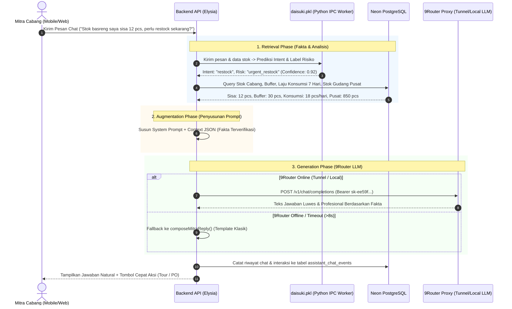

# Rencana Implementasi (Planning): Integrasi RAG & 9Router Proxy AI Local pada Chatbot Mitra

Dokumen ini adalah cetak biru teknis (*technical blueprint*) untuk meng-upgrade sistem Chatbot Asisten Mitra Daisuki dari sistem berbasis template statis menjadi **Sistem RAG (Retrieval-Augmented Generation)** modern yang ditenagai oleh **9Router Proxy** (Local / Tunnel Endpoint) dengan basis data terpusat dari **PostgreSQL** dan model **`ai/retraining/daisuki.pkl`**.

---

## 1. Latar Belakang & Tujuan

### Masalah Saat Ini (*As-Is*)
- Respons chatbot asisten mitra saat ini (`apps/api/src/modules/assistant/compose.ts`) masih menggunakan **string template kaku** (*hardcoded template*).
- Meskipun sistem sudah memiliki model Scikit-Learn (`daisuki.pkl`) untuk mendeteksi intensi (*intent*) dan risiko stok (*risk classification*), jawaban yang dihasilkan terasa monoton, kurang luwes, dan tidak dapat diajak berdiskusi secara natural layaknya asisten pintar.

### Solusi yang Diinginkan (*To-Be*)
- Menghubungkan **9Router Proxy** sebagai *Language Model (LLM) Generator* melalui API Key dan URL Tunnel (`https://rfngsre.abc-tunnel.us/v1`) atau Local (`http://localhost:20128/v1`).
- Menerapkan arsitektur **RAG (Retrieval-Augmented Generation)**:
  1. **Retrieval**: Mengambil fakta aktual dari PostgreSQL (sisa stok toko mitra, konsumsi 7 hari, stok gudang pusat, status pesanan PO) dan prediksi risiko dari `daisuki.pkl`.
  2. **Augmentation**: Menyuntikkan fakta-fakta tersebut ke dalam *System Prompt* yang terstruktur rapi.
  3. **Generation**: 9Router menghasilkan jawaban bahasa Indonesia yang ramah, natural, solutif, dan **100% bebas halusinasi** karena terikat kuat pada data riil.
  4. **Fallback Anggun (*Graceful Degradation*)**: Jika koneksi 9Router atau tunnel mati/offline, sistem otomatis beralih ke template statis yang sudah ada tanpa menimbulkan error di sisi pengguna.

---

## 2. Arsitektur Alur Sistem (RAG Workflow)



---

## 3. Komponen Teknis yang Akan Dibuat & Dimodifikasi

### A. Environment Configuration (`apps/api/.env`)
Menambahkan konfigurasi kredensial 9Router yang fleksibel (dapat beralih antara local dan tunnel):

```env
# --------------------------------------------------------------------------
# 9Router AI Proxy & LLM Configuration
# --------------------------------------------------------------------------
LLM_ENABLED="true"
# Gunakan URL Tunnel jika API berjalan di cloud/VPS, atau URL Local jika berjalan di mesin yang sama
LLM_BASE_URL="http://localhost:20128/v1"
LLM_TUNNEL_URL="https://rfngsre.abc-tunnel.us/v1"
LLM_API_KEY=<isi-di-env-api>
LLM_MODEL="opn" # atau model aktif di provider 9Router Anda
LLM_TIMEOUT_MS="8000"
```

### B. Modul Baru: LLM Client (`apps/api/src/modules/assistant/llm-client.ts`)
Membuat modul khusus pemanggil API 9Router dengan fitur:
- Pemanggilan endpoint standar OpenAI `/v1/chat/completions`.
- Penanganan timeout otomatis (`AbortController` 8 detik).
- Deteksi ketersediaan endpoint (*health check* / circuit breaker ringan).
- Fallback transparan jika 9Router mengalami kendala.

### C. Context & Prompt Builder RAG (`apps/api/src/modules/assistant/rag-prompt.ts`)
Menyusun *prompt engineering* yang mengikat LLM dengan ketat agar tidak berhalusinasi:
- **Identitas**: Asisten Resmi Manajemen Inventaris Daisuki B2B.
- **Batasan Bisnis Sesuai CLAUDE.md**:
  1. *Unbounded Stock*: Stok mitra tidak memiliki batas atas/plafon 40 pcs. Jangan sebutkan kapasitas rak 40 pcs.
  2. *Strict 4 Produk*: Hanya membahas 4 produk resmi: *Seblak Jadul Instan, Basreng Daun Jeruk, Makaroni Daun Jeruk, Keripik Pisang Rasa Coklat*.
  3. *Integritas Angka*: Angka sisa stok dan stok pusat wajib sama persis dengan context data yang diberikan.
  4. *Rekomendasi Nyata*: Menghubungkan label risiko dari `daisuki.pkl` (`urgent_restock`, `regular_order`, `normal`) ke saran kuantitas pengajuan restock.

### D. Penyesuaian Endpoint Assistant (`apps/api/src/modules/assistant/index.ts`)
- Memodifikasi alur pada endpoint `POST /assistant/mitra/chat`:
  - Jika `LLM_ENABLED === "true"`, coba minta respons dari 9Router terlebih dahulu dengan menginjeksikan context hasil query database dan prediksi `daisuki.pkl`.
  - Jika respons berhasil, gunakan jawaban hasil LLM.
  - Jika gagal / timeout, fallback otomatis ke `composeMitraReply()` eksisting.
  - Simpan riwayat chat ke tabel `assistant_chat_events` (termasuk metadata label model dan penanda apakah dijawab oleh LLM atau fallback).

### E. Frontend UI Chatbot (`apps/web/src/components/inventory/mitra-ai-assistant.tsx`)
- Mempercantik tampilan bubble chat mitra:
  - Render format Markdown sederhana (teks tebal, poin-poin saran restock).
  - Indikator halus badge *AI Powered* saat respon berasal dari 9Router.
  - Quick action chips yang relevan (misal: tombol cepat langsung navigasi ke form restock).

---

## 4. Struktur Data Context RAG yang Dikirim ke 9Router

Setiap kali mitra mengirim pesan, sistem mengumpulkan data kontekstual dari database dan `daisuki.pkl` lalu menyusun JSON berikut ke dalam prompt:

```json
{
  "mitra_profile": {
    "partner_name": "Kantin Rinjani Sejahtera",
    "partner_type": "kafe",
    "city": "Kota Bandung",
    "pic_name": "Budi Santoso"
  },
  "operational_facts": {
    "stocks": [
      {
        "product_name": "Basreng Daun Jeruk",
        "current_stock": 12,
        "par_level_buffer": 30,
        "status": "kritis",
        "average_daily_consumption": 8.5,
        "days_of_supply": 1.4,
        "central_stock_available": 850,
        "model_risk_prediction": "urgent_restock",
        "model_confidence": 0.94
      },
      {
        "product_name": "Seblak Jadul Instan",
        "current_stock": 45,
        "par_level_buffer": 25,
        "status": "aman",
        "average_daily_consumption": 5.0,
        "days_of_supply": 9.0,
        "central_stock_available": 1200,
        "model_risk_prediction": "normal",
        "model_confidence": 0.88
      }
    ],
    "active_orders": [
      {
        "order_no": "PO-261109-0012",
        "status": "dalam_pengiriman",
        "items_summary": "Basreng Daun Jeruk (50 pcs)",
        "driver_info": "Armada Logistik Daisuki"
      }
    ]
  }
}
```

Dengan data ini, LLM 9Router memiliki dasar konteks yang sangat lengkap sehingga dapat memberikan jawaban seperti:
> *"Halo Pak Budi! Berdasarkan data toko Anda, stok **Basreng Daun Jeruk** saat ini berstatus **Kritis** (tersisa 12 pcs, buffer aman 30 pcs) dengan laju penjualan ~8-9 pcs/hari. Prediksi model kami menandai ini sebagai **urgent_restock** karena sisa stok hanya cukup untuk sekitar 1-2 hari lagi. Kabar baiknya, ada pesanan Anda **PO-261109-0012** (50 pcs Basreng) yang saat ini sedang **Dalam Pengiriman**. Begitu barang tiba, silakan langsung scan resi agar stok toko otomatis bertambah!"*

---

## 5. Rencana Tahapan Eksekusi (Implementation Roadmap)

| Tahap | Aktivitas Utama | Estimasi & Output |
|---|---|---|
| **Fase 1** | **Setup Klien 9Router & Environment**<br>- Tambah variabel `LLM_BASE_URL` & `LLM_API_KEY` di `.env`<br>- Buat utility `llm-client.ts` di backend Elysia Bun | File klien siap pakai dengan dukungan AbortController timeout |
| **Fase 2** | **Rancang Context Extractor & Prompt Template**<br>- Rancang generator prompt di `rag-prompt.ts`<br>- Sambungkan data dari `loadMitraContext` dan `daisuki.pkl` | Prompt terstruktur yang aman dari halusinasi dan patuh aturan bisnis |
| **Fase 3** | **Integrasi Endpoint & Mekanisme Fallback**<br>- Modifikasi `POST /assistant/mitra/chat`<br>- Terapkan try-catch fallback ke `composeMitraReply` jika 9Router offline | API tetap 100% stabil meski koneksi 9Router terputus |
| **Fase 4** | **Pengujian & Validasi Respons**<br>- Uji pertanyaan restock, stok fisik, pesanan pengiriman, dan tanya jawab umum<br>- Verifikasi bahwa angka yang disebutkan LLM cocok persis dengan database | Verifikasi akurasi data dan gaya bahasa ramah |
| **Fase 5** | **Dokumentasi & Changelog**<br>- Catat hasil implementasi ke `CLAUDE.md` dan `AGENTS.md` | Protokol changelog terpenuhi |

---

## 6. Tindakan Selanjutnya

Implementasi berada di `apps/api/src/modules/assistant/` dan `apps/web/src/components/inventory/mitra-ai-assistant.tsx`. Konfigurasi rahasia ditempatkan hanya di `apps/api/.env`; contoh yang dapat dibagikan memakai placeholder. Retrieval memakai query PostgreSQL untuk mitra yang sedang login dan prediksi dari `daisuki.pkl`, tanpa indeks vektor. Klien mencoba proxy local lalu tunnel dalam batas waktu total delapan detik. Respons yang memuat angka atau nomor PO di luar fakta ditolak dan diganti jawaban template.
