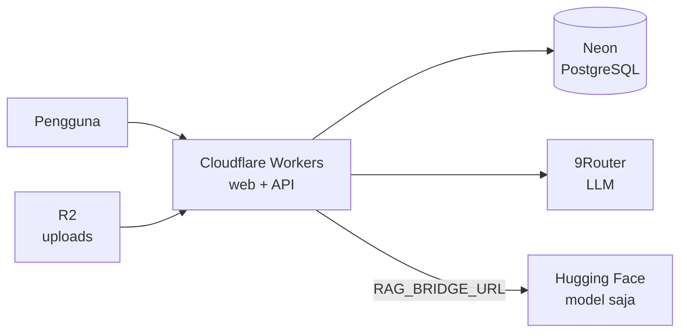
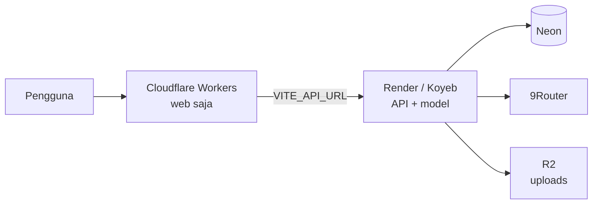

# Rencana Deploy: Cloudflare Workers + Hugging Face

Target: frontend & backend di Cloudflare Workers, model di Hugging Face,
dipanggil lewat HTTP. Biaya seminimal mungkin.

Dokumen pendamping: [KONSULTASI_DEPLOY_CF_HF.md](KONSULTASI_DEPLOY_CF_HF.md)
(bahan konsultasi ke AI lain, memuat batasan teknis lengkap).

---

## Keputusan yang sudah diambil

**Bentuk A** — Hugging Face hanya memegang model, bukan seluruh pipeline AI.



Yang tetap di Cloudflare: fakta operasional dari PostgreSQL, guardrail, penyusunan
prompt, pemanggilan LLM, isolasi tenant.

Yang di Hugging Face: intent classifier, indeks retrieval, prediksi risiko.

**Alasan memilih A:** kredensial database dan LLM tidak perlu pindah ke HF, dan
`partner_id` tetap dekat dengan data yang dilindunginya.

---

## Kondisi kode saat ini

Pemisahan jalur model **sudah terpasang** di
`apps/api/src/modules/assistant/model.ts`:

```ts
function getOrStartWorker(): Worker | null {
  if (BRIDGE_URL) {
    if (!currentWorker || currentWorker.isDead) currentWorker = createRemoteWorker();
    return currentWorker;      // Bun.spawn tidak pernah dieksekusi
  }
  // ... jalur Python lokal lama, perilaku tidak berubah
```

Artinya: begitu `RAG_BRIDGE_URL` diisi, API **tidak** menjalankan Python dan
**tidak** membaca `daisuki.pkl`. Tanpa URL, semuanya seperti semula.

---

## Fase 0 — Beresi penghambat (kerjakan lebih dulu)

Tiga hal ini menghambat **semua** opsi, jadi tidak ada gunanya memilih platform
sebelum selesai.

| # | Pekerjaan | Perintah |
|---|---|---|
| 0.1 | Selesaikan merge Git | `git add AGENTS.md CLAUDE.md && git commit && git push` |
| 0.2 | Perbaiki build web | `cd apps/web && bun run build` |
| 0.3 | Verifikasi typecheck | `bun run typecheck` |

**0.2 adalah gerbang utama.** Changelog proyek mencatat build tertahan
`prettier/index.js` yang hilang, dan berkas itu memang tidak ada di
`node_modules`. Tanpa build sukses, tidak ada deploy CF sama sekali — untuk opsi
apa pun.

Kalau gagal, coba `bun install` dulu dari root.

---

## Fase 1 — Uji kelayakan: apakah Elysia jalan di Workers?

**Ini gerbang sebenarnya.** Kalau gagal, seluruh rencana CF gugur dan tidak ada
gunanya mengerjakan Fase 3-5.

Jangan uji dengan seluruh API. Buat Worker kecil:

```ts
import { Elysia } from "elysia";
const app = new Elysia().get("/ping", () => ({ ok: true }));
export default { fetch: app.fetch };
```

Deploy. Kalau `/ping` merespons, lanjut. Kalau tidak, pindah ke Rencana B.

**Perkiraan waktu:** 15 menit. **Perkiraan biaya:** nol.

---

## Fase 2 — Host model

Tiga pilihan, semuanya memakai kode `deploy/hf-space/` yang sama. Yang berbeda
hanya URL yang diisi ke `RAG_BRIDGE_URL`.

| Pilihan | Biaya | Catatan |
|---|---|---|
| HF Space (Docker) | **$9/bln** | Sesuai rencana awal. Sudah siap, tinggal `hf upload`. |
| HF Space (Gradio) | gratis? | **Belum terverifikasi.** Akun gratis bisa punya 2 Gradio Space. Perlu uji apakah FastAPI yang di-mount menerima `POST` dari luar. |
| Render / Koyeb | gratis (tidur saat idle) | Bukan HF, tapi `app.py` tidak berubah. |

**Langkah HF Space (kalau bayar):**

```bash
bun deploy/prepare.mjs space
hf upload <user>/daisuki-rag ./deploy/.staging/space . --type space --private
hf spaces secrets add <user>/daisuki-rag --secrets BRIDGE_TOKEN=<acak-32-karakter>
hf spaces secrets add <user>/daisuki-rag --secrets HF_MODEL_REPO=<user>/daisuki-model
curl https://<user>-daisuki-rag.hf.space/health -H "Authorization: Bearer <token>"
```

Harus mengembalikan `available: true` dan `retrieval_ready: true`.

**Peringatan privasi:** model memuat 644 baris analisis per cabang dan 387
cuplikan PDF privat. Space dan repo model **wajib private**, dan `BRIDGE_TOKEN`
**wajib diisi** (Space menolak start kalau kosong).

---

## Fase 3 — Adaptasi API untuk Workers

Hanya dikerjakan kalau Fase 1 lolos.

| # | Pekerjaan | Berkas yang disentuh | Ukuran |
|---|---|---|---|
| 3.1 | 5 pembacaan berkas level-modul → bundel aset | storage, guardrails, word-loader, assistant-copy, company-knowledge | Sedang |
| 3.2 | `.listen()` → `fetch` handler | `index.ts` | Kecil |
| 3.3 | `@elysiajs/cron` → `scheduled()` | `index.ts`, `analysis-runs.ts` | Kecil |
| 3.4 | Uploads disk → R2 | `lib/storage.ts` | Sedang |
| 3.5 | Driver `postgres` → Hyperdrive | `db/client.ts` | Kecil |
| 3.6 | Buang `import.meta.dir` | 20 berkas | Sedang |

**3.1 dan 3.6 adalah pekerjaan terbesar.** Keduanya menyentuh banyak berkas.

**Yang tidak perlu dikerjakan:** memindahkan logika model ke TypeScript. Karena
Bentuk A, HF yang menyuplai intent dan prediksi risiko — bukan TS.

---

## Fase 4 — Pipeline training

Tujuh job Python tetap butuh filesystem, jadi tetap berjalan di mesin lokal
lewat `bun run dev`.

| Langkah | Tempat |
|---|---|
| Admin klik "Perbarui analisis Data Science" | Kontainer/lokal |
| 7 job Python berurutan | **Mesin lokal** |
| Model hasil training | Unggah ke `candalena/daisuki-model` |
| Space muat ulang | `POST /reload` |

**Fase ini tidak menghambat chat AI.** Chat berfungsi tanpa training.

Kalau nanti ingin otomatis tanpa mesin lokal, di situ perlu biaya tambahan.

---

## Rencana B — kalau Fase 1 gagal



`Dockerfile.api` dipakai apa adanya. Tidak perlu mempelajari Docker — platform
yang menjalankannya. `RAG_BRIDGE_URL` dikosongkan, API pakai jalur Python lokal.

---

## Yang dikorbankan

| Kehilangan | Dampak |
|---|---|
| Model lokal saat dev | Kalau HF tidak tersedia, chat turun ke `.public.md` |
| Training otomatis | Butuh mesin lokal |
| API tidur (kalau Rencana B) | Request pertama lambat 30-60 detik |
| Kredensial DB di HF | **Tidak terjadi** — itu keuntungan Bentuk A |

---

## Yang belum terverifikasi

Semua klaim teknis di dokumen ini berasal dari pembacaan kode dan dokumentasi
resmi. **Belum ada satu pun yang diuji dengan deploy.**

| Pertanyaan | Status |
|---|---|
| Elysia jalan di Workers? | **belum diuji** — Fase 1 |
| Build web berhasil? | **belum dijalankan** — Fase 0.2 |
| Ukuran bundle muat batas Workers? | belum diketahui |
| HF Jobs bisa capai Neon? | belum diuji |
| Harga Cloudflare Containers? | belum diperiksa |
| Gradio Space gratis menerima POST? | belum diuji |
