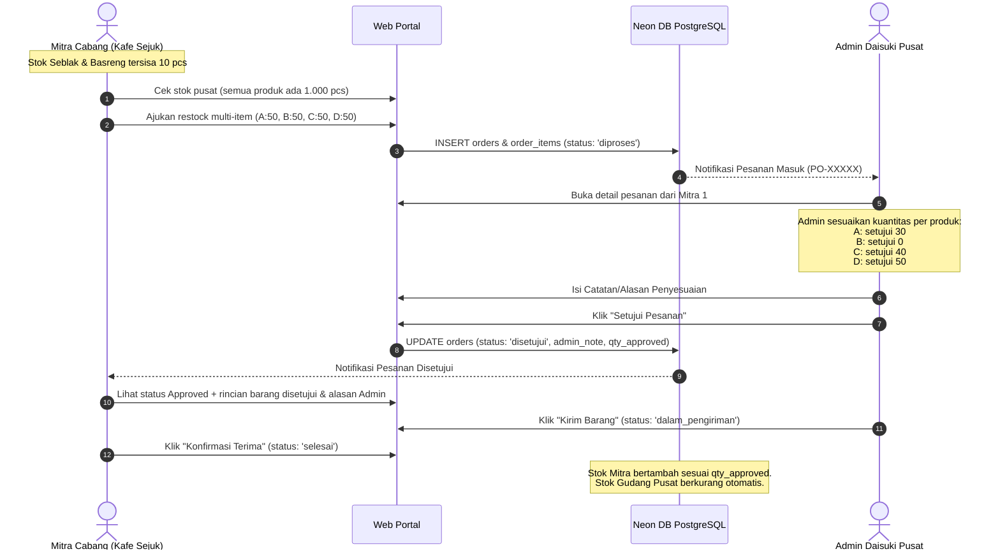

# 📋 Rencana Implementasi Sistem Daisuki Inventory

Dokumen ini memuat spesifikasi alur fitur baru, skenario bisnis nyata, struktur data, dan pembagian tugas kelompok untuk **Fullstack**, **Data Science**, dan **AI Engineer**.

---

## 1. 🛍️ 4 Produk Resmi Daisuki

Sistem beralih dari produk percobaan ke **4 produk resmi Daisuki**:

| No | Kode SKU | Nama Produk | Kategori | Harga B2B | Stok Awal Gudang Pusat |
|:---:|:---|:---|:---|:---:|:---:|
| 1 | `DSK-SB-001` | **Seblak Jadul Instan** | Makanan Instan | Rp 12.000 | **1.000 pcs** |
| 2 | `DSK-BR-002` | **Basreng Daun Jeruk** | Camilan Gurih | Rp 10.000 | **1.000 pcs** |
| 3 | `DSK-MK-003` | **Makaroni Daun Jeruk** | Camilan Gurih | Rp 8.500 | **1.000 pcs** |
| 4 | `DSK-KP-004` | **Keripik Pisang Rasa Coklat** | Camilan Manis | Rp 15.000 | **1.000 pcs** |

---

## 2. 🏢 Fitur Stok Gudang Pusat (Daisuki Central Warehouse)

### A. Di Sisi Admin Pusat (Publish & Kelola):
* Admin dapat mengatur dan mem-publish jumlah total stok barang yang ada di gudang utama Daisuki (default: **1.000 pcs** untuk setiap produk).
* Jika ada produksi baru dari pabrik, Admin dapat memperbarui angka stok gudang pusat ini.

### B. Di Sisi Mitra Cabang (Transparansi Stok):
* Seluruh mitra dapat melihat ketersediaan stok gudang pusat secara transparan melalui kartu/banner informasi di portal mereka:
  > **📦 Ketersediaan Stok Gudang Daisuki Pusat:**  
  > • Seblak Jadul Instan: **1.000 pcs**  
  > • Basreng Daun Jeruk: **1.000 pcs**  
  > • Makaroni Daun Jeruk: **1.000 pcs**  
  > • Keripik Pisang Coklat: **1.000 pcs**
* Hal ini memudahkan mitra mengetahui apakah gudang pusat punya stok yang cukup sebelum mereka memesan.

---

## 3. 🔄 Skenario Alur Restock & Approval Parsial

### Langkah demi Langkah:

#### 1. Kondisi Stok Mitra 1 (Kafe Sejuk BSD):
* Seblak Jadul Instan: sisa **10 pcs** (Batas aman 40 ➔ Status: 🔴 **Kritis**)
* Basreng Daun Jeruk: sisa **10 pcs** (Batas aman 40 ➔ Status: 🔴 **Kritis**)
* Makaroni Daun Jeruk: sisa **30 pcs** (Batas aman 40 ➔ Status: 🟢 **Aman**)
* Keripik Pisang Rasa Coklat: sisa **35 pcs** (Batas aman 40 ➔ Status: 🟢 **Aman**)

#### 2. Mitra Mengajukan Restock Sekaligus (Multi-Item):
* Mitra melihat stok gudang pusat lengkap 1.000 pcs.
* Mitra mengisi kuantitas restock yang diinginkan dalam 1 kali pengajuan:
  * Seblak Jadul: **50 pcs**
  * Basreng Daun Jeruk: **50 pcs**
  * Makaroni Daun Jeruk: **50 pcs**
  * Keripik Pisang Coklat: **50 pcs**
* Pesanan terkirim dengan status **"Diproses"**.

#### 3. Admin Menyetujui Secara Parsial & Memberi Alasan:
* Di Dashboard Admin muncul pesanan masuk dari Mitra 1.
* Admin memeriksa kuantitas dan menentukan jumlah yang disetujui per barang:
  * Seblak Jadul: disetujui **30 pcs** (dari 50 yang diminta)
  * Basreng Daun Jeruk: disetujui **0 pcs** (dari 50 yang diminta)
  * Makaroni Daun Jeruk: disetujui **40 pcs** (dari 50 yang diminta)
  * Keripik Pisang Coklat: disetujui **50 pcs** (disetujui penuh)
* Admin menulis **Penjelasan / Alasan**:
  > *"Untuk Basreng stok sedang dialokasikan untuk pemesanan event hotel. Seblak kami kirim 30 pcs dulu agar stok gudang cukup dibagi rata ke cabang lain. Makaroni dan Keripik Pisang dikirim sesuai persediaan."*
* Admin menekan tombol **"Setujui Pesanan"**.

#### 4. Tampilan di Halaman Mitra:
* Mitra membuka tab **Pesanan** dan melihat status: **Disetujui (Approved)**.
* Menampilkan rincian kuantitas yang disetujui:
  * Seblak Jadul: Diminta 50 ➔ **Disetujui 30 pcs**
  * Basreng Daun Jeruk: Diminta 50 ➔ **Disetujui 0 pcs**
  * Makaroni Daun Jeruk: Diminta 50 ➔ **Disetujui 40 pcs**
  * Keripik Pisang Coklat: Diminta 50 ➔ **Disetujui 50 pcs**
* Tampil kotak pesan resmi dari Admin berisi alasan penyesuaian di atas.
* Saat barang tiba, Mitra klik **"Barang Diterima"**:
  * Stok di rak toko Mitra otomatis bertambah sesuai jumlah yang disetujui (Seblak +30, Makaroni +40, Keripik +50).
  * Stok Gudang Pusat Daisuki otomatis berkurang sesuai barang yang dikirim.

---

## 4. 👥 Pembagian Tugas Peran Kelompok

Agar pengerjaan tugas kelompok seimbang dan relevan dengan skenario 4 produk di atas, berikut pembagian kerjanya:

### 💻 1. Fullstack Developer (Aplikasi Web & Database)
* **Anggota:** Frisca Nabilla, Hudzaifah Ar-Rantisi
* **Workspace:** `apps/web/`, `apps/api/`, `packages/shared/`
* **Tugas:**
  1. Menambahkan kolom `central_stock` pada tabel `products` dan `admin_note` pada tabel `orders`.
  2. Mengupdate script seeder database (`apps/api/src/db/seed.ts`) untuk memasukkan 4 produk baru dan stok gudang 1.000 pcs.
  3. Membangun banner/tampilan ketersediaan stok gudang pusat di Portal Mitra.
  4. Membuat form restock multi-item di halaman Mitra.
  5. Membuat form approval parsial per item + input alasan admin di Dashboard Admin.
  6. Menampilkan status Approved, rincian kuantitas disetujui, dan catatan admin di Portal Mitra.

---

### 📊 2. Data Science (Analisis Data & Model Inventaris)
* **Anggota:** Adelia Juliani, Keyla Farrelia
* **Workspace:** `data-science/`
* **Tugas Praktis:**
  1. **Analisis Pola Penjualan 4 Produk:**
     * Menghitung rata-rata pemakaian harian (*Average Daily Usage*) per produk di tiap cabang dari data tabel `stock_logs`.
     * Mengidentifikasi produk *Fast-Moving* (Seblak & Basreng) vs *Slow-Moving* (Makaroni & Keripik Pisang).
  2. **Perhitungan Reorder Point (ROP) & Safety Stock:**
     * Menghitung batas minimal stok (kenapa saat sisa 10 pcs harus langsung restock? Karena lead time pabrik 6 hari, dan penjualan 3–5 pcs/hari akan membuat stok habis dalam 2–3 hari).
     * Menghitung batas rak ideal (*Par Level*) agar cabang tidak kekurangan barang.
  3. **Rekomendasi Jumlah Restock (Suggested Qty):**
     * Membuat script Python yang membaca data stok riil dari Neon DB dan mengisi kolom saran pesanan otomatis di tabel `restock_recommendations`.
  4. **Analisis Ketahanan Stok Gudang Pusat:**
     * Menghitung estimasi ketahanan stok gudang pusat (1.000 pcs cukup untuk berapa minggu menyuplai seluruh cabang sebelum Daisuki harus pesan batch baru ke pabrik).

---

### 🤖 3. AI Engineer (Otomasi, Alert & Asisten)
* **Anggota:** Annura Rizkya Chantika, Reyhan Fawwaz Habibi
* **Workspace:** `ai/`
* **Tugas Praktis:**
  1. **Alarm Kritis Otomatis (< 20%):**
     * Membuat background job/scheduler yang mendeteksi jika ada produk di cabang yang sisa stoknya tinggal $\le 10$ pcs, lalu otomatis mengirim pesan darurat ke tabel `notifications` agar Admin langsung menerima notifikasi merah di dashboard.
  2. **Scheduler Reminder 24 Jam:**
     * Script otomatis yang memeriksa cabang yang belum melakukan input stok fisik harian lebih dari 24 jam dan memicu reminder otomatis.
  3. **Peringatan Stok Gudang Pusat Menipis:**
     * Bot/script yang memantau jika stok gudang pusat untuk salah satu produk turun di bawah batas aman (misal tersisa $< 200$ pcs), lalu memberi alert ke Admin untuk menjadwalkan produksi baru ke pabrik.
  4. **AI Executive Digest (Ringkasan Harian):**
     * Menggunakan model AI/LLM untuk merangkum kondisi stok harian bagi Admin, contoh:  
       *"Halo Admin! Pagi ini ada 1 cabang kritis (Kafe Sejuk) dengan sisa Seblak & Basreng 10 pcs. Stok gudang pusat masih aman di 1.000 pcs. Ada 1 pesanan restock menunggu persetujuan Anda."*

---

## 5. 📁 Rencana Perubahan File & Struktur Kode

| Komponen | File | Rencana Perubahan |
|---|---|---|
| **Database Schema** | `apps/api/src/db/schema.ts` | Tambah `central_stock` di tabel `products`, tambah `admin_note` di tabel `orders`. |
| **SQL Migration** | `supabase/migrations/0005_central_stock.sql` | Script SQL untuk menambahkan kolom ke Neon DB. |
| **Data Seed** | `apps/api/src/db/seed.ts` | Ganti data produk menjadi 4 produk resmi, set stok pusat 1.000, set stok awal mitra 1 (10, 10, 30, 35). |
| **API Backend** | `apps/api/src/modules/orders/index.ts` | Tangani `admin_note`, approval parsial per item, dan pengurangan stok pusat saat order selesai. |
| **API Backend** | `apps/api/src/modules/stocks/index.ts` | Sertakan informasi `central_stock` pada endpoint produk. |
| **Frontend Mitra** | `apps/web/src/routes/mitra.tsx` | Tampilkan ketersediaan stok pusat 1.000 pcs, form order 4 item sekaligus, rincian barang disetujui & alasan admin. |
| **Frontend Admin** | `apps/web/src/routes/admin.tsx` | Tampilkan stok pusat, form input approval per item, textarea alasan admin. |
| **Data Science** | `data-science/notebooks/` | Notebook analisis konsumsi 4 produk, rumus ROP, dan script rekomendasi ke Neon DB. |
| **AI Engineer** | `ai/jobs/` | Script scheduler reminder 24 jam, alert stok kritis (< 20%), dan AI digest harian. |
