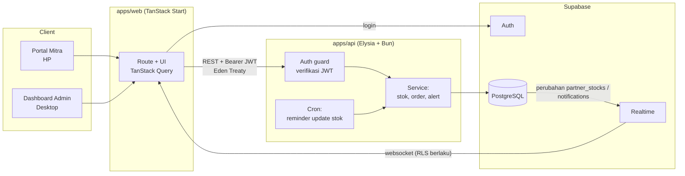
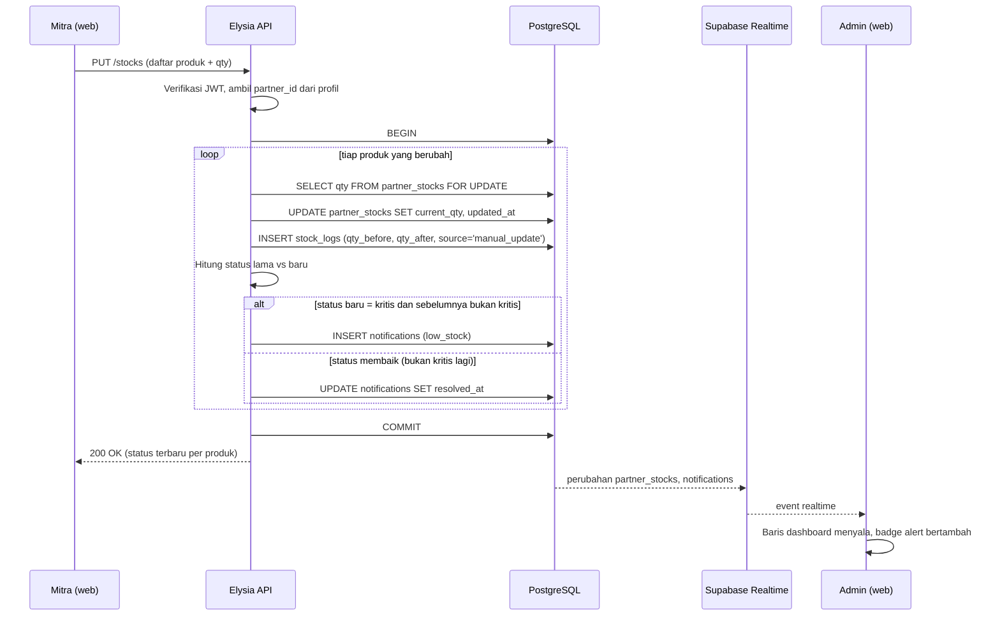
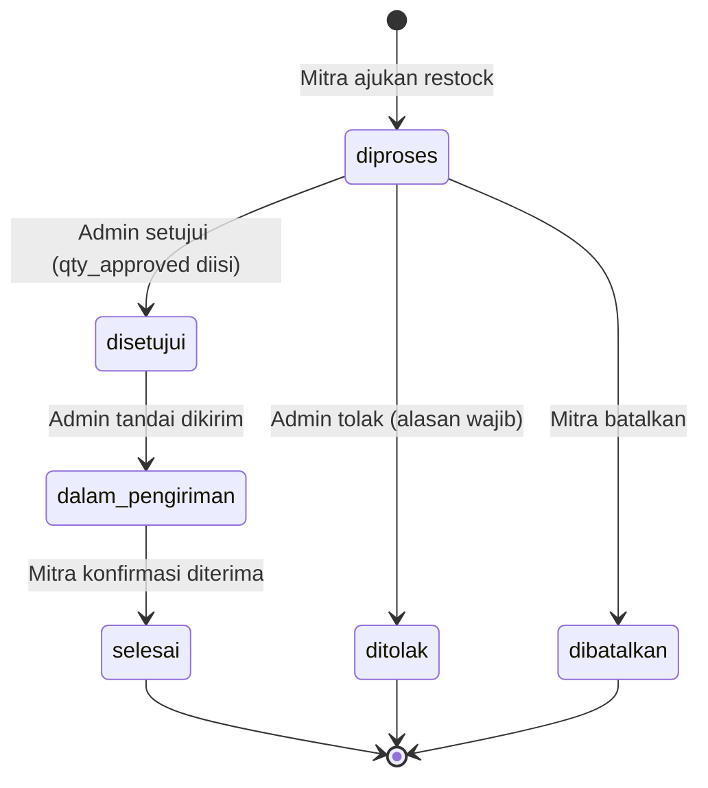
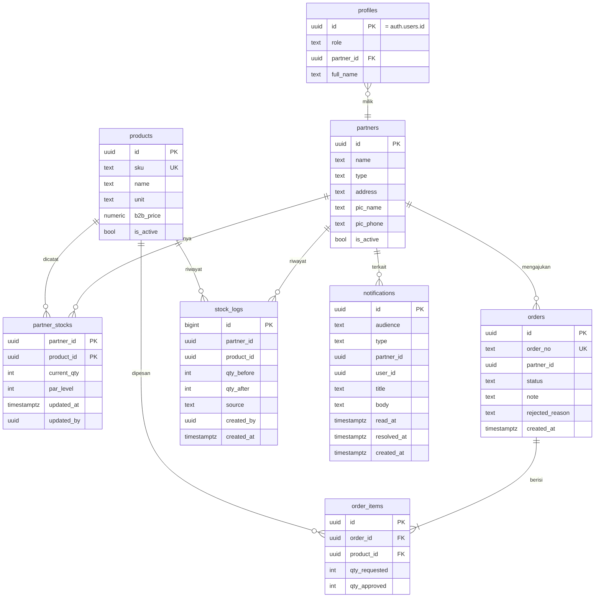

# Alur Sistem — Daisuki B2B Inventory & Order System

Dokumen teknis untuk implementasi. Mengacu pada PRD v1.0 dan notulensi interview (14 Oktober 2025).

**Stack:** TanStack Start (web) · ElysiaJS + Bun (API) · TypeScript · PostgreSQL di Supabase (Postgres + Auth + Realtime)

---

## 1. Arsitektur



**Pembagian tugas:**

| Lapisan | Tugas |
|---|---|
| TanStack Start | UI, routing, SSR, cache data (TanStack Query), subscribe Realtime |
| Elysia API | Semua aturan bisnis dan penulisan data (update stok, order, approval, alert) |
| Supabase Auth | Login, penerbit JWT |
| Supabase Postgres | Data, constraint, RLS |
| Supabase Realtime | Dorong perubahan stok dan notifikasi ke dashboard admin tanpa polling |

**Prinsip:** frontend **tidak menulis langsung ke tabel**. Semua penulisan lewat API Elysia supaya aturan bisnis ada di satu tempat. Frontend hanya *membaca* realtime lewat Supabase (dilindungi RLS).

---

## 2. Peran dan hak akses

| Peran | Bisa | Tidak bisa |
|---|---|---|
| `admin` | Lihat semua mitra, setujui/tolak/ubah order, kelola produk dan mitra, atur par level, lihat laporan | – |
| `mitra` | Update stok miliknya, ajukan dan batalkan order miliknya, konfirmasi barang diterima, lihat riwayat miliknya | Lihat data mitra lain, ubah master data |

Peran disimpan di tabel `profiles` (`role`, `partner_id`). Mitra A tidak boleh bisa membaca data Mitra B, ditegakkan di **dua lapis**: pengecekan di Elysia dan RLS di database.

---

## 3. Alur utama

### 3.1 Login

1. Pengguna login lewat Supabase Auth (email + password) dari web.
2. Web menyimpan sesi, lalu memanggil `GET /me` ke API dengan header `Authorization: Bearer <access_token>`.
3. API memverifikasi JWT, mengambil `profiles` (role, partner_id), mengembalikan profil.
4. Web mengarahkan: `admin` → `/admin`, `mitra` → `/mitra`.

Akun mitra **dibuat oleh admin** (tidak ada registrasi publik).

### 3.2 Update stok (mitra)



Aturan:
- `partner_id` **selalu diambil dari profil di server**, tidak dari body request.
- `qty` harus bilangan bulat ≥ 0 dan ≤ `par_level`. Selain itu ditolak dengan pesan yang jelas.
- Hanya produk yang nilainya berubah yang dicatat di `stock_logs`.
- Alert dibuat hanya saat **transisi** ke kritis, supaya tidak spam setiap kali stok diupdate.

### 3.3 Pemantauan dan alert (admin)

1. Dashboard memuat ringkasan awal lewat `GET /admin/overview`.
2. Web subscribe Realtime ke `partner_stocks` dan `notifications`. Event masuk memicu invalidasi cache TanStack Query dan animasi baris.
3. Badge bell menampilkan notifikasi `low_stock` yang belum dibaca. Klik item → buka detail mitra atau langsung "Buat restock" untuk mitra tersebut.
4. **Cron harian** (mis. 16.00 WIB): cari `partner_stocks` yang `updated_at` > 24 jam. Hasilnya dibuat notifikasi `stale_update` (ke admin dan ke akun mitra). Opsional: kirim email via Resend.

### 3.4 Restock / order



| Transisi | Pelaku | Efek samping |
|---|---|---|
| (baru) → `diproses` | mitra | Notifikasi `new_order` ke admin |
| `diproses` → `disetujui` | admin | `qty_approved` per item (default = qty diminta), notifikasi ke mitra |
| `diproses` → `ditolak` | admin | `rejected_reason` wajib, notifikasi ke mitra |
| `diproses` → `dibatalkan` | mitra | Hanya selama belum disetujui |
| `disetujui` → `dalam_pengiriman` | admin | Catat `shipped_at`, notifikasi ke mitra |
| `dalam_pengiriman` → `selesai` | mitra | `current_qty` bertambah sebesar `qty_approved`, catat `stock_logs` (`source='order_received'`), hitung ulang status |

Semua transisi dilakukan dalam **satu transaksi database** dan memvalidasi status sebelumnya (transisi di luar tabel di atas ditolak 409).

> **Keputusan desain (bisa diubah):** stok bertambah otomatis saat mitra menekan "Barang diterima", bukan saat dikirim. Ini menjaga stok di sistem sama dengan stok fisik di tempat mitra.

### 3.5 Laporan dan analitik

- Penjualan per mitra per periode = jumlah penurunan stok di `stock_logs` (`source='manual_update'` dengan `qty_after < qty_before`) ditambah koreksi dari penerimaan order.
- Frekuensi restock = jumlah order `selesai` per mitra per periode.
- Prediksi kebutuhan (v1, sederhana) = rata-rata penjualan harian 4 minggu terakhir × jumlah hari menuju restock berikutnya + buffer. Buffer awal 20% (bisa diatur), tambahkan lead time pabrik bila diperlukan karena pabrik mengerjakan 1000 produk dalam 5–7 hari.

---

## 4. Model data



### 4.1 Skema SQL (simpan sebagai `supabase/migrations/0001_init.sql`)

```sql
create extension if not exists "pgcrypto";

create type user_role as enum ('admin', 'mitra');
create type partner_type as enum ('hotel', 'restoran', 'kafe', 'minimarket');
create type order_status as enum
  ('diproses', 'disetujui', 'dalam_pengiriman', 'selesai', 'ditolak', 'dibatalkan');
create type stock_source as enum ('manual_update', 'order_received', 'adjustment');

create table partners (
  id uuid primary key default gen_random_uuid(),
  name text not null,
  type partner_type not null,
  address text,
  pic_name text,
  pic_phone text,
  is_active boolean not null default true,
  created_at timestamptz not null default now()
);

create table profiles (
  id uuid primary key references auth.users(id) on delete cascade,
  role user_role not null,
  partner_id uuid references partners(id),
  full_name text not null,
  created_at timestamptz not null default now(),
  constraint mitra_needs_partner check (role = 'admin' or partner_id is not null)
);

create table products (
  id uuid primary key default gen_random_uuid(),
  sku text not null unique,
  name text not null,
  unit text not null default 'pcs',
  b2b_price numeric(12,2) not null check (b2b_price >= 0),
  is_active boolean not null default true,
  created_at timestamptz not null default now()
);

create table partner_stocks (
  partner_id uuid not null references partners(id) on delete cascade,
  product_id uuid not null references products(id),
  current_qty integer not null default 0 check (current_qty >= 0),
  par_level integer not null check (par_level > 0),
  updated_at timestamptz not null default now(),
  updated_by uuid references profiles(id),
  primary key (partner_id, product_id),
  constraint qty_within_par check (current_qty <= par_level)
);

create table stock_logs (
  id bigint generated always as identity primary key,
  partner_id uuid not null references partners(id),
  product_id uuid not null references products(id),
  qty_before integer not null,
  qty_after integer not null,
  source stock_source not null,
  created_by uuid references profiles(id),
  created_at timestamptz not null default now()
);
create index on stock_logs (partner_id, product_id, created_at desc);

create table orders (
  id uuid primary key default gen_random_uuid(),
  order_no text not null unique,
  partner_id uuid not null references partners(id),
  status order_status not null default 'diproses',
  note text,
  rejected_reason text,
  created_by uuid references profiles(id),
  approved_by uuid references profiles(id),
  created_at timestamptz not null default now(),
  approved_at timestamptz,
  shipped_at timestamptz,
  completed_at timestamptz
);
create index on orders (partner_id, created_at desc);
create index on orders (status);

create table order_items (
  id uuid primary key default gen_random_uuid(),
  order_id uuid not null references orders(id) on delete cascade,
  product_id uuid not null references products(id),
  qty_requested integer not null check (qty_requested > 0),
  qty_approved integer check (qty_approved >= 0)
);

create table notifications (
  id uuid primary key default gen_random_uuid(),
  audience text not null check (audience in ('admin', 'mitra')),
  type text not null check (type in ('low_stock', 'stale_update', 'new_order', 'order_update')),
  partner_id uuid references partners(id),
  user_id uuid references profiles(id),
  title text not null,
  body text,
  read_at timestamptz,
  resolved_at timestamptz,
  created_at timestamptz not null default now()
);
create index on notifications (audience, read_at, created_at desc);
```

### 4.2 RLS (untuk Realtime dan akses langsung dari client)

API Elysia terhubung ke Postgres sebagai role server yang **melewati RLS**, jadi isolasi data di API ditegakkan oleh kode. RLS tetap wajib karena **Supabase Realtime hanya mengirim baris yang boleh dibaca pengguna**.

```sql
alter table partner_stocks enable row level security;
alter table notifications enable row level security;
alter table orders enable row level security;
alter table order_items enable row level security;
alter table stock_logs enable row level security;
alter table profiles enable row level security;
alter table partners enable row level security;
alter table products enable row level security;

create or replace function auth_role() returns user_role
  language sql stable security definer set search_path = public as
  $$ select role from profiles where id = auth.uid() $$;

create or replace function auth_partner() returns uuid
  language sql stable security definer set search_path = public as
  $$ select partner_id from profiles where id = auth.uid() $$;

-- partner_stocks: admin semua, mitra hanya miliknya
create policy stocks_select on partner_stocks for select to authenticated
  using (auth_role() = 'admin' or partner_id = auth_partner());

-- notifications: admin lihat audience admin, mitra lihat miliknya
create policy notif_select on notifications for select to authenticated
  using (
    (audience = 'admin' and auth_role() = 'admin')
    or (audience = 'mitra' and partner_id = auth_partner())
  );

-- orders dan order_items
create policy orders_select on orders for select to authenticated
  using (auth_role() = 'admin' or partner_id = auth_partner());
create policy order_items_select on order_items for select to authenticated
  using (exists (select 1 from orders o where o.id = order_id
         and (auth_role() = 'admin' or o.partner_id = auth_partner())));

-- stock_logs
create policy logs_select on stock_logs for select to authenticated
  using (auth_role() = 'admin' or partner_id = auth_partner());

-- profiles: baca profil sendiri, admin baca semua
create policy profiles_select on profiles for select to authenticated
  using (id = auth.uid() or auth_role() = 'admin');

-- master data: semua pengguna login boleh baca
create policy partners_select on partners for select to authenticated using (true);
create policy products_select on products for select to authenticated using (true);

-- aktifkan Realtime
alter publication supabase_realtime add table partner_stocks, notifications, orders;
```

Tidak ada policy `insert/update/delete` untuk `authenticated`: semua penulisan hanya lewat API.

---

## 5. Kontrak API (Elysia)

Base URL dev: `http://localhost:3001`. Semua endpoint (kecuali `/health`) butuh `Authorization: Bearer <JWT>`. Validasi body memakai TypeBox (`t.Object(...)`) bawaan Elysia.

### Umum
| Method | Path | Peran | Fungsi |
|---|---|---|---|
| GET | `/health` | publik | Cek status |
| GET | `/me` | semua | Profil + role + partner |

### Mitra
| Method | Path | Fungsi |
|---|---|---|
| GET | `/stocks` | Stok semua produk milik mitra (qty, par_level, persen, status) |
| PUT | `/stocks` | Update stok: `{ items: [{ productId, qty }] }` |
| GET | `/stocks/:productId/logs` | Riwayat perubahan satu produk |
| GET | `/orders` | Daftar order milik mitra |
| GET | `/orders/:id` | Detail order |
| POST | `/orders` | Ajukan restock: `{ note?, items: [{ productId, qty }] }` |
| POST | `/orders/:id/cancel` | Batalkan (hanya status `diproses`) |
| POST | `/orders/:id/receive` | Konfirmasi diterima (hanya `dalam_pengiriman`) |
| GET | `/notifications` | Notifikasi mitra |

### Admin
| Method | Path | Fungsi |
|---|---|---|
| GET | `/admin/overview` | Ringkasan jumlah kritis/waspada/aman/belum update + daftar kritis |
| GET | `/admin/partners` | Daftar mitra (filter jenis, status) |
| POST / PATCH | `/admin/partners`, `/admin/partners/:id` | Tambah / ubah mitra |
| POST | `/admin/partners/:id/account` | Buat akun login untuk PIC mitra |
| GET | `/admin/partners/:id/stocks` | Stok per produk satu mitra |
| PUT | `/admin/partners/:id/par-levels` | Atur par level per produk |
| GET / POST / PATCH | `/admin/products`, `/admin/products/:id` | Kelola produk |
| POST | `/admin/products/import` | Import CSV dari Excel lama |
| GET | `/admin/orders` | Semua order (filter status, mitra, tanggal) |
| POST | `/admin/orders/:id/approve` | `{ items: [{ itemId, qtyApproved }] }` |
| POST | `/admin/orders/:id/reject` | `{ reason }` |
| POST | `/admin/orders/:id/ship` | Tandai dalam pengiriman |
| GET | `/admin/reports/sales` | Penjualan per mitra/periode |
| GET | `/admin/reports/restock` | Frekuensi restock |
| GET | `/admin/reports/forecast` | Rekomendasi kebutuhan |
| GET | `/admin/notifications` | Daftar alert |
| POST | `/admin/notifications/:id/read` | Tandai dibaca |

### Format error
```json
{ "error": { "code": "QTY_EXCEEDS_PAR", "message": "Jumlah tidak boleh lebih besar dari kapasitas rak (40)." } }
```
Kode HTTP: `400` validasi, `401` token tidak valid, `403` bukan haknya, `404` tidak ditemukan, `409` transisi status tidak valid.

---

## 6. Autentikasi di Elysia

1. Verifikasi JWT Supabase di middleware (`derive`/`resolve`), memakai `jose`:
   - Project dengan **JWT signing keys asimetris**: `createRemoteJWKSet(new URL(`${SUPABASE_URL}/auth/v1/.well-known/jwks.json`))`.
   - Project dengan secret lama (HS256): `jwtVerify(token, new TextEncoder().encode(SUPABASE_JWT_SECRET))`.
   - Cek di dashboard Supabase mana yang aktif untuk project-mu.
2. Dari `sub` token, ambil `profiles` (role + partner_id) dan sisipkan ke context: `{ userId, role, partnerId }`.
3. Guard per grup rute: `adminOnly` dan `mitraOnly`. Semua query mitra otomatis difilter `partner_id = context.partnerId`.

---

## 7. Struktur proyek (Bun workspaces)

```
daisuki-inventory/
├─ package.json                # workspaces: ["apps/*", "packages/*"]
├─ docs/
│  ├─ PRD_Sistem_Manajemen_Inventaris_Terintegrasi_-_Daisuki.docx
│  ├─ design_system.md
│  └─ alursistem.md
├─ supabase/
│  └─ migrations/0001_init.sql
├─ packages/
│  └─ shared/                  # tipe, konstanta, getStockStatus, state order
│     └─ src/index.ts
├─ apps/
│  ├─ web/                     # TanStack Start
│  │  └─ src/
│  │     ├─ routes/
│  │     │  ├─ login.tsx
│  │     │  ├─ mitra/        (stok, pesan, riwayat)
│  │     │  └─ admin/        (index, mitra, produk, order, laporan)
│  │     ├─ components/      (RakBar, StatusBadge, StockStepper, ...)
│  │     ├─ lib/             (supabase.ts, api.ts [Eden Treaty], realtime.ts)
│  │     └─ styles/app.css
│  └─ api/                     # Elysia + Bun
│     └─ src/
│        ├─ index.ts           # new Elysia().use(...).listen(3001)
│        ├─ plugins/           (auth.ts, cors.ts)
│        ├─ modules/
│        │  ├─ stocks/        (routes + service)
│        │  ├─ orders/
│        │  ├─ notifications/
│        │  ├─ admin/
│        │  └─ reports/
│        ├─ db/               (client.ts, schema.ts [Drizzle])
│        └─ jobs/stale-reminder.ts
```

Tipe API dibagikan ke web dengan `export type App = typeof app` dari `apps/api`, lalu dipakai Eden Treaty di web untuk client yang type-safe.

---

## 8. Environment variables

`apps/api/.env`
```
PORT=3001
DATABASE_URL=postgresql://postgres.<ref>:<password>@aws-0-<region>.pooler.supabase.com:6543/postgres
SUPABASE_URL=https://<ref>.supabase.co
SUPABASE_SERVICE_ROLE_KEY=...      # hanya di server, untuk membuat akun mitra
SUPABASE_JWT_SECRET=...            # hanya jika project masih memakai secret HS256
WEB_ORIGIN=http://localhost:3000   # untuk CORS
RESEND_API_KEY=...                 # opsional
```

`apps/web/.env`
```
VITE_SUPABASE_URL=https://<ref>.supabase.co
VITE_SUPABASE_ANON_KEY=...
VITE_API_URL=http://localhost:3001
```

Catatan koneksi database: pakai connection string **pooler** Supabase (mode transaction, port 6543). Jika memakai `postgres.js`, set `prepare: false`.

---

## 9. Kasus tepi dan aturan penting

| Situasi | Perilaku |
|---|---|
| Dua orang di satu mitra update stok bersamaan | `SELECT ... FOR UPDATE` per baris, update terakhir menang, kedua perubahan tercatat di `stock_logs` |
| Mitra input qty > par level | Ditolak (`QTY_EXCEEDS_PAR`) |
| Admin ubah par level | Status semua produk terkait dihitung ulang, tidak membuat alert baru kecuali terjadi transisi ke kritis |
| Order disetujui dengan qty berbeda | `qty_approved` tampil jelas ke mitra, ditandai "Jumlah diubah admin" |
| Mitra offline saat update | Tampilkan "Stok belum tersimpan", simpan draft di perangkat, minta coba lagi (v1 tanpa antrean offline) |
| Mitra dinonaktifkan | `is_active=false`: tidak bisa login dan tidak muncul di dashboard, data historis tetap ada |
| Dua order `diproses` untuk produk sama | Diizinkan, admin bisa menggabungkan saat menyetujui |
| Produk baru ditambahkan | Admin menambah baris `partner_stocks` (qty 0, par level) untuk mitra yang menjualnya |

---

## 10. Urutan pengerjaan (mengikuti milestone PRD)

1. **Setup:** monorepo, Supabase project, jalankan `0001_init.sql`, seed 1 admin + 2 mitra + 5 produk.
2. **API inti:** auth guard, `/me`, `GET/PUT /stocks`, log stok, logika status dan alert.
3. **Portal mitra:** login, halaman stok (Rak Bar + stepper), simpan stok.
4. **Dashboard admin:** overview, tabel mitra, subscribe Realtime, panel alert.
5. **Order:** ajukan → approve/reject → kirim → terima, plus timeline status.
6. **Master data:** CRUD produk dan mitra, par level, import CSV.
7. **Laporan + cron reminder.**
8. **Pilot** dengan 3 mitra utama, kumpulkan masukan, lalu rilis penuh dan onboarding mitra.

### Definisi selesai untuk MVP
- Mitra bisa login dari HP, update stok, dan admin melihat perubahan **tanpa refresh** (< 2 detik).
- Stok masuk zona kritis memunculkan alert di admin.
- Satu siklus order lengkap berjalan sampai `selesai` dan stok mitra bertambah otomatis.
- Mitra A terbukti tidak bisa membaca atau mengubah data Mitra B (uji manual lewat API dan Realtime).
