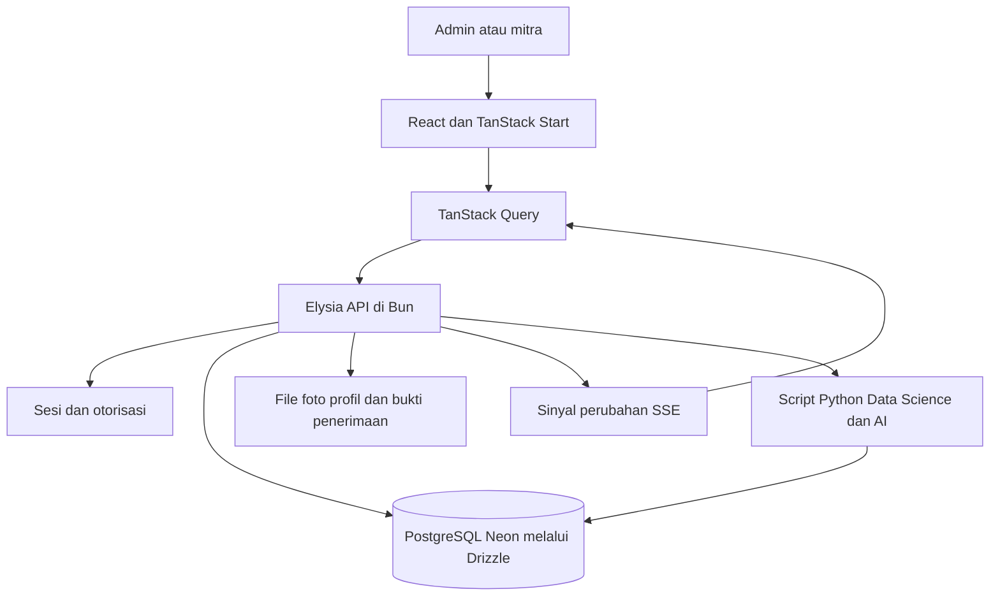

# Stack Teknologi Daisuki Inventory

Dokumen ini menjelaskan teknologi yang digunakan dalam proyek, fungsi masing-masing, dan alur kerjanya. Penjelasan mengacu pada source code dan konfigurasi repositori yang diperiksa pada 8 November 2026. Angka versi di bawah mengikuti deklarasi `package.json`, bukan klaim versi terbaru di internet; versi hasil instalasi mengikuti `bun.lock`.

## 1. Gambaran proyek

Daisuki Inventory adalah aplikasi manajemen stok dan pemesanan B2B untuk admin pusat dan mitra cabang. Admin mengelola stok pusat serta persetujuan pengiriman, sedangkan mitra melaporkan stok fisik, mengajukan restock, dan mengonfirmasi penerimaan barang.

Proyek memakai **Bun monorepo**: frontend, backend, dan kode bersama berada dalam satu repositori. Analisis data dan pekerjaan AI berada dalam workspace Python terpisah.

| Bagian | Lokasi | Tanggung jawab |
| --- | --- | --- |
| Frontend | `apps/web/` | Halaman admin dan mitra, formulir, cache data, serta tampilan notifikasi |
| Backend API | `apps/api/` | Autentikasi, otorisasi, validasi, transaksi stok, dan event perubahan |
| Kode bersama | `packages/shared/` | Tipe, status pesanan, aturan perpindahan status, dan perhitungan status stok |
| Data Science | `data-science/` | Pengolahan data, analisis konsumsi, dan pemodelan kebutuhan stok |
| AI | `ai/` | Rekomendasi, alert, agregasi fakta operasional, serta pelatihan model |
| Skema database | `neon/init.sql` | Acuan skema SQL dan data inisialisasi PostgreSQL |

## 2. Frontend

| Teknologi | Versi deklarasi | Penggunaan dalam proyek |
| --- | --- | --- |
| TypeScript | `^6.0.2` | Memberikan pemeriksaan tipe pada komponen, model data, dan pemanggilan API |
| React dan React DOM | `^19.2.0` | Menyusun antarmuka menjadi komponen dan memperbarui tampilan saat state berubah |
| TanStack Start | `1.169.3` | Kerangka aplikasi React dengan dukungan rendering server dan integrasi router |
| TanStack Router | `1.170.45` | Mengatur navigasi berdasarkan file rute, seperti `/admin`, `/mitra`, dan `/login` |
| TanStack Query | `5.104.3` | Mengambil data API, menyimpan cache, dan memperbarui data setelah mutasi atau event SSE |
| Vite | `^8.0.0` | Menjalankan server pengembangan, pembaruan modul saat coding, dan build produksi |
| Tailwind CSS | `^4.1.18` | Menyusun layout responsif, jarak, warna, dan tampilan komponen melalui kelas utilitas |
| Radix UI | `^1.8.1` | Menyediakan komponen interaksi seperti dialog |
| Lucide React | `^0.577.0` | Menyediakan ikon navigasi dan tindakan |
| Sonner | `^2.0.8` | Menampilkan toast untuk keberhasilan atau kegagalan tindakan |

Halaman utama berada di [direktori routes](apps/web/src/routes/). Komponen yang dipakai ulang berada di [components](apps/web/src/components/), sedangkan pemanggilan API dikumpulkan di [lib/api](apps/web/src/lib/api/).

State lokal React dipakai untuk pilihan tab, input formulir, dan dialog. TanStack Query menangani data dari server seperti stok dan pesanan, sehingga data tersebut tidak perlu dikelola ulang sebagai state formulir.

Tipografi proyek memakai **Bricolage Grotesque** untuk judul dan angka besar, serta **Figtree** untuk teks dan formulir. Token desain ada di [styles.css](apps/web/src/styles.css). Angka stok dan harga memakai `tabular-nums` agar sejajar. Target sentuh portal mitra minimal 44 piksel.

Paket tambahan yang tercantum dalam frontend antara lain Zod dan `@t3-oss/env-core` untuk kebutuhan validasi/konfigurasi, serta TanStack Form dan TanStack Table. Keberadaan paket dalam manifest tidak berarti seluruh formulir atau tabel memakai paket tersebut.

## 3. Backend dan runtime

| Teknologi | Versi deklarasi | Penggunaan dalam proyek |
| --- | --- | --- |
| Bun | Versi runtime tidak ditetapkan dalam manifest root | Menjalankan server TypeScript, mengelola dependensi, workspace, dan script pengembangan |
| ElysiaJS | `^1.4.30` | Mendefinisikan endpoint HTTP, schema request, middleware, dan respons API |
| TypeScript API | `^7.0.2` | Pemeriksaan tipe backend sesuai deklarasi workspace API |
| Elysia Eden | `^1.4.9` pada frontend | Menyediakan client `treaty<App>` berdasarkan tipe aplikasi Elysia |
| `@elysiajs/cors` | `^1.4.2` | Mengatur origin, header, metode, dan pengiriman kredensial lintas origin |
| `@elysiajs/cron` | `^1.4.2` | Menjadwalkan pekerjaan backend, termasuk pipeline analisis mingguan |

Titik masuk API adalah [apps/api/src/index.ts](apps/api/src/index.ts). Modul seperti `orders`, `stocks`, `auth`, `admin`, dan `assistant` berada di `apps/api/src/modules/`.

Frontend memiliki wrapper `apiClient`/`apiFetch` dan client Eden di [client.ts](apps/web/src/lib/api/client.ts). Wrapper menangani prefix `/api`, cookie sesi, token CSRF, dan respons error. Semua akses data operasional frontend melewati API; frontend tidak mengakses database secara langsung.

**Bun wajib digunakan untuk operasi JavaScript/TypeScript proyek ini.** Gunakan `bun install` dan `bun run`, mengikuti aturan repositori.

## 4. Database dan transaksi

Database yang digunakan adalah **PostgreSQL di Neon**. **Drizzle ORM** (`^0.45.4`) membantu membangun query dan memetakan tabel ke tipe TypeScript. Driver **Postgres.js** (`postgres`, `^3.4.9`) menghubungkan API dengan database.

Sumber konfigurasi dan skema:

- [neon/init.sql](neon/init.sql): acuan skema SQL dan data awal.
- [schema.ts](apps/api/src/db/schema.ts): representasi tabel untuk Drizzle.
- [client.ts](apps/api/src/db/client.ts): koneksi melalui `DATABASE_URL`, dengan `prepare: false` untuk koneksi pooler Neon.

Drizzle Kit tercantum sebagai alat pengembangan. Namun, aturan proyek melarang menjalankan `drizzle-kit push` atau `drizzle-kit generate`; perubahan skema harus mengikuti acuan SQL proyek.

Transaksi dan kunci baris `FOR UPDATE` digunakan pada alur stok/pesanan untuk menjaga konsistensi ketika beberapa request berjalan bersamaan. Contohnya, stok pusat direservasi saat pesanan dibuat. Persetujuan parsial mengembalikan selisih reservasi, sedangkan stok cabang bertambah saat penerimaan dikonfirmasi berdasarkan `qty_approved`.

## 5. Autentikasi dan pemisahan mitra

Implementasi autentikasi saat ini menggunakan **sesi database dan cookie HttpOnly**. Token sesi dibuat secara acak; hash token disimpan dalam tabel `auth_sessions`. Server memeriksa sesi, waktu kedaluwarsa, role, dan keterkaitan pengguna dengan cabang sebelum memberikan akses.

Cookie memakai `SameSite=Strict`, serta `Secure` pada lingkungan produksi. Request mutasi juga membawa token CSRF. Verifikasi password memakai `Bun.password.verify`.

Role `admin` memiliki akses pengelolaan pusat, sementara role `mitra` dibatasi ke cabangnya. Identitas cabang untuk tindakan mitra diambil dari pengguna terautentikasi pada server. Nilai `partner_id` dari client tidak menjadi dasar otorisasi.

Referensi implementasi: [plugins/auth.ts](apps/api/src/plugins/auth.ts), [modules/auth](apps/api/src/modules/auth/index.ts), dan [auth frontend](apps/web/src/lib/auth.tsx).

**Catatan dokumentasi:** paket `jose` masih tercantum di manifest API, dan sebagian dokumentasi lama menyebut JWT. Alur login yang diperiksa untuk dokumen ini memakai sesi cookie, sehingga keberadaan `jose` tidak dijadikan bukti bahwa login saat ini menggunakan JWT.

## 6. Cache dan pembaruan melalui SSE

**Server-Sent Events (SSE)** mengirim pemberitahuan satu arah dari API ke browser melalui endpoint `/events`. Browser memakai `EventSource`, sedangkan API mengirim topik perubahan seperti `orders`, `stocks`, `products`, `logs`, `metrics`, dan `notifications`.

Event berfungsi sebagai sinyal pembaruan. Setelah menerima topik, frontend menginvalidasi query yang terkait. `refetchType: 'active'` membuat query aktif diambil ulang; query lain ditandai stale untuk diperbarui ketika dibutuhkan.

Default TanStack Query di [root-provider.tsx](apps/web/src/integrations/tanstack-query/root-provider.tsx) adalah:

```ts
staleTime: Infinity,
gcTime: 1000 * 60 * 60,
refetchOnWindowFocus: false,
refetchOnReconnect: false,
refetchOnMount: false,
```

`staleTime: Infinity` berarti data tidak otomatis dianggap usang karena waktu. Invalidasi tetap dapat membuatnya stale. `gcTime` satu jam berlaku untuk pembuangan query yang tidak aktif, bukan jaminan seluruh cache dihapus tepat satu jam setelah login.

Opsi pada query tertentu dapat mengganti default global. Pada saat dokumen dibuat, query pesanan di rute mitra masih memiliki `refetchInterval: 15_000`; karena itu implementasi saat ini belum sepenuhnya bebas polling.

Referensi: [realtime API](apps/api/src/realtime.ts), [listener frontend](apps/web/src/lib/inventory-events.ts), dan [rencana optimasi](planing.md).

## 7. QR, barcode, dan foto

| Paket atau mekanisme | Fungsi |
| --- | --- |
| `qrcode` | Menghasilkan QR code untuk kebutuhan pengiriman |
| `jsbarcode` | Menghasilkan barcode pada dokumen/resi |
| `html5-qrcode` | Membaca QR/barcode dengan kamera perangkat |
| Penyimpanan file API | Menyimpan foto profil dan bukti penerimaan melalui utilitas backend |

Hasil pemindaian dikirim ke API untuk diverifikasi. Pemindaian di browser tidak langsung menambah stok. Backend tetap memeriksa kepemilikan pesanan dan status sebelum menyelesaikan penerimaan.

Foto diproses melalui [storage.ts](apps/api/src/lib/storage.ts). Penyimpanan file ini perlu diperhitungkan saat menyiapkan server API agar unggahan tetap tersedia setelah restart atau redeploy.

## 8. Data Science dan AI

Workspace Python melengkapi aplikasi operasional dengan analisis konsumsi, prediksi kebutuhan restock, dan pengingat.

| Teknologi | Peran |
| --- | --- |
| Python | Menjalankan analisis, pekerjaan terjadwal, dan pelatihan model |
| Pandas dan NumPy | Mengolah tabel, membersihkan data, dan melakukan perhitungan numerik |
| scikit-learn | Mendukung pemodelan dan pelatihan machine learning |
| statsmodels | Tersedia dalam workspace Data Science untuk analisis statistik |
| Matplotlib dan JupyterLab | Visualisasi data dan eksplorasi melalui notebook |
| Psycopg | Menghubungkan script Python dengan PostgreSQL |
| python-dotenv | Membaca konfigurasi lingkungan untuk script Python |
| HTTPX dan python-telegram-bot | Tersedia pada workspace AI untuk integrasi HTTP dan notifikasi Telegram |

Contoh implementasi meliputi `data-science/src/weekly_demand.py`, `ai/jobs/weekly_restock_predictor.py`, dan `ai/jobs/regional_stockout_naive_bayes.py`. Job pengingat stok lama berada di `ai/jobs/stale_stock_reminder.py`.

API dapat menjalankan rangkaian script melalui [weekly-pipeline.ts](apps/api/src/lib/weekly-pipeline.ts). Asisten mitra berada di [modules/assistant](apps/api/src/modules/assistant/), dengan pengolahan intent, konteks stok cabang, dan hasil model. Istilah AI dalam proyek ini tidak otomatis berarti setiap respons memakai layanan LLM eksternal.

Dependensi Python dicatat dalam [requirements Data Science](data-science/requirements.txt), [requirements AI](ai/requirements.txt), dan [requirements retraining](ai/retraining/requirements.txt).

## 9. Alur antarkomponen



Contoh alur restock: mitra mengisi formulir, frontend mengirim request, lalu API memvalidasi sesi dan stok pusat. Setelah transaksi tersimpan, API menerbitkan event SSE. Browser admin atau mitra yang berhak menerima sinyal tersebut memperbarui query terkait.

## 10. Build, deployment, dan alat pemeriksaan

Frontend memiliki konfigurasi **Cloudflare Workers** melalui `@cloudflare/vite-plugin` dan [wrangler.jsonc](apps/web/wrangler.jsonc). Wrangler digunakan oleh script deploy frontend. Konfigurasi ini menunjukkan target build/deploy yang tersedia, bukan bukti bahwa aplikasi sudah dipublikasikan.

Backend Elysia berjalan sebagai proses Bun tersendiri. Pada pengembangan lokal, [vite.config.ts](apps/web/vite.config.ts) meneruskan request `/api` ke `http://localhost:3001`. Deployment produksi perlu menyediakan routing API yang sesuai; proxy Vite pengembangan tidak otomatis menjadi konfigurasi routing produksi.

TypeScript memeriksa tipe, ESLint memeriksa aturan kode, dan Prettier memeriksa/merapikan format. Script `test` pada manifest API masih berupa placeholder; keberadaan file tes tidak berarti `bun run test` pada workspace API sudah menjadi runner tes yang berfungsi.

## 11. Perintah yang sering digunakan

Jalankan dari direktori root proyek:

```powershell
bun install
bun run dev
bun run dev:web
bun run dev:api
bun run typecheck
bun --cwd=apps/web run lint
bun --cwd=apps/web run build
bun --cwd=apps/web run generate-routes
```

Frontend berjalan pada port `3000`, sedangkan port default API adalah `3001`. Lengkapi konfigurasi lingkungan berdasarkan file contoh yang tersedia; jangan memasukkan kredensial ke dokumentasi atau source code.

Untuk menyiapkan workspace Python, contoh berikut dijalankan dari root pada PowerShell:

```powershell
cd data-science
python -m venv .venv
.venv\Scripts\Activate.ps1
pip install -r requirements.txt
```

Gunakan pola yang sama di direktori `ai/` untuk dependensi AI. Instalasi dependensi saja tidak menjalankan job atau mengaktifkan jadwalnya.

## 12. Ringkasan pilihan stack

React menangani interaksi pengguna, TanStack Start dan Router mengatur aplikasi serta navigasi, dan TanStack Query mengelola data server di browser. Bun menjalankan Elysia, sementara Drizzle dan PostgreSQL menangani penyimpanan serta transaksi. SSE menyampaikan perubahan agar tampilan dapat diperbarui. Python dipakai untuk pekerjaan analisis dan pemodelan yang mendukung keputusan restock.

Pembagian ini menempatkan aturan stok dan akses data pada backend, komponen tampilan pada frontend, dan analisis data pada workspace Python. Perubahan status dan perhitungan yang dipakai bersama dapat diletakkan di `packages/shared/` agar tidak memiliki definisi berbeda antara frontend dan backend.
